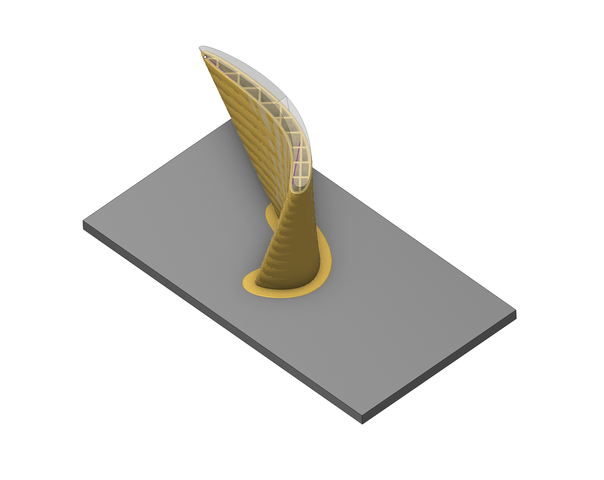

# Fatiamento planar

## Área de aplicação:

A nova operação permite a impressão 3D. O percurso da ferramenta é construído com base nos cálculos do Ultimaker Cura.

### Setup:

A aba <strong>Setup</strong> é usada para configurar os parâmetros primários do projeto. Isso pode envolver o posicionamento da peça no equipamento, o sistema de coordenadas da peça, entre outros. [Detalhes](1022.md)

### Definição da tarefa:

<strong>Faces.</strong> Selecione várias superfícies da peça como definição da tarefa. O sistema calcula o percurso da ferramenta com base nas superfícies escolhidas.

<strong>Properties.</strong> Exibe as propriedades de um elemento. É possível adicionar sobremetal. Esse menu também pode ser aberto com um clique duplo em um item da lista.

<strong>Delete.</strong> Remove um item da lista

### Estratégia:

#### Parametrização automática da ferramenta.

Alteração automática dos parâmetros da ferramenta (diâmetro, comprimento de trabalho) com base nos parâmetros do Cura

#### Geral.

Lista de parâmetros para predefinição

Clique aqui para expandir...

<strong>Manufacturer.</strong> Marcas de impressoras

<strong>Printers.</strong> Lista de impressoras da marca selecionada

<strong>Extruders.</strong> Lista de extrusoras da impressora selecionada

<strong>Material brand.</strong> Marcas de materiais

<strong>Materials.</strong> Lista de materiais da marca de material selecionada

<strong>Variants.</strong> No caso da extrusora, a variante contém configurações relacionadas ao tamanho do bico ou configurações específicas ligadas a ele

<strong>Profiles.</strong> Os perfis de intenção (intent) contêm configurações que modificam a qualidade, atribuindo-lhes uma intenção. Esses perfis dependem do material, da variante e da qualidade/resolução.

<strong>Resolutions.</strong> Os perfis de qualidade definem a resolução da impressão por meio da altura da camada.

<strong>Show custom parameters.</strong> Personalização das configurações de impressão. O modo personalizado oferece mais configurações para usuários experientes. Pode ser <strong>basic. advanced, expert, all.</strong>

#### Outros parâmetros necessários para usar a funcionalidade do Cura estão descritos na ajuda. Veja mais

### Transformações:

Conjunto de parâmetros da operação que permite transformar as coordenadas do percurso da ferramenta calculado na operação. [Detalhes](10168.md)

### Peça:

A peça é um grupo de elementos geométricos que define a região a ser verificada quanto a cortes indevidos. [Detalhes](330.md)

### Bruto:

O modelo do bruto de uma operação define o material a ser usinado. [Detalhes](738.md)

### Dispositivos de fixação:

Os dispositivos de fixação normalmente incluem mandris, garras, grampos e outros elementos de fixação, além de áreas de restrição de qualquer natureza. [Detalhes](10283.md)

### Download:

Selecione a versão mais recente e baixe o arquivo <strong>planar-slicing-extension.dext</strong> na seção Assets.

[https://github.com/EncySoftware/planar-slicing-extension/releases](https://github.com/EncySoftware/planar-slicing-extension/releases)

### Instruções de instalação:

[https://github.com/EncySoftware/planar-slicing-extension](https://github.com/EncySoftware/planar-slicing-extension)
