# Fatiamento não planar

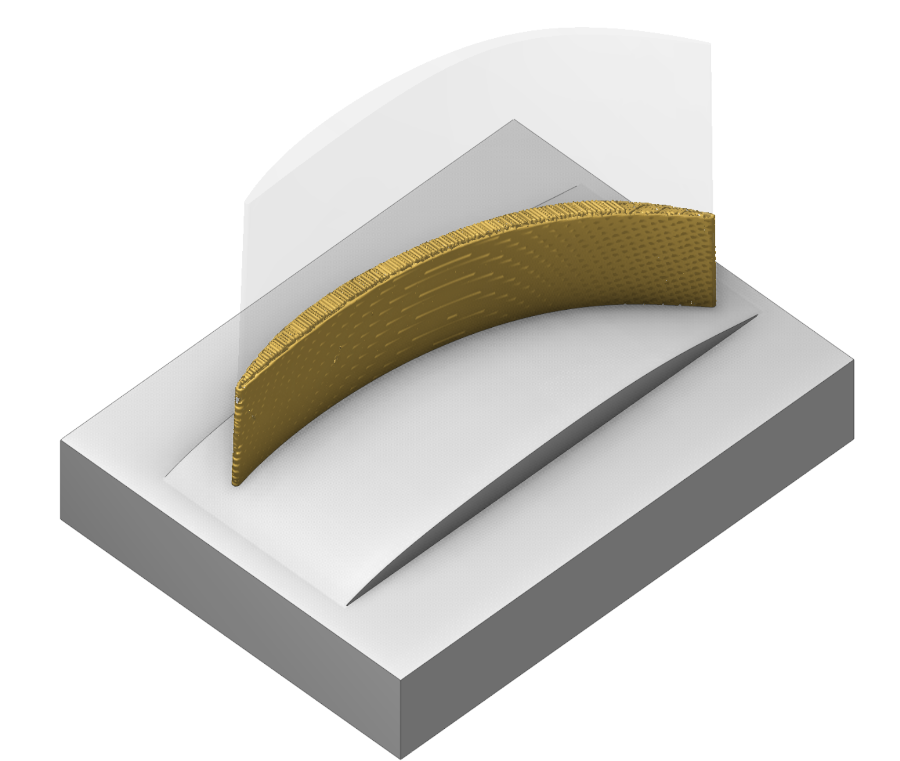

## Área de aplicação:

Esta operação permite imprimir modelos sobre substratos arbitrários. Usa um mecanismo de fatiamento não planar e gera percursos aditivos não planos. Também permite gerar percursos planares convencionais com parâmetros adicionais.

### Setup:

A aba **Setup** configura os parâmetros principais do projeto, como posicionamento da peça na máquina e sistema de coordenadas. [Detalhes](1022.md)

### Definição da tarefa:

**Non-planar substrate.** Substrato de impressão, usado somente na estratégia **Offset**.

**Feature.** Modelo que será impresso.

**Properties.** Desativado.

**Delete.** Remove um elemento da lista.

### Estratégia:

#### Estratégia de fatiamento.

Define a estratégia utilizada para dividir o modelo em camadas.

Clique aqui para expandir.

##### Tipos de estratégia

**Planar.** Realiza o fatiamento planar convencional, com diferentes direções de fatiamento e possibilidade de alterar as normais do percurso.

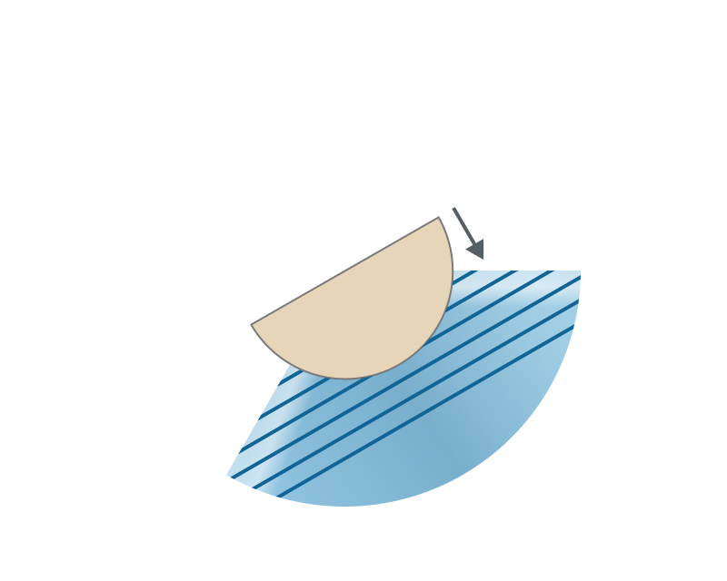

**Offset.** Fatia o modelo por deslocamento a partir do substrato, mantendo uma altura constante entre camadas.

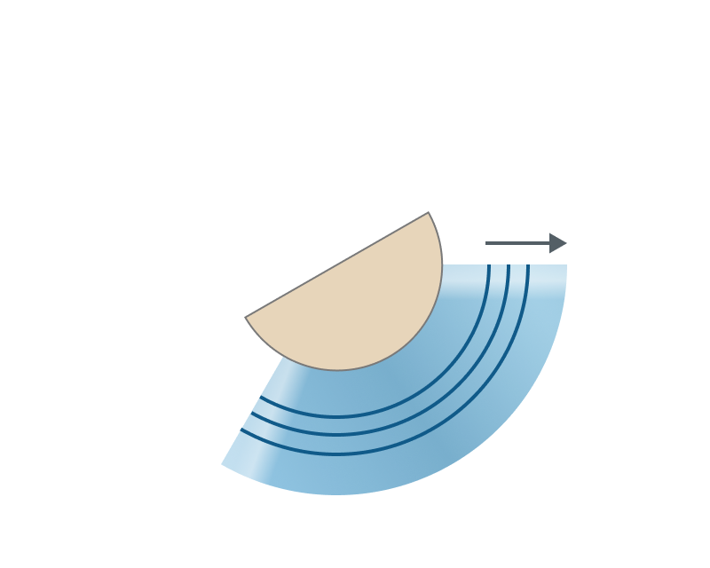

**Radial.** Fatia o modelo por superfícies cilíndricas ao redor de um eixo de rotação, permitindo imprimir ao redor desse eixo com passo radial constante.

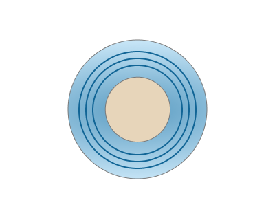

##### Parâmetros comuns

**Layer height.** Altura de cada camada, em milímetros. Por padrão, corresponde ao comprimento de trabalho (WL) da ferramenta.

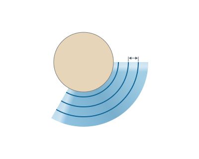

**Line width.** Largura de uma linha de deposição. Por padrão, corresponde ao diâmetro da ferramenta.

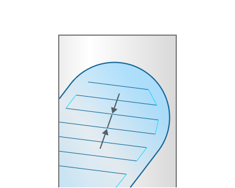

**Gap to prevent overlapping.** Deixa uma folga na união entre o início e o fim de contornos fechados para evitar sobreposição de material.

**GTPO** — folga para evitar sobreposição.

##### Parâmetros do fatiamento planar

**Slicing direction.** Define a direção de fatiamento: eixo global X, Y ou Z, ou um vetor personalizado.

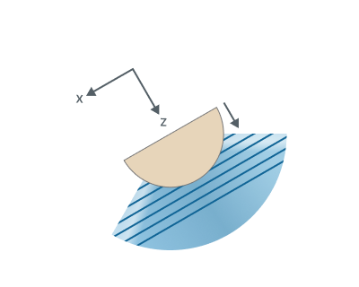

**Top level.** Limite superior do fatiamento, medido na direção selecionada. A última camada é posicionada nesse nível. Em **Auto**, usa o limite superior do modelo.

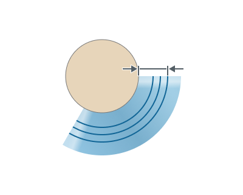

**Bottom level.** Limite inferior do fatiamento, medido na direção selecionada. A primeira camada é posicionada nesse nível. Em **Auto**, usa o limite inferior do modelo.

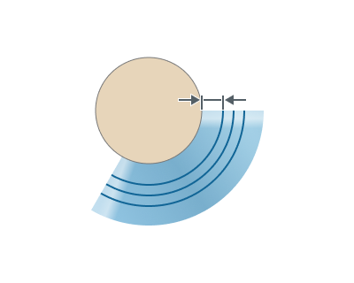

##### Parâmetros do fatiamento por deslocamento

**Surface resolution level.** Define a resolução das superfícies deslocadas que dividem o modelo. Valores menores produzem resultados mais rápidos e menos detalhados; valores maiores aumentam a resolução e o tempo de cálculo.

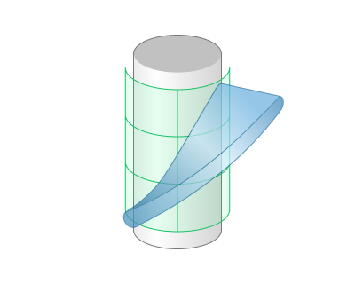 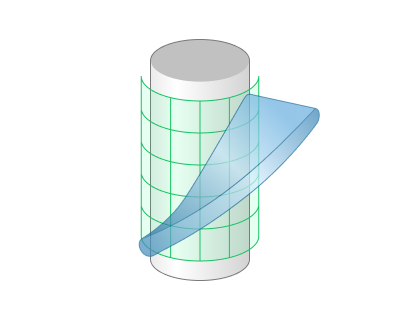 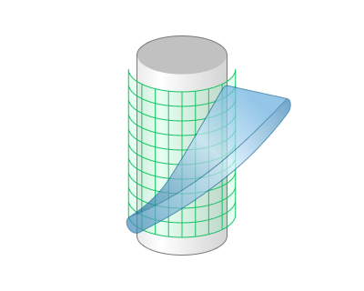 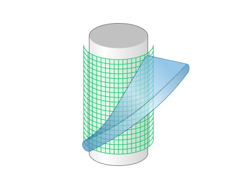 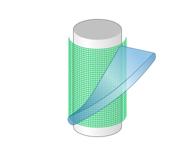

**Top offset.** Deslocamento em relação ao substrato que define o limite final da impressão. A impressão pode terminar antes dele, dependendo da altura da camada. Em **Auto**, usa a distância máxima entre o modelo e o substrato.

**Bottom offset.** Deslocamento em relação ao substrato no qual a impressão começa. Em **Auto**, usa a distância mínima entre o modelo e o substrato.

##### Parâmetros do fatiamento radial

**Rotary axis.** Direção do eixo em torno do qual o modelo é envolvido e fatiado. Selecione X, Y ou Z, ou use **Custom** para informar um vetor arbitrário.

**Top radius.** Limite cilíndrico externo da zona de fatiamento, medido radialmente a partir do eixo. Camadas além desse raio são ignoradas. Em **Auto**, usa a distância máxima entre o modelo e o eixo.

**Bottom radius.** Limite cilíndrico interno da zona de fatiamento. O fatiamento começa nesse raio. Em **Auto**, usa a distância mínima entre o modelo e o eixo.

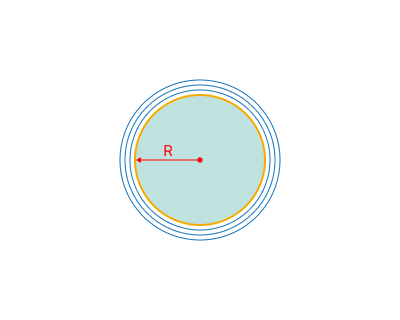

#### Impressão do volume interno.

Desloca o percurso para dentro do modelo por metade da largura de linha.

Clique aqui para expandir.

.png) .png)

#### Preenchimento.

Grupo de parâmetros que controla o preenchimento do modelo.

Clique aqui para expandir.

**Infill pattern.** Define o padrão de preenchimento.

**Lines.** Intersecta camadas não planas com planos verticais simples para gerar linhas.

**Grid.** Intersecta camadas não planas com planos verticais de modo a formar uma grade.

.png)

**Triangles.** Intersecta camadas não planas com planos verticais de modo a formar triângulos equiláteros.

.png)

**Zig Zag.** Divide cada camada em regiões e preenche cada região com um percurso contínuo em zigue-zague. É gerado um percurso separado para cada região.

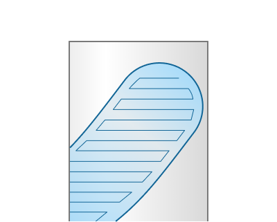

**Infill orientation.** Define a orientação do preenchimento no espaço 3D.

**Direction.** Direção dos planos de corte que intersectam cada camada para produzir as linhas de preenchimento.

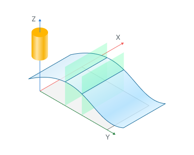

**Tool orientation vector.** Alinha os planos de corte ao vetor de orientação da ferramenta. É o padrão da estratégia Offset. A orientação da ferramenta pode ser definida na página Setup. [Detalhes](260.md)

**Slicing direction vector.** Alinha os planos de corte à direção do fatiamento. É o padrão da estratégia planar.

**Across rotary axis.** Alinha os planos transversalmente ao eixo de rotação, de modo que as linhas de preenchimento envolvam o cilindro. É o padrão da estratégia radial.

**Custom.** Permite definir manualmente o vetor normal e o ângulo de rotação do preenchimento.

**Infill density.** Ajusta a densidade de preenchimento em porcentagem.

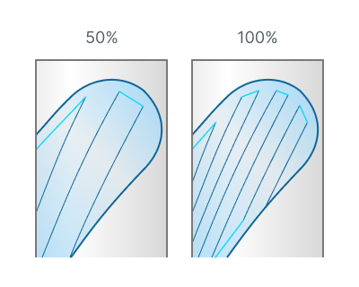

**Alternate lines direction.** Alterna a direção das linhas entre camadas.

**By angle.** Define o ângulo de rotação aplicado a cada camada seguinte.

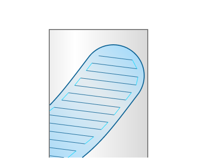 .png)

> **Nota importante**
>
> Em geral, 0° significa que as linhas ficam paralelas ao eixo X. Se **Normal vector**, em **Infill orientation**, estiver definido como **Custom** e **Rotation angle** for diferente de zero, as linhas receberão também essa rotação.
>
> Exemplo: 45° define 0° para a camada 1, 45° para a camada 2, 90° para a camada 3, 135° para a camada 4 e assim por diante.

**By sequence of angles.** Define uma sequência personalizada de ângulos, repetida ciclicamente entre camadas. Informe uma lista de ângulos separados por qualquer símbolo e delimitada por parênteses.

> **Nota importante**
>
> Exemplo: (0,90,45) define 0° para a camada 1, 90° para a camada 2, 45° para a camada 3, novamente 0° para a camada 4 e assim por diante.

**Mirror infill.** *Disponível somente na estratégia Radial.* Quando ativado, calcula o preenchimento de meio cilindro e o espelha em relação ao eixo, produzindo padrões idênticos e simétricos nas duas metades. Quando desativado, gera o preenchimento continuamente ao redor do cilindro completo, permitindo padrões espirais ou helicoidais com alternância dos ângulos entre camadas.

#### Paredes duplas.

Adiciona uma parede interna.

Clique aqui para expandir.

.png) .png)

#### Ordenação.

Parâmetros de ordenação e ligação dos percursos.

Clique aqui para expandir.

##### Critério de ordenação.

Define a ordem de impressão das camadas e dos elementos.

**Layers.** Imprime todos os elementos camada a camada.

**Features.** Imprime os elementos um de cada vez. Para usar essa opção, configure-os como elementos separados na página **Job Assignment**.

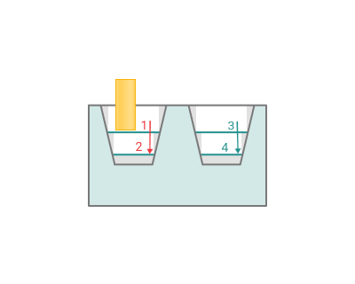

##### Divisão por camadas.

**Split by layers** permite dividir os elementos pelo número de camadas desejado. Está disponível somente quando **Sort by** está definido como **Features**.

*Nota:* este parâmetro é útil quando a impressão de um elemento inteiro de cada vez causaria colisões com elementos já impressos. Também ajuda a distribuir o calor de maneira mais uniforme e a reduzir tensões residuais.

##### Pontos iniciais.

Define regras personalizadas para escolher os pontos iniciais das camadas.

Clique aqui para expandir.

**Auto.** Escolhe o ponto inicial automaticamente.

_(Auto).png)

**Custom for first layers.** Permite escolher manualmente o ponto inicial da primeira camada de cada elemento. Nas camadas seguintes, o ponto é escolhido pela menor distância ao ponto inicial da camada anterior. Configure os pontos na página **Job assignment**.

_(Custom_for_first_layers).png)

**Custom for all layers.** Define os pontos iniciais de todas as camadas por uma curva. Os pontos são calculados pela menor distância até essa curva. Configure-a na página **Job assignment**.

_(Custom_for_all_layers).png)

##### Ordem de impressão.

Define a sequência das paredes e do preenchimento.

Clique aqui para expandir.

**Inside to outside.** Imprime primeiro o preenchimento, depois as paredes internas e a parede externa.

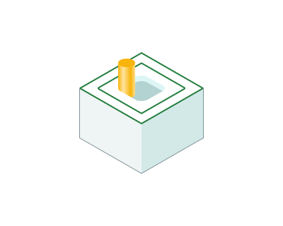

**Outside to inside.** Imprime primeiro a parede externa, depois as paredes internas e o preenchimento.

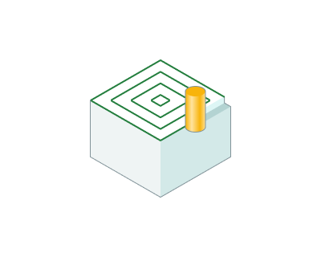

**Alternate directions.** Alterna a ordem entre camadas, começando por **Inside to outside**.

#### Orientação da ferramenta.

Permite alterar a orientação, ou normal, da ferramenta sem modificar o percurso original. Há cinco opções: **Normal to surface**, **Fixed**, **To rotary axis**, **Through point** e **Through curve**.

Clique aqui para expandir.

<strong>Normal to surface</strong>.

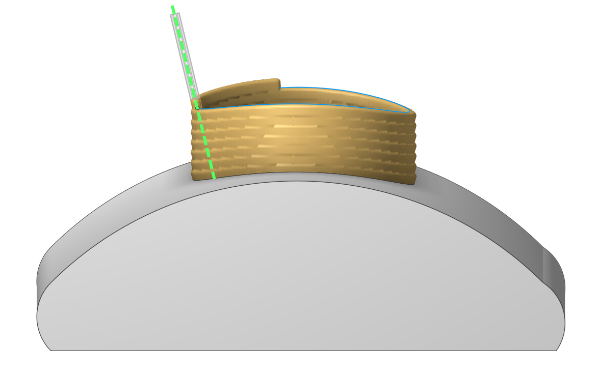

<strong>Fixed</strong>

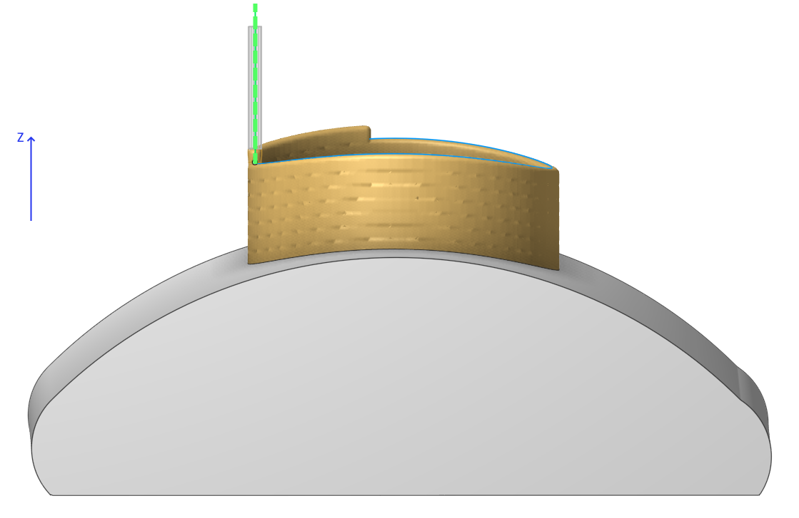

<strong>To rotary axis</strong>.

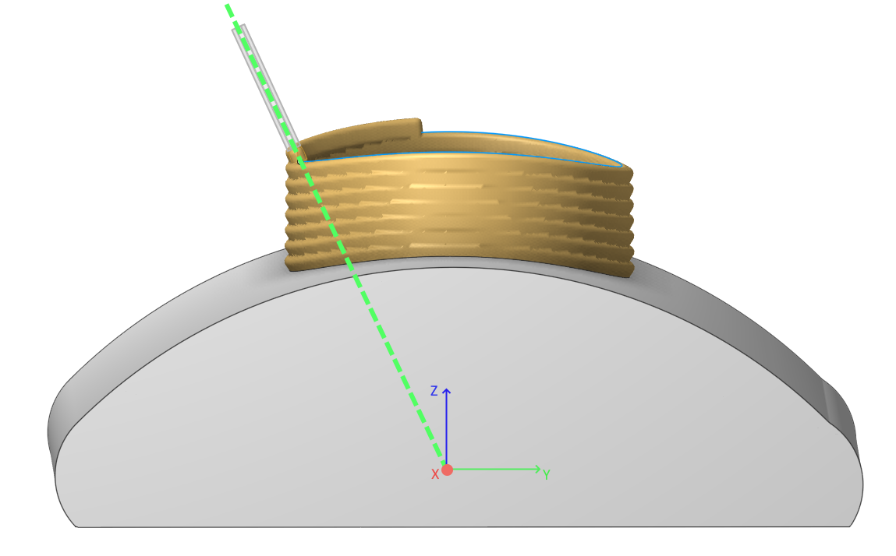

<strong>Through point</strong>.

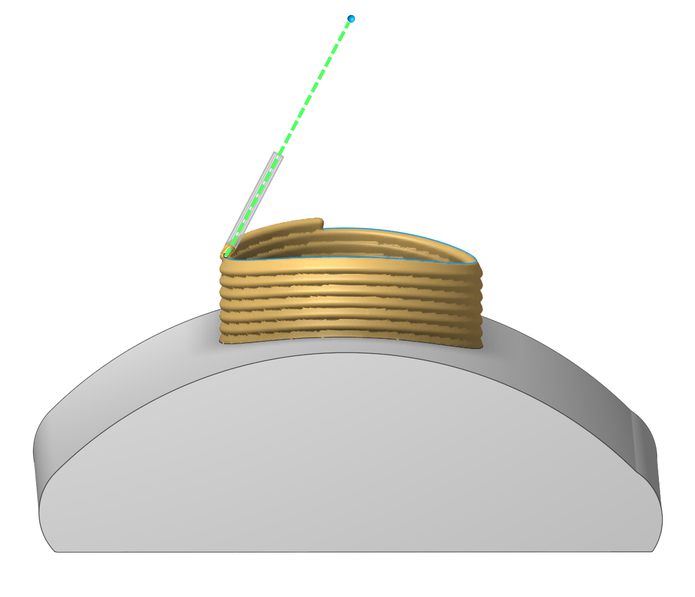

<strong>Through curve</strong>.

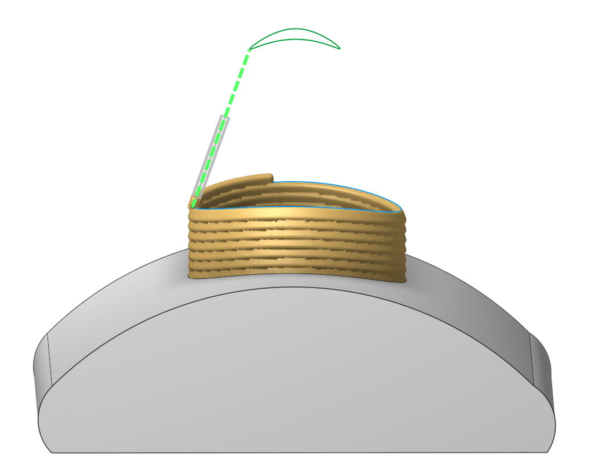

Mais informações sobre o parâmetro **Tool orientation** podem ser encontradas na descrição da operação **5D Surfacing**. [Detalhes.](10135.md)

#### Limites dos ângulos de rotação.

Quando o sinalizador está ativado, define os valores-limite da posição angular da ferramenta em relação ao eixo especificado. Este grupo de parâmetros funciona de forma semelhante ao da operação **5D Surfacing**. [Detalhes.](10135.md)

### Parâmetros:

Esta aba contém os parâmetros principais de controle da peça, do bruto, dos dispositivos de fixação e de outros elementos que permitem modificar o percurso. [Detalhes](100112.md)

### Ligações e entradas/saídas:

Na aba **Links/Leads**, são definidos os parâmetros dos movimentos rápidos. Esses movimentos incluem a aproximação da ferramenta a partir da posição de troca, a entrada no início do movimento de trabalho, a saída após o último movimento de corte, as transições entre passadas de trabalho e o retorno ao ponto de troca da ferramenta. É possível configurar a sequência dos movimentos ao longo das coordenadas, a trajetória desses movimentos e o valor dos deslocamentos.

Clique aqui para expandir.

**Componentes:**

**Approach/Return.** Controla os movimentos entre a posição de troca da ferramenta e o início do percurso de entrada, nos dois sentidos. [Detalhes](100116.md)

**Links.** Define as regras das ligações de entrada e saída e entre movimentos de trabalho. [Detalhes](100130.md)

**Leads.** Adiciona entradas e saídas aos movimentos de trabalho, com os avanços correspondentes. [Detalhes](100136.md)

**Safe motions.** Define o tipo de superfície de segurança e sua distância ao bruto. Essa superfície permite transições entre superfícies ou percursos; a primeira etapa da aproximação ou do retorno é feita em direção a ela. [Detalhes](100117.md)

**Advanced links settings.** Define características de geração do percurso, principalmente em cinco eixos, considerando movimentos ideais dos eixos rotativos. [Detalhes](100118.md)

**Distances.** Define as distâncias usadas nas regras de ligação. [Detalhes](100140.md)

### Avanços e velocidades:

Permite definir o avanço rápido, os avanços dos diferentes trechos do percurso e os parâmetros de controle de cantos (**Corner control**). [Detalhes](100142.md)

### Transformações:

Conjunto de parâmetros para transformar as coordenadas do percurso calculado na operação. [Detalhes](10168.md)

> **Nota importante**
>
> Nesta operação, **Multiply scheme** funciona de maneira diferente das demais.
>
> Normalmente, esse parâmetro duplica o percurso completo, incluindo o resultado do fatiamento e as ligações entre camadas.
>
> Nesta operação, ele duplica somente o resultado do fatiamento, antes da etapa de geração das ligações.
>
> Isso permite multiplicar elementos e aplicar configurações como **Links/Leads** e **Split by Layers**, o que não seria possível com o método convencional.

### Peça:

Na manufatura aditiva, a peça representa a geometria desejada a ser produzida pela impressão. [Detalhes](330.md)

### Bruto:

Na manufatura aditiva, o bruto é o material ou substrato preexistente que serve de base para a impressão. Pode estar vazio. [Detalhes](738.md)

### Dispositivos de fixação:

Incluem mandris, garras, grampos e outros elementos de fixação, além de áreas de restrição de qualquer natureza. [Detalhes](10283.md)
