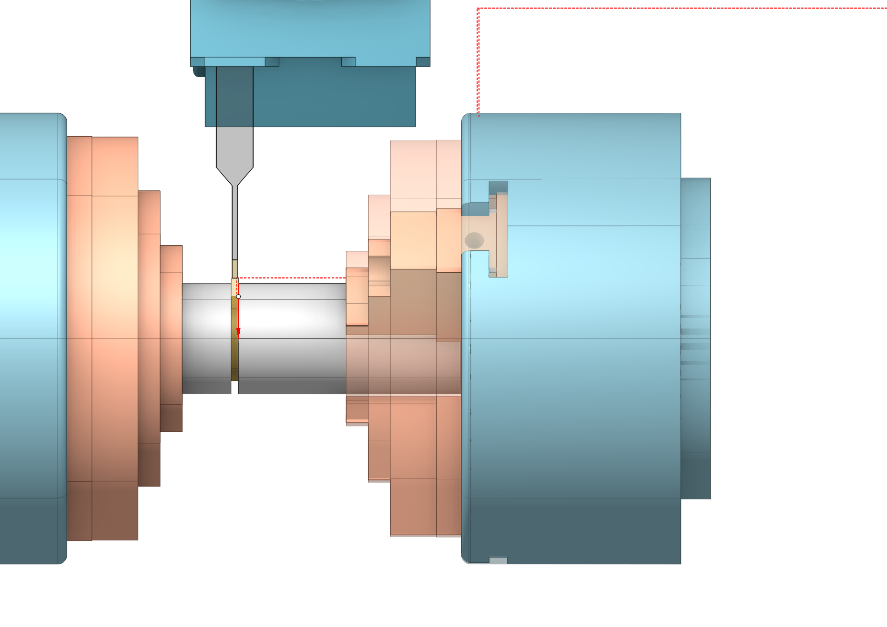

# 掴み換え付き切り落とし

## 適用分野：

このオペレーションは、加工済みパーツを残材から切り離すと同時に、パーツの後端面を形成することです。これには、面取りやR付けも含まれます。切り落とし加工を行う前に、。例えば、溝加工を行うことで、ワークを事前に準備することができます。 <strong>切り落としオペレーション</strong>とは異なり、本オペレーションでは加工終了時にワークが別の主軸に移動されます。

## セットアップ：

<strong>セットアップ</strong>タブでは、プロジェクトの主要なパラメータを設定します。これには、装置上のパーツの位置、パーツの座標系などが含まれます。[詳細を見る](1022.md)

## ジョブ割り当て:

<strong>切り落とし</strong> 加工済みパーツをワークの残り材料から切り離すと同時に、パーツの後面も加工します。システムは、パーツの右側または左側で、ワークの外径と内径を結ぶ垂直線として、加工サイクルの輪郭を生成します。

<strong>輪郭</strong> システムはシングルパス（1回の経路）を生成し、そのツールパスは部品の輪郭と一致します。ツールパスには、切込み/退避、取り代（ストック）値によるシフト、工具が到達できない領域（グレーゾーン）の除外、および工具半径補正を適用できます。[詳細を見る](10189.md)

<strong>溝加工サイクル</strong> 切り落としオペレーションを、ISO G75または ISO G74 サイクルとして NCプログラムに出力します。

<strong>スロット</strong> このサイクルは、単純な長方形の溝を最小限の動作回数で効率的に加工します。[詳細を見る](10196.md)

<strong>溝</strong> このサイクルは荒加工と同様ですが、加工プロセスをISO G71/ G72と同様のサイクルとしてNCプログラムに出力します 。[詳細を見る](10195.md)

<strong>ジグザグ</strong> 工具は荒加工代をレイヤーごとに除去します。各レイヤーでは、切削深さまで下降し、その後、水平方向に移動します。このように、方向を交互に変えながら水平パスを行うことで、荒加工代全体をレイヤーごとに除去します。[詳細を見る](10201.md)

<strong>プロパティ</strong> 要素のプロパティを表示します。ストックを追加することも可能です。リスト内の項目をダブルクリックすることでも、このメニューを表示できます。

<strong>削除</strong> リストから項目を削除します。

<strong>制限</strong> 加工してはならない領域を制限することができます。[詳細を見る](101231.md)

## サイクルパラメータ：

一部のパラメーターグループは<strong>切り落とし</strong>オペレーションと同様に機能します。[詳細を見る](313.md)

## 送り速度設定

このダイアログを使用して、ユーザーは主軸回転速度、早送り値、ツールパスの各領域の送り値を設定できます。主軸回転速度は、毎分回転数または切削速度のいずれかで設定できます。設定値には下線が表示されます。もう一方の値は、 工具径を考慮し、設定値に基づいて再計算されます 。[詳細を見る](100142.md)

## 変換：

オペレーション内で計算された工具の軌跡に対して座標変換 を 行うための パラメータグループです。[詳細を見る](10168.md)

## パーツ：

パーツは、干渉をチェックする空間を定義する幾何要素のグループです。[詳細を見る](330.md)

## ワーク：

加工のワークモデルは、加工する素材を定義します。[詳細を見る](738.md)

## 治具：

治具 には通常、 チャック、グリップ、クランプなどの固定補助具と、その他の種類の制限領域を指定します 。[詳細を見る](10283.md)
