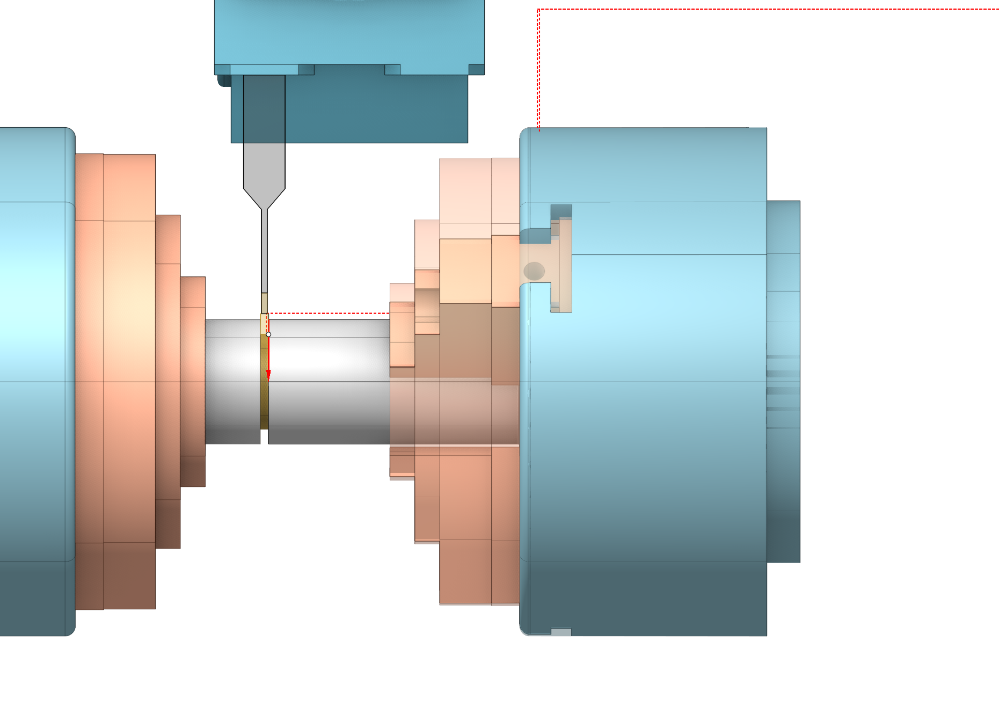
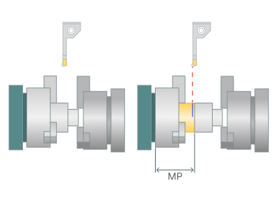
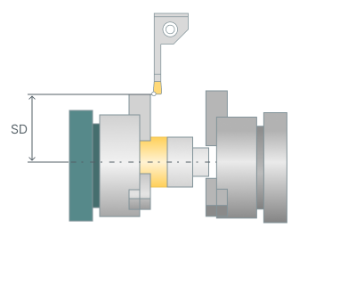
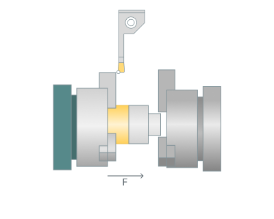

# Corte da peça com transferência

## Área de aplicação:

O objetivo desta operação é separar a peça usinada do material restante do bruto e, ao mesmo tempo, formar a extremidade traseira da peça, incluindo a criação de um chanfro ou raio. É possível preparar o bruto antes do corte, por exemplo, usinando um canal. Difere da <strong>operação de corte de torneamento</strong> porque, no final da operação, o bruto é transferido para outro fuso.

### Setup:

A aba <strong>Setup</strong> é usada para configurar os parâmetros principais do projeto, como o posicionamento da peça no equipamento, o sistema de coordenadas da peça e outros. [Detalhes](1022.md)

### Definição da tarefa:

<strong>Corte</strong><strong>.</strong> Separa a peça usinada do material restante do bruto e, ao mesmo tempo, usina a face traseira da peça<strong>.</strong> O sistema gera o contorno do ciclo de trabalho como uma linha vertical que liga os diâmetros externo e interno do bruto no lado direito ou esquerdo da peça.

<strong>Perfil.</strong> O sistema forma uma única passada, cujo percurso da ferramenta é idêntico ao contorno geométrico da peça. É possível adicionar entrada/saída, deslocamento pelos valores de sobremetal, exclusão das zonas cinzentas inacessíveis à ferramenta e compensação do raio da ferramenta no percurso. [Detalhes](10189.md)

<strong>Ciclo de canal.</strong> O sistema envia a operação de corte ao programa NC como um ciclo ISO G75 ou ISO G74.

<strong>Canal simples.</strong> Este ciclo usina com eficiência canais retangulares simples com um número mínimo de ações. [Detalhes](10196.md)

<strong>Canais</strong><strong>.</strong> Este ciclo é semelhante ao desbaste, mas envia a usinagem ao programa NC como um ciclo semelhante ao ISO G71/G72. [Detalhes](10195.md)

<strong>Ziguezague.</strong> <strong>A ferramenta remove o sobremetal de desbaste</strong> camada por camada. Em cada camada, ela penetra até a profundidade de corte e executa um movimento horizontal. Assim, passadas horizontais em sentidos alternados removem todo o sobremetal, camada por camada. [Detalhes](10201.md)

<strong>Propriedades.</strong> Exibe as propriedades do elemento selecionado. Também é possível adicionar sobremetal. O menu Properties pode ser aberto com um clique duplo no elemento selecionado.

<strong>Excluir.</strong> Remove um item da lista.

<strong>Restrições.</strong> Permite restringir as áreas que não devem ser usinadas. [Detalhes](101231.md)

### CycleParams:

Alguns grupos de parâmetros funcionam de forma semelhante aos da <strong>operação de corte de torneamento</strong>. [Detalhes](313.md)

### Estratégia:

Clique aqui para expandir...

<strong>Transferência.</strong> Opções de retirada e posicionamento da peça.

<strong>Mover peça.</strong> Permite puxar a peça até o seu ponto de corte.

<strong>MP</strong> - Mover peça

<strong>Diâmetro de segurança.</strong> Define a coordenada X da ferramenta antes do movimento do contrafuso.

<strong>SD</strong> - Diâmetro de segurança

<strong>Avanço.</strong> Avanço com que a peça é puxada.

<strong>F</strong> - Avanço

<strong>Alguns grupos de parâmetros funcionam de forma semelhante aos das operações Turn take over</strong>. [Detalhes](10406.md)

### Avanços e velocidades:

Esta janela permite definir a rotação do fuso, o avanço rápido e os avanços dos diferentes trechos do percurso. A rotação do fuso pode ser definida em rotações por minuto ou pela velocidade de corte. O valor de referência fica sublinhado; o outro valor é recalculado a partir dele, considerando o diâmetro da ferramenta. [Detalhes](100142.md)

### Transformações:

Conjunto de parâmetros da operação que permite transformar as coordenadas do percurso da ferramenta calculado na operação. [Detalhes](10168.md)

### Peça:

A peça é um grupo de elementos geométricos que define a região a ser verificada quanto a cortes indevidos. [Detalhes](330.md)

### Bruto:

O modelo do bruto de uma operação define o material a ser usinado. [Detalhes](738.md)

### Dispositivos de fixação:

Os dispositivos de fixação normalmente incluem mandris, garras, grampos e outros elementos de fixação, além de áreas de restrição de qualquer natureza. [Detalhes](10283.md)
