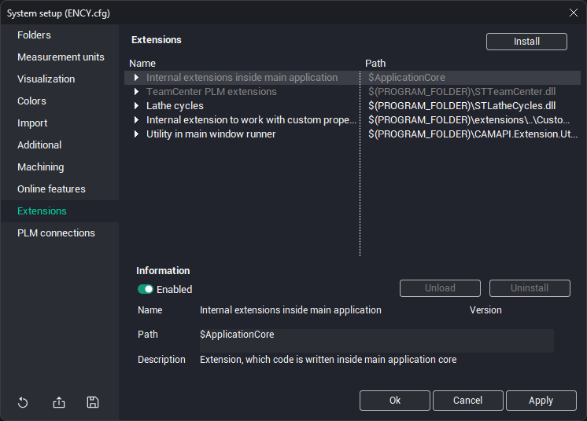
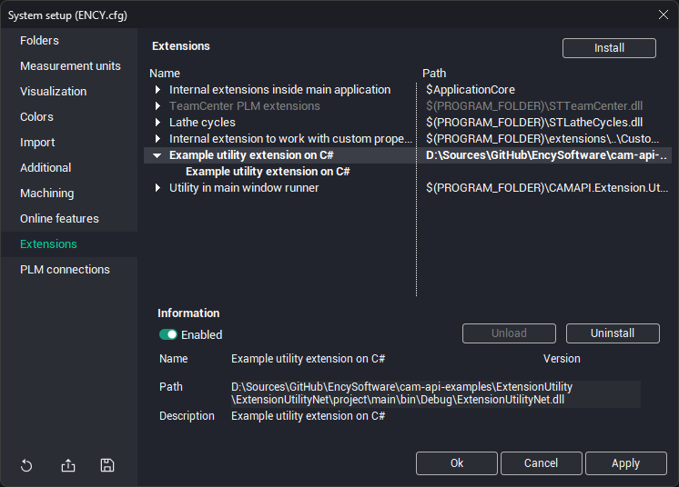

# システム設定ウィンドウを使用した拡張機能のインストール

[システム設定ウィンドウ](90.md)から拡張機能をインストールするには、次の手順に従ってください。

- システム設定ウィンドウを開き、拡張機能タブに切り替えます。

- 「インストール」ボタンをクリックし、ファイル選択ダイアログが開いたら、拡張機能の説明ファイル（.json）または拡張機能パッケージファイル<em>（</em>.dext：拡張機能の動作に必要なすべてのファイルを含むZIPアーカイブ）のいずれかを選択します。

- 選択した拡張機能ライブラリに対応する項目が、拡張機能パネルのリストに追加されます。

このウィンドウの最上位には、拡張機能ライブラリに対応する要素が表示されます。これらのライブラリ内には、個々の拡張機能に対応する要素がネストされています。1つのライブラリで複数の拡張機能を同時に実装できます。

ユーザーが手動でインストールしたライブラリは、リスト内で太字で表示されます。システムによってインストールされたライブラリは通常のフォントで表示されます。

上部のリストからライブラリまたは拡張機能を選択すると、選択した要素に関する情報（名前、説明、バージョン番号、ファイルシステム上の場所）がウィンドウ下部に表示されます。

拡張機能ライブラリを削除するには、リストから該当項目を選択し、アンインストールボタンをクリックします。一部の拡張機能はユーザーによる削除が許可されていない場合があり、その場合はアンインストールボタンが無効になります。

拡張機能ライブラリがメモリに読み込まれている場合は、読み込み解除ボタンをクリックすることで実行を強制停止し、メモリからアンロードできます。

また、拡張機能を削除せずに無効化することもできます。その場合は「有効」トグルをオフにします。無効化された拡張機能はウィンドウ内でグレー表示されます。

注意：拡張機能の種類によっては、変更を反映させるためにCAMシステムの再起動が必要になる場合があります。
