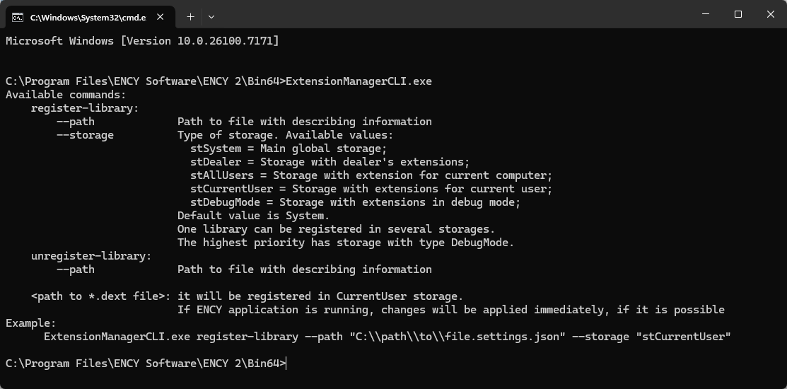
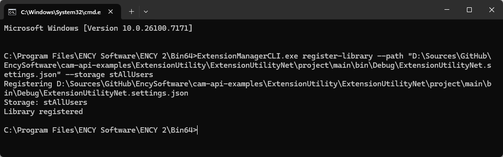

# Installazione delle estensioni dalla riga di comando

Le estensioni possono essere installate tramite un'utilità a riga di comando. Ciò è comodo per le installazioni in serie, quando occorre ripetere rapidamente il processo su più computer.

Per installare le estensioni dalla riga di comando, procedere come segue:

- Trovare l'utilità ExtensionManagerCLI.exe nella cartella di installazione del sistema CAM.

Nota: l'utilità ExtensionManagerCLI.exe serve a registrare e rimuovere le estensioni del sistema CAM dalla riga di comando.

- Eseguire la riga di comando dalla cartella di installazione del sistema CAM. L'esecuzione dell'utilità senza parametri non produce alcuna azione: vengono semplicemente visualizzate le informazioni di guida sugli argomenti validi della riga di comando.

- Eseguire il comando:

ExtensionManagerCLI.exe register-library --path "ExtensionFolder\ExtensionSettings.json" --storage stAllUsers

Al posto di "ExtensionFolder\ExtensionSettings.json", specificare il percorso del file JSON dell'estensione.

Al posto del parametro --path, è anche possibile specificare il percorso del file dext dell'estensione.

Con il parametro --storage (valori possibili: stAllUsers, stCurrentUser) è possibile specificare se l'estensione sarà disponibile per tutti gli utenti o solo per l'utente corrente.

Di seguito è riportato un esempio di esecuzione del comando.

Nota: a seconda del tipo di estensione, le modifiche potrebbero essere applicate solo dopo il riavvio del sistema CAM.
