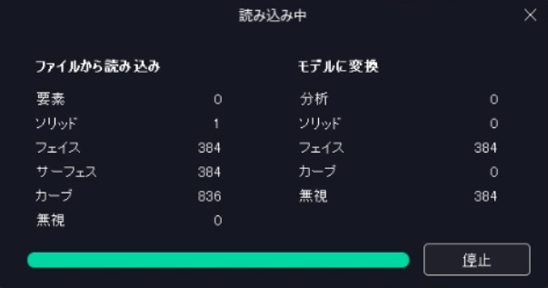

# 幾何オブジェクトのインポート

外部CADファイルからのモデルのインポートは、 ボタンをクリックするか、モデルファイルをアプリケーションのウィンドウへドラッグ＆ドロップすることで実行できます。この機能は、[メインウィンドウ](51.md) <strong>ファイル</strong> <strong>→ インポート</strong> からも利用でき、ショートカットキー <strong>[Ctrl+I]</strong> を押して実行することも可能です。

ファイル選択ウィンドウでは、ファイルの拡張子フィルタを指定することができます。サポートされるファイル形式は、CAMシステムの構成とインストールされた[アドイン](10039.md)によって異なります。

外部CADファイルのインポート処理中、ファイルの読み込み処理と幾何オブジェクトの作成状況に関する現在の情報がウィンドウに表示されます。プロセス指標は、インポート機能の完了率を反映します。単純な構造のファイルをインポートする場合、システムはワンパスアルゴリズムを使用します。つまり、ファイルの読み込みと幾何モデルの生成が同時に実行されます。複雑なデータ構造を持つファイルからインポートする場合、システムはダブルパスアルゴリズムを使用します。第一段階では、システムがファイルを読み込んで幾何モデルの構造を解析し、第二段階ではモデルを作成します。

`ファイルから読み込み`パネルには、ファイル読み込みに関する統計データが表示されます。

- `要素` – 読み込まれた要素の数
- `ソリッド` – 読み込まれたソリッドの数
- `フェイス` – 読み込まれた面（境界付きサーフェス）の数
- `サーフェス` – 読み込まれたサーフェスの数
- `カーブ` – 読み込まれた曲線の数
- < 無視 - 無視される(重要でないか、不正解、サポートされていない)要素の数
- `合計` – 読み込まれた要素の合計

`モデルに変換` パネルは、読み込まれたデータを内部モデルへ変換した際の統計データを表示します。

- `アナライズ` – 変換された要素の数
- `ソリッド` - 変換されたソリッドの数
- `フェイス` – 変換された面の数
- `カーブ` – 変換された曲線の数
- `無視` – 無視された要素の数

オブジェクト間のすべてのトポロジ参照は、内部モデルの生成段階で正確に解析されます。また、多数のコンポーネントから複合オブジェクト（ソリッド、面など）が形成されます。複雑なオブジェクトの中にある単純なオブジェクト（曲線や点など）は、独立したオブジェクトとして複製されます。したがって、ファイルから読み込まれる要素の総数は、モデルに変換されるオブジェクトの数よりも多くなります。

例えば、面は無制限のサーフェスといくつかの制限曲線から構成されています。 ファイルを読み込む際、その面とすべての構成要素が、数値の適切な欄へカウントされます。さらに、内部モデルを作成する際には、これらの要素はすべて1つの面としてカウントされます。

インポート中に <strong>`停止`</strong> ボタンをクリックすると、読み込み処理が停止します。

インポート処理中、システムはインポートされたモデルを分析し、エラーや不適切なレコード、サポートされていないデータタイプが発生した場合、対応するレポートメッセージが作成されます。エラーメッセージは補助ウィンドウに表示され、<strong>`エラー`</strong> ボタンをクリックすると開きます。このボタンは、インポート処理中にエラーが発生した場合にのみ使用可能になります。致命的なエラーが発生した場合、ファイルの読み込みは中断されます。エラーが発生した場合は、そのファイル形式のインポートに関する仕様を詳しく確認し、エラーを回避するための推奨事項に従うことが推奨されます。

<strong>`ウィンドウを自動的に閉じる`</strong> のチェックボックスにチェックが入っている場合、エラーが発生しなければ、インポート処理の完了後にウィンドウは自動的に閉じます。チェックマークがオフになっているか、インポート中にエラーがあった場合、システムは**OK** ボタンが押されるまで処理を保留します。

<em>注意： インポートされるのは、<em>[システム設定](90.md)</em>ウィンドウの <strong>`インポート`</strong> タブで定義されている種類のオブジェクトのみです。その他の種類の要素は無視されます。</em>

<em>注意：曲線の種類を変換する必要がある場合、近似時の最大偏差は、同じウィンドウ内の `カーブ近似トレランス` フィールドで定義された値よりも小さくなります。</em>
