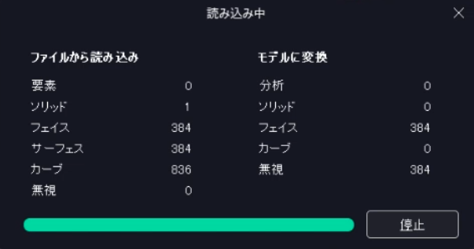

# Importazione di oggetti geometrici

L'importazione di modelli da file CAD esterni si esegue facendo clic sul pulsante  oppure semplicemente trascinando il file del modello nella finestra dell'applicazione. La funzione è disponibile anche dal [menu principale](51.md) File –> Import e premendo il tasto di scelta rapida [ Ctrl+I ].

Nella finestra di selezione del file è possibile specificare filtri per le estensioni dei file. L'insieme dei formati di file supportati dipende dalla configurazione del sistema CAM e dai [componenti aggiuntivi (add-in)](10039.md) installati.

Durante l'importazione di file CAD esterni, nella finestra vengono visualizzate le informazioni correnti sull'avanzamento della lettura del file e della creazione degli oggetti geometrici. Un indicatore di avanzamento mostra la percentuale completata della funzione di importazione. Per l'importazione da file con struttura semplice il sistema utilizza un algoritmo a un passaggio, cioè la lettura del file e la formazione del modello geometrico avvengono contemporaneamente. Per l'importazione da file con una struttura dati complessa il sistema utilizza un algoritmo a due passaggi. Nella prima fase il sistema legge il file e analizza la struttura del modello, nella seconda crea il modello geometrico.

Il pannello **Loaded from file** (caricati dal file) mostra i dati statistici sulla lettura del file:

- **Entities** – contatore delle entità caricate;
- **Solids** – contatore dei solidi caricati;
- **Faces** – contatore delle facce (superfici delimitate) caricate;
- **Surfaces** – contatore delle superfici caricate;
- **Curves** – contatore delle curve caricate;
- **Ignored** – contatore delle entità ignorate (non significative, non corrette o non supportate);
- **Total** – numero totale delle entità caricate.

Il pannello **Converted into model** (convertiti nel modello) visualizza i dati statistici sulla conversione dei dati letti nel modello interno:

- **Analyzed** – contatore delle entità convertite;
- **Solids** – contatore dei solidi convertiti;
- **Faces** – contatore delle facce convertite;
- **Curves** – contatore delle curve convertite;
- **Ignored** – contatore delle entità ignorate.

Tutti i riferimenti topologici tra gli oggetti vengono analizzati proprio nella fase di creazione del modello interno; inoltre, a partire da un numero molto elevato di componenti, si formano gli oggetti complessi (solidi, facce). Tutti gli oggetti semplici (curve, punti ecc.) contenuti in quelli più complessi vengono inoltre duplicati sotto forma di oggetti indipendenti. Di conseguenza, il numero totale di oggetti caricati dal file è in realtà maggiore di quello degli oggetti convertiti nel modello.

Ad esempio, una faccia è costituita da una superficie illimitata e da diverse curve di contorno. Durante la lettura del file, la faccia e tutto il suo contenuto vengono conteggiati nei rispettivi campi del contatore. Invece, durante la creazione del modello interno, tutti questi elementi vengono conteggiati come un'unica faccia.

Facendo clic sul pulsante **Stop** durante l'importazione si interrompe il processo di caricamento.

Durante l'importazione il sistema analizza il modello importato e, se si verificano errori, record non appropriati o tipi di dati non supportati, viene creato un messaggio di segnalazione corrispondente. I messaggi di errore vengono visualizzati in una finestra ausiliaria, che si apre facendo clic sul pulsante **Errors**. Il pulsante diventa disponibile solo se durante l'importazione si sono verificati errori. In caso di errori irreversibili, il caricamento del file si interrompe. Se si verificano errori, si consiglia di studiare più attentamente le particolarità dell'importazione di questo formato di file e di seguire le raccomandazioni per evitare tali errori.

Se la casella di controllo **Close the window automatically** (chiudi automaticamente la finestra) è selezionata e non si sono verificati errori, la finestra si chiude automaticamente al termine dell'importazione. Se la casella è deselezionata oppure si sono verificati errori durante l'importazione, il sistema attende che si prema il pulsante **Ok** per proseguire.

*Nota: vengono importati solo i tipi di oggetti definiti nella finestra delle [impostazioni di sistema](90.md), nella scheda [Import](264.md). Gli elementi di altri tipi vengono ignorati.*

<em>Nota: se è necessario trasformare i tipi di curve, la deviazione massima durante l'approssimazione sarà inferiore al valore definito nel campo **Curves approximation tolerance** (tolleranza di approssimazione delle curve) nella stessa finestra.</em>
