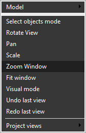
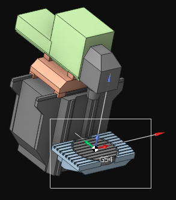

# Fenster-Zoom

Diese Funktion vergrößert einen Bereich, der durch zwei gegenüberliegende Ecken eines rechteckigen Auswahlrahmens definiert ist. Wählen Sie **Zoom Window** (Fenster zoomen) aus dem Kontextmenü des Grafikfensters, um den Modus zu aktivieren.

Legen Sie die erste Ecke fest, halten Sie die linke Maustaste gedrückt und legen Sie die zweite Ecke fest. Wenn Sie die Maustaste loslassen, wird der Bereich innerhalb des Rechtecks so vergrößert, dass er in das Ansichtsfenster passt. Anschließend wird der Modus beendet.

Sie können auch **Alt + rechte Maustaste** oder **die linke und rechte Maustaste gleichzeitig** verwenden, um das gleiche Ergebnis zu erzielen, ohne den Modus zu wechseln.
