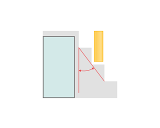

# 工具の逃げ角

## 適用分野:

深い垂直壁を加工する場合、すでに加工済みの部分との工具接触を制限する必要が生じることがあります。この目的のため、レイヤー加工を行うオペレーションでは、逃げ角を設定できます。垂直面（または垂直に近い面）を加工する際は、下図に示すように、各加工レイヤーで実際のストックの厚みが増加します。逃げ角は、加工対象のモデルだけでなく、加工範囲を制限する壁を含む、垂直または垂直に近いすべての壁に対して適用されます。逃げ角には0°以上90°未満の値を設定できます。負の値や90°以上の値は設定できません。また、逃げ角を大きく設定しすぎると、下層のレイヤーに未加工材が多く残る原因となります。
