# Verificação do suporte (evitar colisões)

.png)

## Área de aplicação:

Com a função <strong>Check Holder</strong>, esse recurso detecta os segmentos do percurso da ferramenta em que o suporte da ferramenta colide com a peça e modifica esses segmentos de acordo com a estratégia especificada.

<strong>Métodos para evitar colisões:</strong>

<strong>Trim Toolpath.</strong> Os segmentos em colisão (em vermelho) são excluídos do percurso da ferramenta.

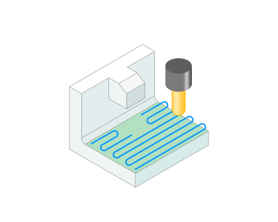

<strong>Frontal Tilting.</strong> A ferramenta se inclina para longe da colisão no plano frontal (no plano da passada da ferramenta).

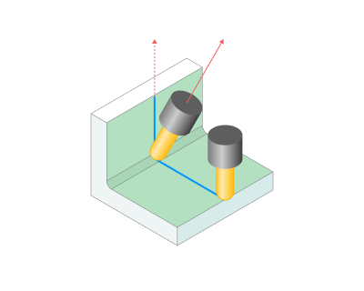

<strong>Side Tilting.</strong> A ferramenta se inclina lateralmente para longe da colisão (em um plano perpendicular ao percurso da ferramenta).

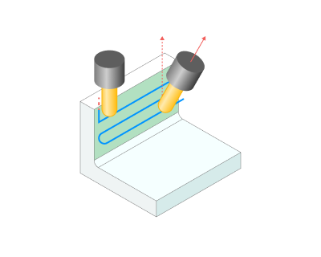

<strong>Tilt to Rotary Axis.</strong> A ferramenta se desvia da orientação inicial pelos ângulos especificados em <strong>Tilt Angles,</strong> no plano formado pelo <strong>Rotary Axis</strong> (eixo rotativo) e pelo ponto de contato da ferramenta. Funciona <strong>somente com máquinas de 5 eixos</strong> que têm um eixo rotativo em torno do eixo de rotação. Por exemplo, o eixo rotativo C da mesa.

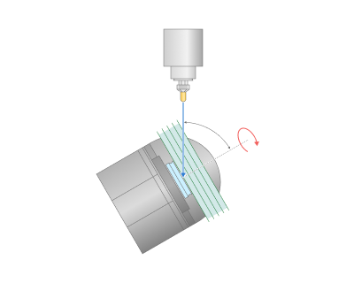

<strong>Tilt Around Rotary Axis.</strong> A ferramenta se desvia da orientação inicial pelos ângulos especificados em <strong>Tilt Angles,</strong> no plano perpendicular ao <strong>Rotary Axis</strong>. Funciona somente com máquinas que <strong>não têm um eixo rotativo em torno do eixo de rotação</strong>.

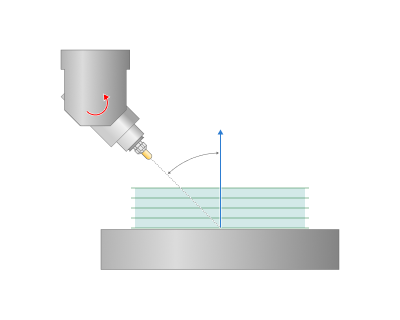

<strong>Adaptive tilting.</strong> Esse recurso permite o desvio angular simultâneo em torno de dois eixos.

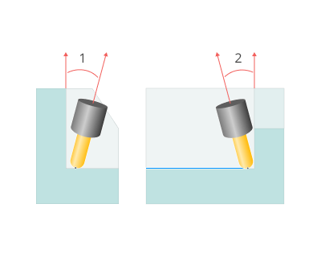

<strong>1 -</strong> Primeiro ângulo em relação à parede.

<strong>2</strong> - Segundo ângulo em relação à segunda parede.

<strong>Offset Along Tool</strong>. O percurso da ferramenta é deslocado ao longo do eixo da ferramenta dentro de uma distância especificada para evitar a colisão entre o suporte da ferramenta e o bruto. Nesse caso, o percurso da ferramenta permanece contínuo.

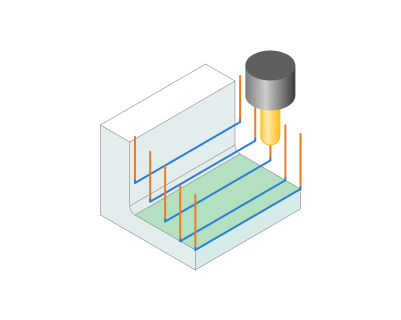

<strong>Parâmetros para evitar colisões.</strong>

<strong>Tool Working Length.</strong> Defina o comprimento de corte da ferramenta ao longo do seu eixo (comprimento utilizável LU conforme a ISO 13399).

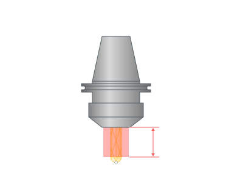

<strong>Tool Radial Clearance</strong>. Defina a distância mínima segura entre a parte não cortante da ferramenta e o bruto na direção perpendicular ao eixo da ferramenta.

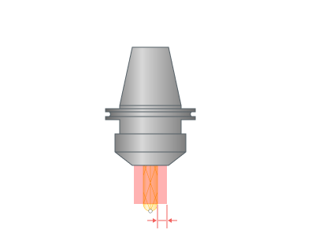

<strong>Tool Angular Clearance.</strong> A zona de segurança ao redor da parte não cortante da ferramenta é um cone truncado com raio no vértice igual ao raio da ferramenta mais <strong>Tool Radial Clearance</strong> e com ângulo igual a <strong>Tool Angular Clearance</strong>.

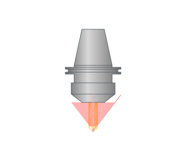

<strong>Holder Radial Clearance.</strong> Defina a distância mínima segura entre o suporte e o bruto na direção perpendicular ao eixo da ferramenta.

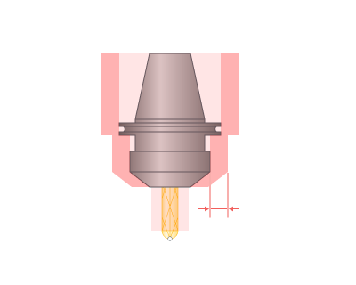

<strong>Holder Axial Clearance.</strong> Defina a distância mínima segura entre o suporte e o bruto ao longo do eixo da ferramenta. Hac — Holder Axial Clearance.

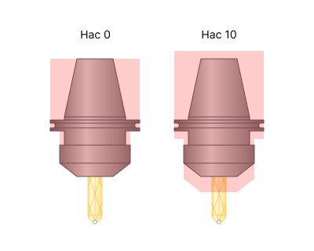

<strong>Fixed Lead Direction.</strong> Fixa o movimento da ferramenta no ângulo selecionado (considerando as folgas especificadas em Check Holder) ao se aproximar de um obstáculo, em relação ao sistema de coordenadas global selecionado.

.png) .png)

<strong>Additional Tilt Angle.</strong> Ângulo de folga adicional nas estratégias de inclinação de <strong>Avoid Collisions</strong>, que garante um percurso da ferramenta seguro e sem colisões.

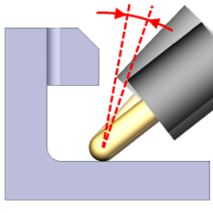

<strong>Max. tilt angle.</strong> Ângulo de inclinação máximo permitido.

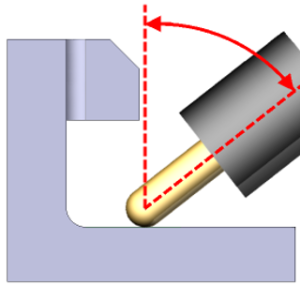

<strong>Inertia</strong>. Quanto maior o valor, mais suave é a inclinação do eixo da ferramenta. O valor 0 significa sem suavização.

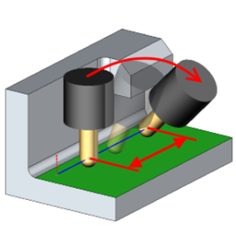

<strong>Normal blend distance.</strong> Distância entre dois pontos do percurso da ferramenta usada para calcular a direção atual de inclinação da ferramenta. Use valores maiores ao usinar formas irregulares para eliminar oscilações desnecessárias do eixo da ferramenta. Use valores maiores que o raio do suporte ao usinar cantos internos.

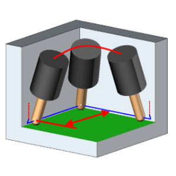

<strong>Additional Distance.</strong> Deslocamento do percurso da ferramenta ao longo do eixo da ferramenta para evitar a colisão entre o suporte da ferramenta e o bruto.

<strong>Max. Distance.</strong> Valor máximo permitido de <strong>Additional Distance</strong>.

<strong>Check Spindle</strong>. Parâmetros que controlam a prevenção de colisões entre o bruto e a unidade do fuso da máquina.

<strong>Auto</strong>. Esse modo usa os modelos 3D do esquema da máquina para calcular as colisões.

<strong>Manual</strong>. Nesse modo, o sistema monitora as colisões entre o bruto e uma zona de segurança composta por um cone truncado e um cilindro. O cone é definido pelo raio superior <strong>Radius</strong>, pelo ângulo <strong>Angle</strong> e por <strong>Max Radius</strong>. O cilindro é definido por <strong>Max Radius</strong>.

<strong>Spindle Radial Clearance</strong>. Defina a distância mínima segura entre o nó do fuso e o bruto na direção perpendicular ao eixo da ferramenta.

<strong>Spindle Axial Clearance</strong>. Defina a distância mínima segura entre o nó do fuso e o bruto ao longo do eixo da ferramenta.

<strong>Max Radius</strong>. No modo <strong>Auto</strong>, é o raio de um cilindro que envolve os componentes adjacentes ao fuso (como o cabeçote do fuso) que podem colidir com o bruto durante a usinagem. No modo <strong>Manual</strong>, é o raio máximo da zona de segurança.

<strong>Radius</strong>. Raio envolvente do nó do fuso.

<strong>Angle</strong>. A zona de segurança ao redor do nó do fuso é um cone truncado com raio no vértice igual a <strong>Radius</strong> mais <strong>Spindle Radial Clearance</strong> e com ângulo igual a <strong>Angle</strong>.

<strong>Check links.</strong> Função que permite o desvio angular controlado da ferramenta em duas direções durante as transições entre as passadas de usinagem, para evitar colisões com o bruto.

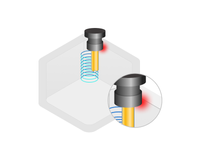 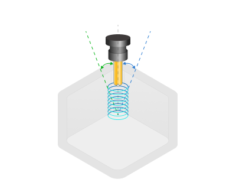
