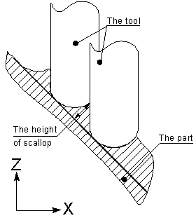
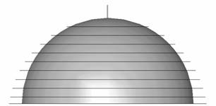
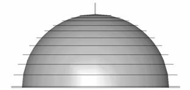
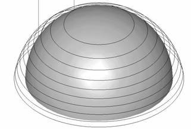
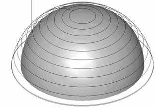

# Passo adaptativo (seleção do passo pela altura da crista)

Ao usinar superfícies cujo raio de curvatura não coincide com o raio do perfil da [ferramenta](37.md), surge uma crista de material residual entre as passadas vizinhas. Sua altura depende do formato da superfície do modelo que está sendo usinado, do tipo e do tamanho da [ferramenta](37.md) e da distância entre as passadas vizinhas da fresa.

Nas operações, é possível definir o passo pela altura máxima da crista. Nesse caso, a distância entre as passadas vizinhas da ferramenta será selecionada automaticamente para que a altura da crista não exceda o valor definido.

O valor do passo é calculado para cada passada de trabalho de modo que a altura definida da crista nunca seja excedida, mesmo no pior caso.

Não é difícil perceber que o valor do passo na direção vertical diminuirá em superfícies próximas da horizontal e aumentará com o aumento da inclinação das superfícies. Em superfícies verticais, o valor do passo tende ao infinito. Para evitar passos excessivamente grandes, é necessário definir o valor máximo do passo vertical. Se o valor calculado exceder o máximo, será selecionado o valor máximo de passo permitido.

| Usinagem com passo constante | Passo escolhido pela altura da crista |
|---|---|
|  |  |
|  |  |

O valor do passo na direção horizontal aumenta em superfícies planas e diminui em superfícies próximas da vertical. Para evitar passadas em excesso em áreas próximas da vertical, é necessário definir um valor mínimo de passo. Se o passo calculado for menor que o mínimo, será usado o valor mínimo.

A altura máxima da crista só pode ser definida com um valor positivo. Não é recomendável definir a altura da crista menor do que a tolerância de usinagem.

A altura da crista para o passo na direção vertical pode ser definida na página **Parameters**, e na direção horizontal, na página **Strategy**.
