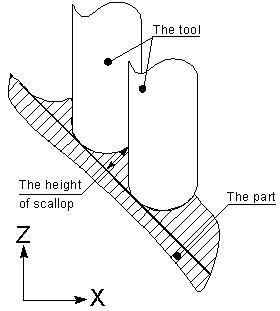
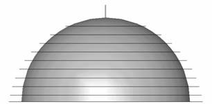
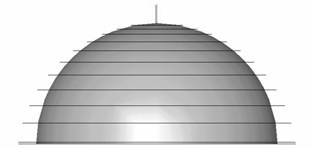
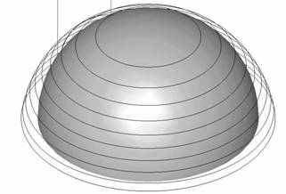
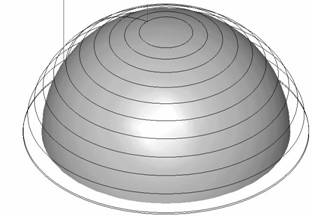

# スキャロップの高さによるピッチ選択

[工具](37.md)の輪郭半径と一致しない曲率半径を持つ面を加工する場合、隣接するパスの間に未加工材（スキャロップ）が残ります。 その高さは、加工対象となるモデルの表面形状、[工具](37.md)の種類およびサイズ、そしてミルの隣接パス間の距離によって決まります。

オペレーションでは、スキャロップ最大高さによってステップを割り当てることが可能です。これにより、スキャロップの高さが定義された値を超えないように、隣接するツールパス間の距離が自動的に選択されます。

ステップ値は、最悪条件においても設定されたスキャロップ高さを超えないように、各[加工パス](https://confluence.encycam.com/display/SC1/.Working+Toolpath+v20)ごとに計算されます。

水平方向に近い面では垂直方向のステップ値が小さくなり、面の傾斜が大きくなるとステップ値も増加することが容易に理解できます。垂直面では、ステップ値は無限大に近づきます。過大なステップを避けるため、垂直方向の最大ステップ値を設定する必要があります。計算値が最大値を超える場合は、許容される最大ステップ値が選択されます。

| <strong>固定ステップによる加工</strong> | <strong>ステップはスキャロップの高さで選択</strong> |
|---|---|
|  |  |
|  |  |

水平方向のステップ値は、平らな面では増加し、垂直に近い面では減少します。垂直に近い部分でパスが多くなるのを避けるため、最小ステップ値を割り当てる必要があります。算出されたステップが最小値より小さい場合、最小値が使用されます。

スキャロップの最大高さは正の値でのみ指定できます。スキャロップの高さを加工[トレランス](https://confluence.encycam.com/display/SC1/.Tolerance+v20)より小さく設定することは推奨されません。

垂直方向におけるステップ時のスキャロップ値は[パラメータ](https://confluence.encycam.com/display/SC1/.Assigning+Parameters+of+Mill+Operations+v20) ページで設定でき、水平方向については`加工設定` ページで設定できます。
