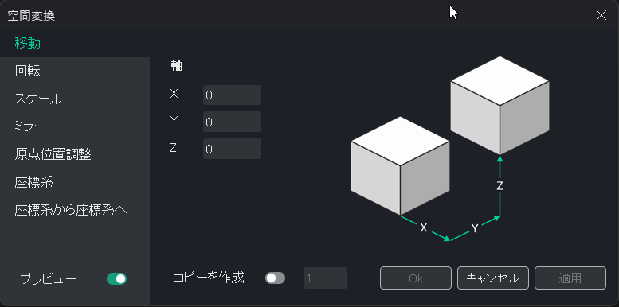
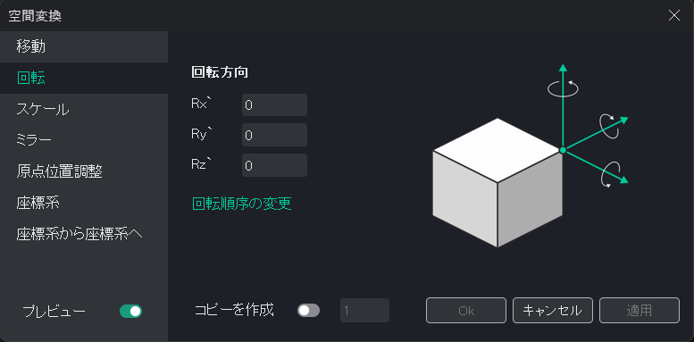
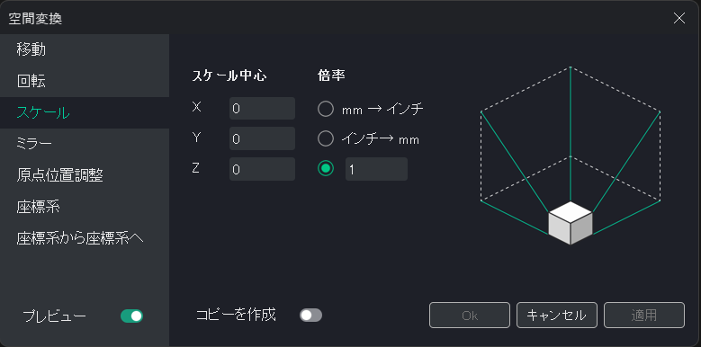
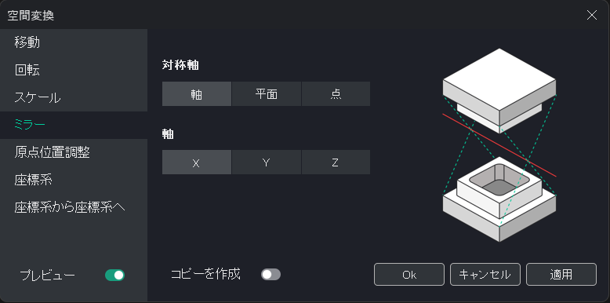
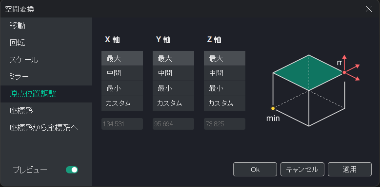
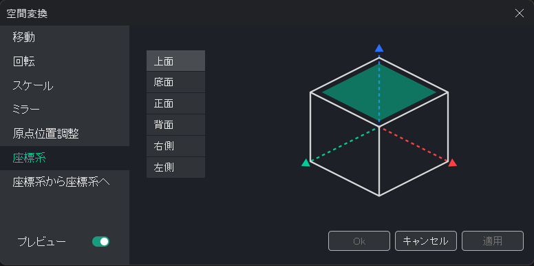
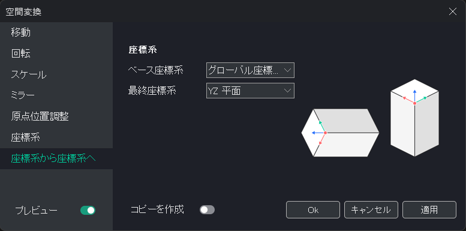

# Transformações espaciais

Uma gama mais ampla de métodos de transformação dos objetos geométricos selecionados está disponível na janela **Spatial transformations**. A janela é aberta quando o botão  é pressionado.

- Na página **Move**, o usuário pode definir a translação paralela de um objeto. Nos campos **X**, **Y**, **Z**, são definidos os valores de deslocamento ao longo dos eixos. Se não houver uma marca de seleção no campo **Make copies**, o objeto selecionado será transferido pela distância definida ao longo de cada um dos respectivos eixos. Se a marca de seleção nesse campo estiver ativada, o objeto selecionado será copiado para o local definido. É possível atribuir um número de cópias. Por exemplo, se o número de cópias for definido como dois, a segunda cópia será criada à distância de translação da primeira.

- Na página **Rotate**, o usuário pode girar os objetos selecionados em torno do eixo selecionado até o ângulo definido. O ângulo é atribuído em graus. O trabalho com cópias é incremental, ou seja, cada cópia subsequente é obtida pela rotação da anterior em torno do eixo definido até o ângulo definido.

- Na página **Scale**, o usuário pode ampliar ou reduzir os objetos selecionados. No campo **Scale center**, são definidas as coordenadas do ponto central da escala. O **Scale factor** pode ser um dos dois valores predefinidos, **mm to inch** ou **inch to mm**, ou um valor arbitrário, **Other**. Com um fator de escala maior que um, os objetos são ampliados. Com um fator de escala menor que um, os objetos são reduzidos proporcionalmente.

- Na página **Mirror**, o usuário pode obter um objeto simétrico ao selecionado em relação a um eixo, plano ou ponto.

- Na página **Locate Zero**, o usuário pode realizar uma translação paralela de um objeto de acordo com suas dimensões espaciais. O objeto geométrico selecionado será deslocado ao longo dos eixos pelos valores necessários para que o objeto transformado fique posicionado em relação ao [sistema de coordenadas](753.md) atual de acordo com os parâmetros definidos.

- Na página **Coordinate System**, o usuário pode girar um objeto de modo que as arestas selecionadas fiquem na parte superior. Além disso, o modelo pode ser transformado de modo que o plano construído coincida com o plano XY do sistema de coordenadas global.

- Na página **CS to CS**, o usuário pode transformar um objeto localizado em um sistema de coordenadas **Base CS** em outro sistema de coordenadas **Final CS**.

Ao pressionar o botão **OK**, a transformação selecionada será aplicada e a janela se fechará automaticamente. Ao pressionar o botão **Cancel**, a janela se fecha sem aplicar as transformações feitas. Ao pressionar o botão **Apply**, todas as transformações serão aplicadas aos objetos selecionados, mas a janela permanecerá ativa.
