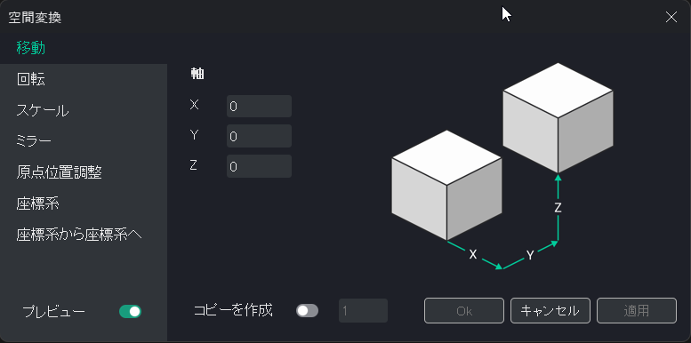
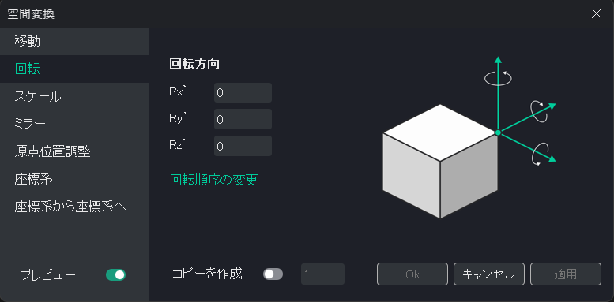
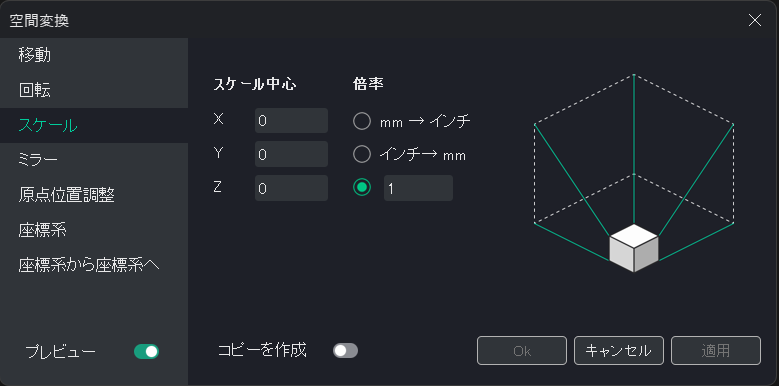
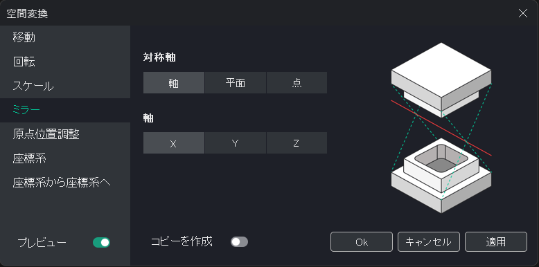
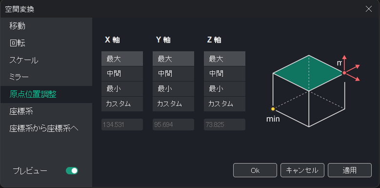
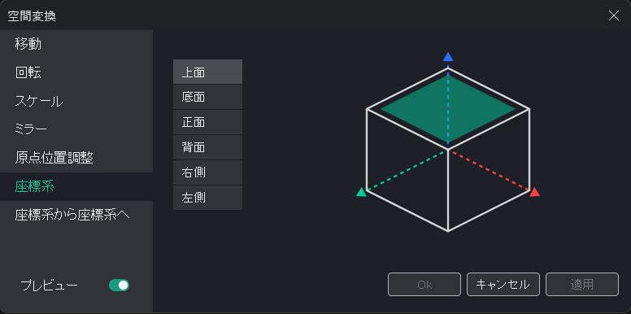
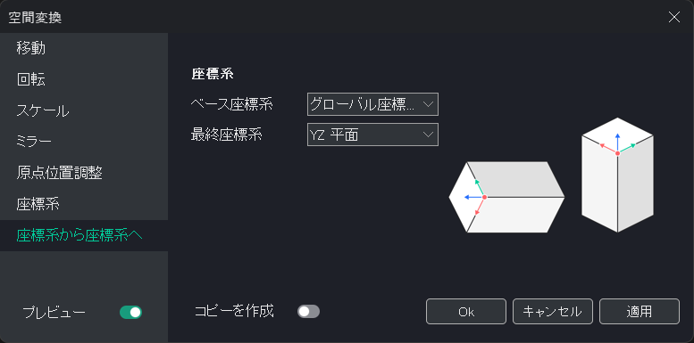

# 空間変換

選択した幾何オブジェクトに対して、より多くの変換方法は<strong>`空間変換`</strong>ウィンドウで利用できます。

このウィンドウは、 ボタンを押すことで開きます。

- `移動` ページでは、オブジェクトの平行移動を設定することができます。`X`、`Y`、`Z` の各フィールドには、それぞれの軸方向への移動量を入力します。`コピーを作成`にチェックが入っていない場合、選択したオブジェクトは指定した各軸方向の距離だけ移動します。このフィールドにチェックが入っている場合は、選択したオブジェクトが指定した位置にコピーされます。コピー数を指定することも可能です。例えば、コピー数を 2 に設定した場合、2つ目のコピーは1つ目のコピーから指定した移動距離の位置に作成されます。

- `回転` ページでは、選択したオブジェクトを指定した軸を中心に、設定した角度だけ回転させることができます。角度は度で指定します。コピーを作成する場合は段階的に処理されます。つまり、後続のコピーは、前のコピーを基準にして指定した軸回りに設定した角度だけ回転して作成されます。

- `スケール` ページでは、選択したオブジェクトを拡大または縮小することができます。`スケール中心`フィールドでは、スケーリングの基準となる中心点の座標を設定します。`倍率`は、`mm→inch`または `inch→mm`のいずれかの既定値を選択するか、`その他`で任意の値を入力することも可能です。スケール係数が1より大きい場合、オブジェクトは拡大されます。スケール係数が1より小さい場合、オブジェクトはそれに応じて縮小されます。

- `ミラー` ページでは、選択したオブジェクトに対して、軸、平面、点を基準として対称となるオブジェクトを作成することができます。

- `原点位置調整` ページでは、オブジェクトの空間寸法に基づいて平行移動を行うことができます。選択した幾何オブジェクトは、設定されたパラメータに従い、現在の座標系に対して指定された位置関係になるように、各軸方向に所定の値だけ移動されます。

- `座標系` ページでは、選択したエッジが上側にくるようにオブジェクトを回転させることができます。また、作成した平面がグローバル座標系のXY平面と一致するようにモデルを変換することも可能です。

- `座標系から座標系へ` ページでは、ある <strong>`ベース座標系`</strong> に配置されているオブジェクトを、別の <strong>`最終座標系`</strong> へ変換することができます。

`OK` ボタンを押すと、選択した変換が適用され、ウィンドウは自動的に閉じます。`キャンセル` ボタンを押すと、行った変換を適用せずにウィンドウが閉じます。`適用` ボタンを押すと、選択したオブジェクトにすべての変換が適用されますが、ウィンドウはそのまま開いた状態で保持されます。
