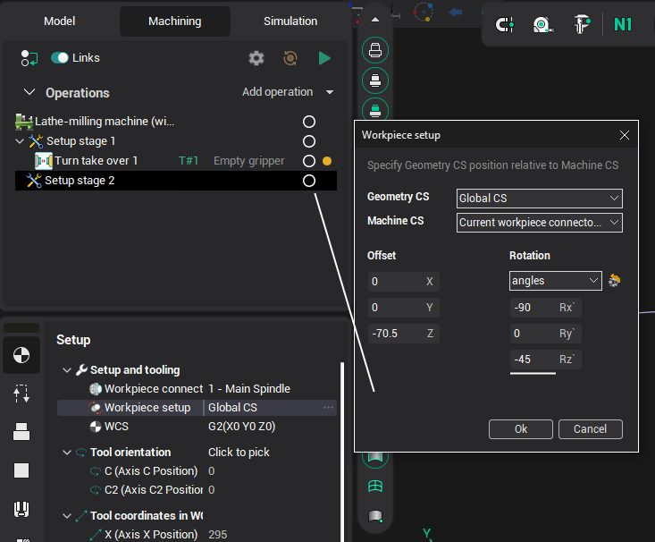
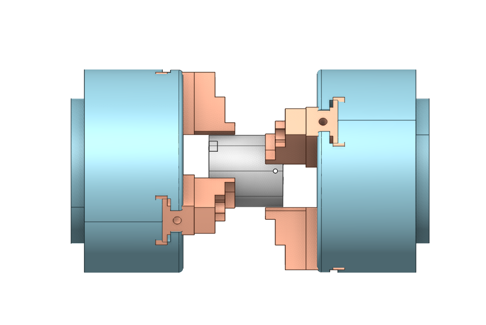
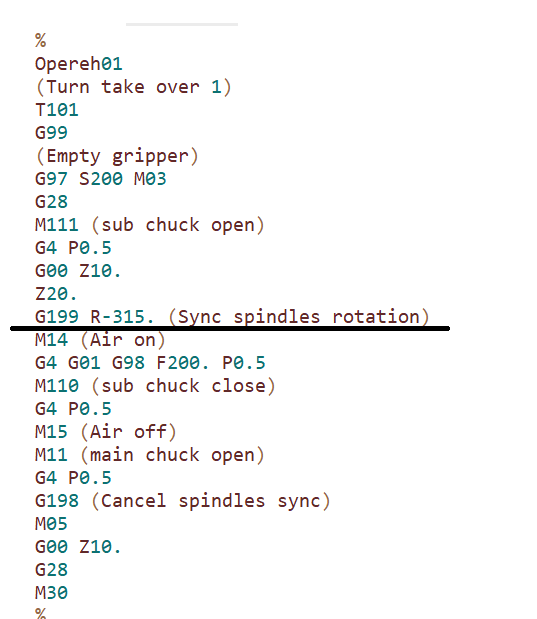

# Sincronizzazione di fase nell'operazione Turn take over

## Ambito di applicazione:

È necessario eseguire la ripresa di pezzi con fasi diverse sincronizzando i mandrini.

## Particolarità del funzionamento:

Per stabilire fasi (angoli) diverse del mandrino, è necessario indicare una fase diversa da quella iniziale nella posizione successiva del pezzo (piazzamento/pezzo).

Ad esempio, nella figura seguente l'angolo è di 45 gradi.

