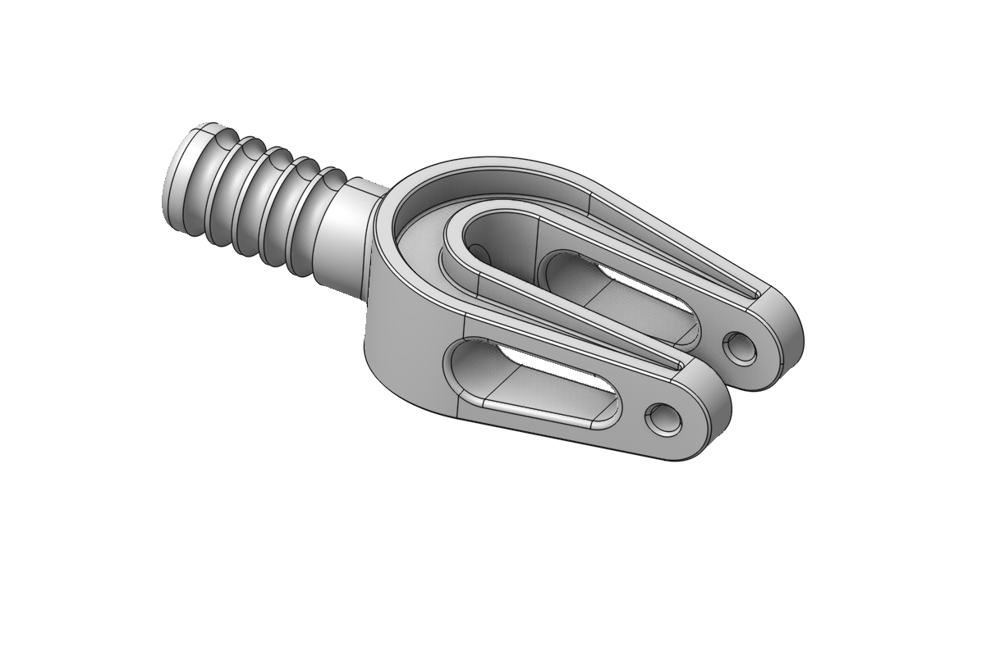

# Progettazione (geometria 3D)

## Ambito di applicazione:

Il modulo di modellazione integrato consente di creare sia disegni 2D sia modelli 3D basati su di essi. All'interno del sistema CAM, questo modulo viene utilizzato per sviluppare modelli semplici destinati a essere usati come attrezzature, grezzi o pezzi lavorati.
