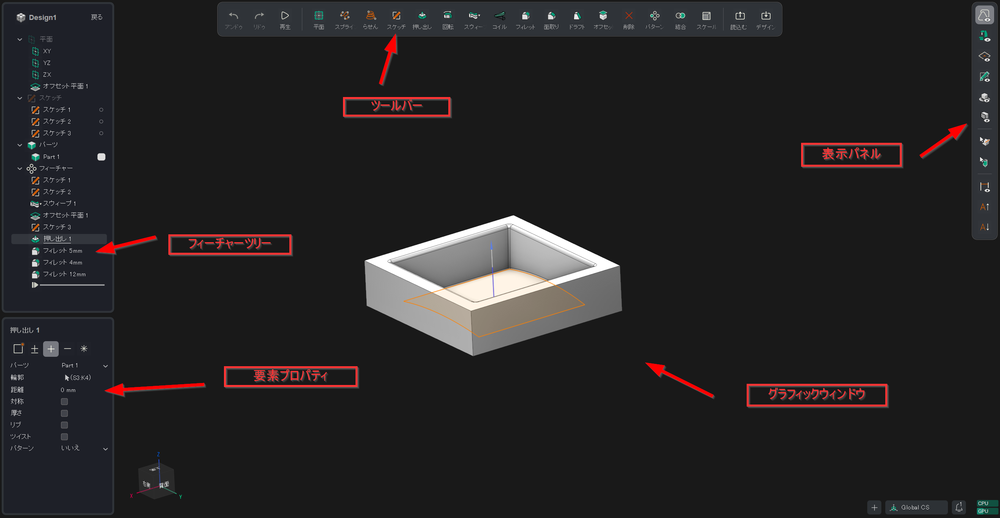
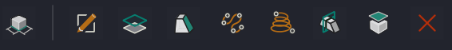
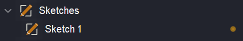
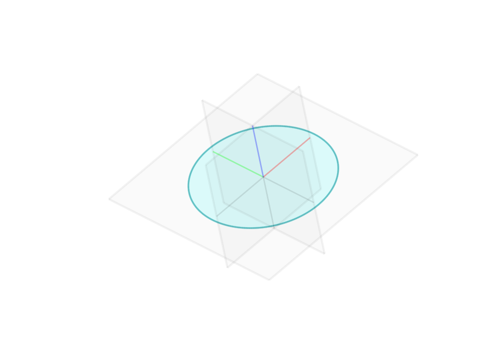
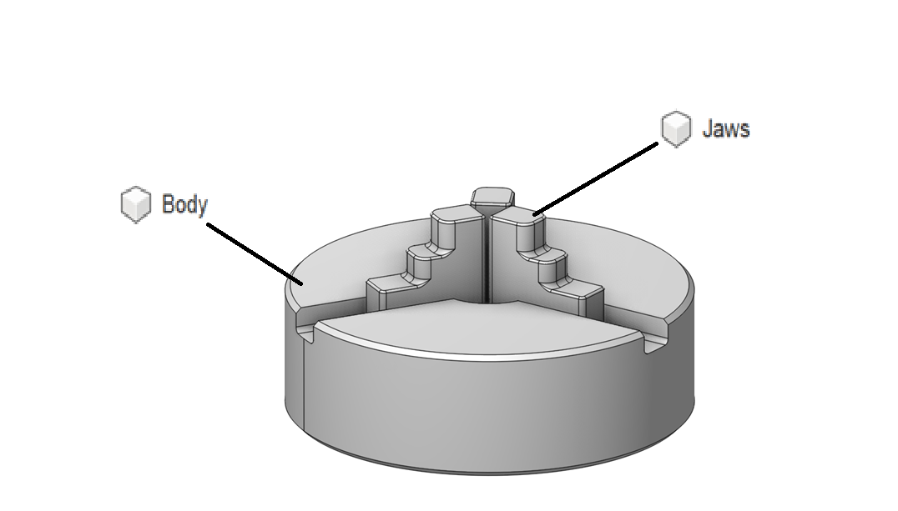
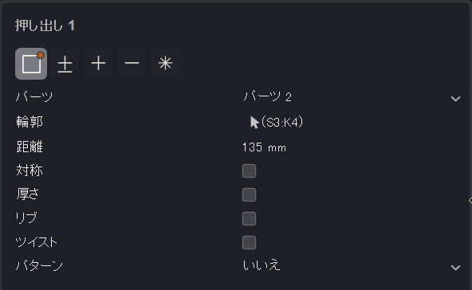
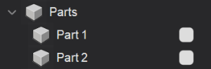
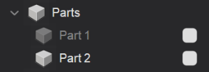
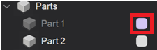
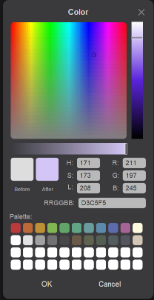

# Janela principal

## Área de aplicação:

<strong>O conteúdo dos elementos da janela principal depende do modo de trabalho 2D ou 3D.</strong>

A janela principal é composta pela árvore de elementos, pela barra de ferramentas, pelas propriedades dos elementos e pelo painel de visibilidade.

### Árvore de elementos.

A árvore de elementos exibe a sequência cronológica das operações realizadas para criar o modelo 3D. É importante observar que a árvore de elementos é estritamente sequencial. Por isso, não é possível criar duas extrusões que não se intersectam dentro de um único corpo. O sistema exigirá a criação de um novo corpo.

A árvore é composta por 3 planos básicos, esboços, peças e elementos.

<strong>Esboços.</strong> Definem um desenho na árvore de construção.

Clique aqui para expandir...

Os planos são criados pelo menu de contexto (clicando com o botão direito ou esquerdo do mouse em uma superfície ou plano). O conteúdo do menu muda de acordo com o elemento selecionado.

Em seguida, clique no botão de desenho.

Os métodos de definição de um plano são descritos em outro capítulo. [Detalhes](12451.md)

Ao lado de cada esboço na árvore existe um controle de visibilidade que permite mostrá-lo ou ocultá-lo no modo 3D.

Se o contorno estiver fechado, o sistema o destaca, indicando que uma operação booleana pode ser executada.

<strong>Se o contorno não estiver destacado para extrusão, verifique a visibilidade do esboço e certifique-se de que o contorno está fechado.</strong>

<strong>Curvas.</strong> Representam curvas espaciais (<strong>Helix, Spline</strong>). [Detalhes](12451.md)

<strong>Peças.</strong> O projeto pode ser composto por várias peças (uma por padrão). Isso permite criar conjuntos a partir de peças individuais. Isso é necessário para criar conjuntos (por exemplo, uma placa de castanhas é composta por castanhas e uma base). [Detalhes](10283.md)

Clique aqui para expandir...

O botão <strong>Create Part</strong> fica no painel de propriedades do elemento durante a execução do comando Extrude.

Para que duas peças apareçam na árvore, é necessário criar pelo menos dois esboços e executar a operação <strong>Extrude</strong> em cada um deles.

A visibilidade de uma peça é controlada clicando em seu ícone.

Também é possível alterar a cor do modelo.

 

<strong>Elementos.</strong> Contêm vários elementos (esboços, extrusões etc.).

### Barra de ferramentas.

É a barra de ferramentas do modo 2D ([Detalhes](12452.md)) ou 3D ([Detalhes](12451.md)). O conteúdo da barra de ferramentas muda de acordo com o modo selecionado.

### Propriedades dos elementos.

Este painel permite alterar as propriedades dos <strong>Features</strong>.

### Painel de visibilidade.

Este painel permite controlar a visibilidade de vários elementos (como a máquina, planos, esboços etc.).

Clique aqui para expandir...

<strong>Show 3D model.</strong> Define a visibilidade dos modelos 3D que não participam do projeto do modelo.

<strong>Show machine.</strong> Define a visibilidade do modelo do equipamento

<strong>Planes.</strong> Define a visibilidade de todos os planos

<strong>Sketches.</strong> Define a visibilidade de todos os esboços

<strong>Ground plane.</strong> Define a visibilidade do piso

<strong>Section plane.</strong> Ativa (ou desativa) um modo especial de exibição da estrutura interna de um objeto. [Detalhes](333.md)

<strong>Edges.</strong> Permite selecionar arestas do modelo

<strong>Features.</strong> Permite selecionar elementos do modelo

<strong>Dimensions.</strong> Define a visibilidade de todas as dimensões.

<strong>Increase PMI Font.</strong> Aumenta o tamanho das dimensões

<strong>Decrease PMI Font.</strong> Diminui o tamanho das dimensões

### Janela gráfica.

É a janela principal na qual o desenho, o modelo ou o conjunto é exibido.
