# 2Dモードでのデザイン

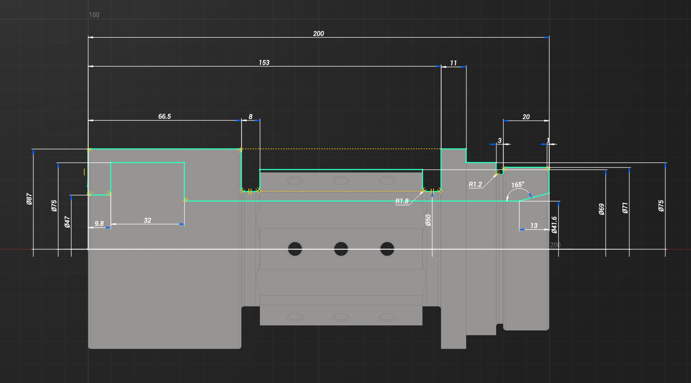

## 適用分野：

このモードでは、図面を作成することができます。

図面作成のための平面の定義については、次の章で説明されています。[詳細を見る](12451.md)

### ツールバー/要素のプロパティ

詳細を表示

<strong>アンドゥ</strong> 直前の操作を取り消します。

<strong>リドゥ</strong> 直前に取り消した操作を再度適用します。

<strong>スケッチ</strong> 図面の作成または終了を行います。

<strong>点</strong> スケッチに点を追加します。

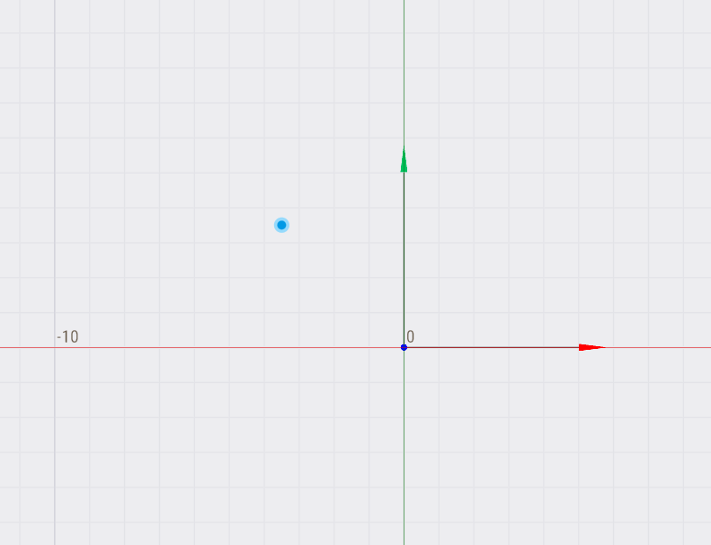

<strong>座標：</strong>点の座標を[スペース]で区切って入力します。

<strong>輪郭線を分割：</strong>曲線を2つに分割できます。

<strong>ホットキー</strong>

<em><strong>マウス右クリック</strong></em>: 終了

<strong>輪郭</strong> 線と円弧を使用して輪郭を作成します。 クリックして次の線または接線円弧を追加します。

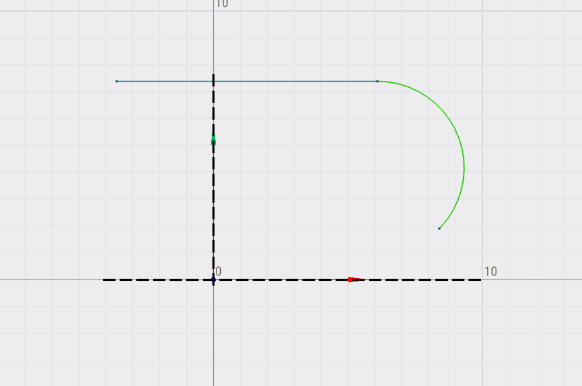

<strong>座標：</strong>点の座標を［スペース］で区切って入力します。

詳細を表示

例として星型を使用します。

1.この表をクリップボードにコピーします。2.対応するフィールドにデータを入力します。3.Enterキーを押します。

| 0 | 20 |
|---|---|
| 5,87 | 6,47 |
| 19,02 | 6,47 |
| 9,51 | -3,09 |
| 11,75 | -19,02 |
| 0 | -9,51 |
| -11,75 | -19,02 |
| -9,51 | -3,09 |
| -19,02 | 6,47 |
| -5,87 | 6,47 |

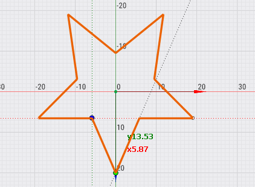

<strong>ホットキー</strong>

<strong><em>スペース：</em></strong>線と円弧の描画を切り替えることができます。

<strong><em>Shift：</em></strong> Shiftキーを押しながら円弧や円をクリックすると、線が接線になります。

<strong><em>輪郭をトリム</em></strong> マウスの左ボタンを押したままドラッグすると、輪郭の一部を切り取ることができます。

<em><strong>マウス右クリック：</strong></em>終了します。

<strong>円弧2点</strong> 2点を結ぶ円弧を描画します。

1. 円弧の最初の点をクリックします。

2. 円弧の2点目をクリックします。

3. 円弧の3点目をクリックするか、半径フィールドに円弧の半径を入力します。

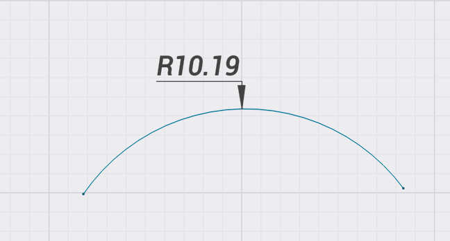

<strong>半径</strong> 2点間の半径を予測します。

<strong>始点</strong> 座標で点を指定できます。

<strong>終了点</strong> 座標で点を指定できます。

<strong>ホットキー</strong>

<strong>Shift</strong>: Shiftを押しながら円弧または直線をクリックすると、円弧が接線になります。

<strong>マウス右クリック</strong>: 終了します。

<strong>円弧中心</strong> 最初に中心点を指定して、円弧を描画します。

1. 円弧の中心点をクリックします。 2. 円弧の最初の点をクリックします。 3. 円弧の2点目をクリックします。

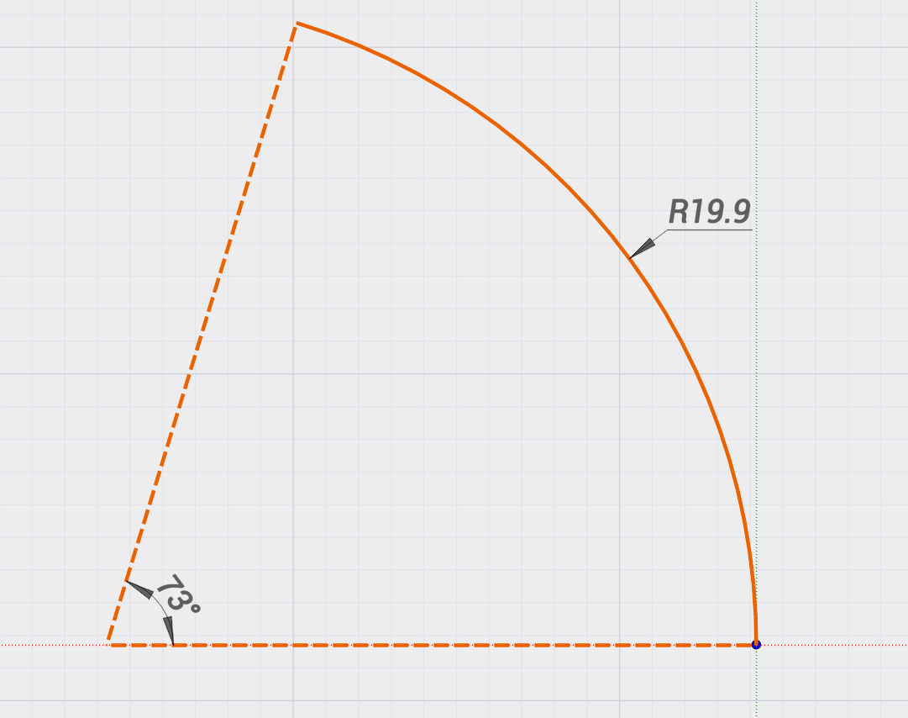

<strong>ホットキー</strong>

<strong>マウス右クリック:</strong> 終了します。

<strong>2点による長方形</strong> 対角の2点を指定して長方形を描画します。

1. 長方形の最初の角の点をクリックします。 2. 2つ目のコーナーの点をクリックするか、上のフィールドに長方形の寸法を入力します。

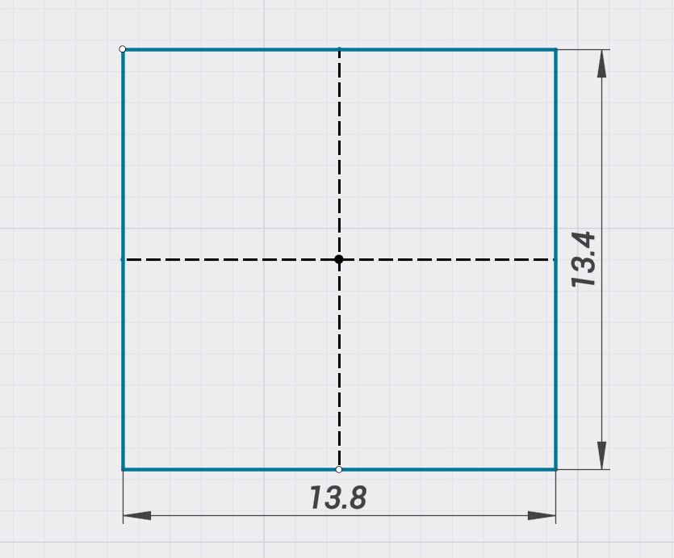

<strong>寸法</strong> 正方形にするには、寸法を1つだけ入力します。(例 67.5 67)

<strong>開始点</strong> 座標で点を指定できます。

<strong>ホットキー</strong>

<strong>マウス右クリック:</strong> 終了します。

<strong>中央から長方形</strong> 中心点から長方形を描画します。

1. 長方形の中心点をクリックします。 2. コーナーの点をクリックするか、上のフィールドに長方形の寸法を入力します。

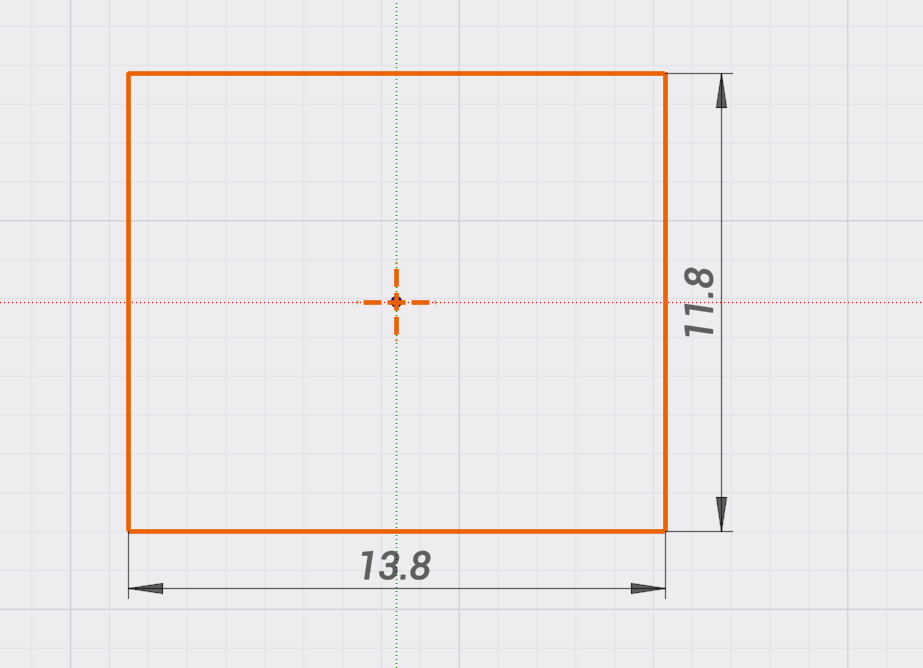

<strong>寸法</strong> 正方形にするには、寸法を1つだけ入力します。(例 67.5 67)

<strong>中心点</strong> 座標で点を指定できます。

<strong>ホットキー</strong>

<strong>マウス右クリック:</strong> 終了します。

<strong>円</strong> 中心から円を描画します。

1. 円の中心点をクリックします。

2. 円上の点をクリックするか、上のフィールドに円の大きさを入力します。

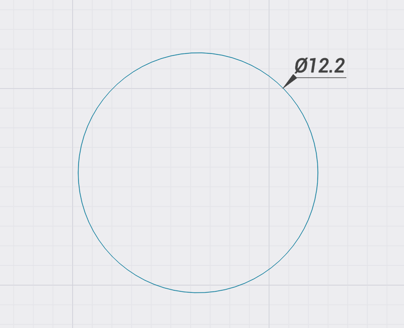

<strong>直径</strong> 円の直径を指定します。

<strong>中心点</strong> 座標で点を指定できます。

<strong>ホットキー</strong>

<strong>Shiftを押しながら</strong> 線分をクリックすると、セグメントに接する円を作成できます。

<strong>Ctrlを押したまま</strong> にすると、同じ直径の円を複数作成できます。

他の図形に接する円を描きます。

<strong>Shiftを押しながら線、円弧、円、または点をクリック</strong> すると、それらの要素に接する円を描画することができます。

必要に応じて、上部のフィールドに円のサイズを入力します。

<strong>マウス右クリック:</strong> 終了します。

<strong>スロット直線</strong> 2点間にスロット直線を描画します。

1. スロットの最初の点をクリックします。

2. スロットの2点目をクリックします。

3. スロットの幅を定義するには、スロットの外周上の点をクリックします。

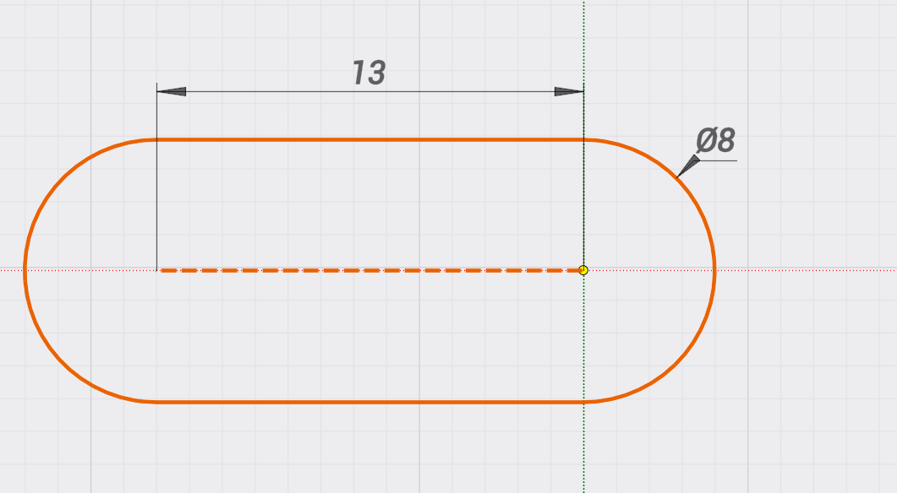

<strong>ホットキー</strong>

<strong>マウス右クリック</strong>: 終了します。

<strong>円形スロット</strong> 中心点から円形スロットを描画します。

1. スロット円弧の中心点をクリックします。

2. スロット円弧の最初の点をクリックします。

3. スロット円弧の2点目をクリックします。

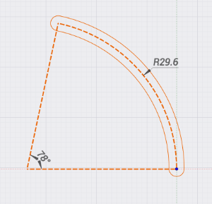

<strong>ホットキー</strong>

<strong>マウス右クリック:</strong> 終了します。

<strong>オフセット</strong> 選択した要素のオフセットを設定できます。

<strong>左</strong> 輪郭線の左側にオフセットを設定できます。

<strong>右</strong> 輪郭線の右側にオフセットを設定できます。

<strong>両方</strong> 輪郭線の左と 右 にオフセットを設定できます。

<strong>距離</strong> 輪郭線を移動させる距離です。

<strong>ロールコーナー</strong> オフセットした輪郭の角を丸めることができます。

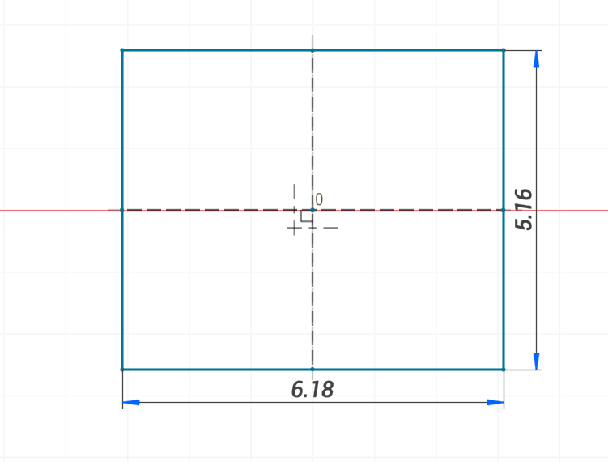 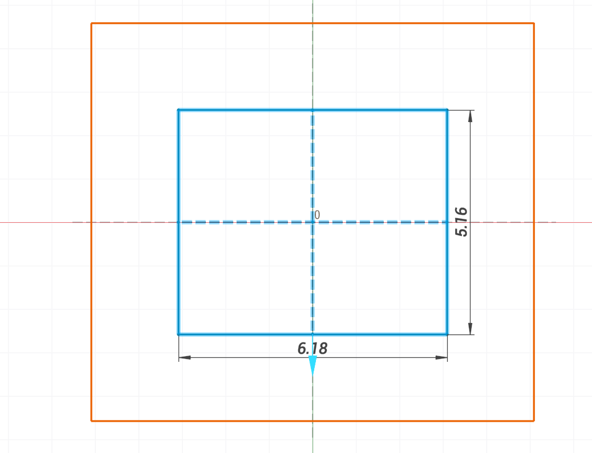

<strong>ホットキー</strong>

<strong>輪郭を選択し、Ctrlを押しながら</strong>希望する方向にドラッグします。

<strong>マウス右クリック:</strong> 終了します。

<strong>ポリゴン</strong> 最初に中心点を指定して、多角形を描画します。

1. 上のフィールドに多角形の辺の数を指定します。

2. 多角形の中心点をクリックします。

3. 多角形の外周点をクリックします。

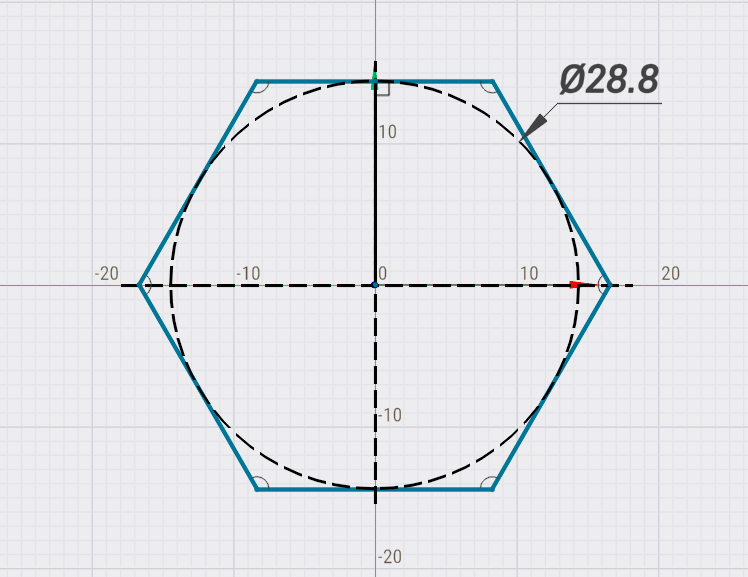

<strong>側面上の 2 点目</strong> 2つ目の点は辺上に配置されています。

<strong>コーナーの2点目</strong> 2点目はコーナーに配置されています。

<strong>多角形の辺の数</strong> 辺の数を指定します。

<strong>ホットキー</strong>

<strong>マウス右クリック:</strong> 終了します。

<strong>フィレット/面取り</strong>スケッチのフィレットと面取りを作成します。

フィーチャーを挿入したいスケッチ要素にマウスカーソルを合わせてクリックします。

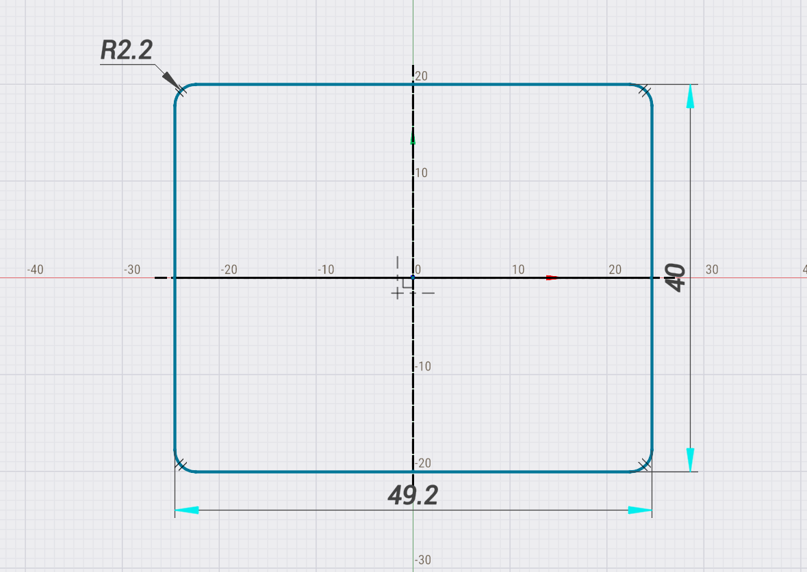 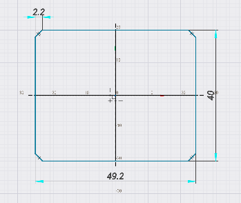

<strong>半径/サイズ</strong> 要素のサイズを定義します。

<strong>ホットキー</strong>

<strong>Space</strong>を押すと、 フィレットと面取りを切り替えることができます。

[Ctrl] キーを押しながらマウスホイールを回転させると、フィーチャーのサイズを拡大／縮小できます。

<strong>マウス右クリック:</strong> 終了します。

<strong>オブジェクトをインポート</strong> スケッチに参照図形をインポートします。

面、カーブ、エッジをクリックするとスケッチに投影されます。インポートされた要素には色が付けられています。

スケッチから参照形状を削除します。インポートされた要素をクリックすると、スケッチから削除されます。

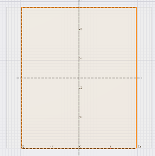 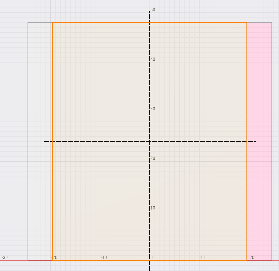

<strong>ホットキー</strong>

<strong>マウス右クリック:</strong> 終了します。

<strong>トリム</strong> 輪郭の一部を切り取ります。

トリムしたい要素にマウスカーソルを合わせてクリックします。削除される要素はハイライト表示されます。

注意：このツールは、他の要素と交差する要素をトリムするために使用します。他の要素と交差しない要素を削除するには、[Del]キーを使用してください。

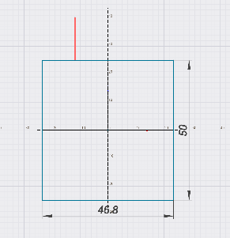 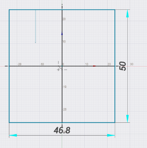

<strong>ホットキー</strong>

<strong>マウス右クリック:</strong> 終了します。

<strong>寸法</strong> スケッチに寸法を追加します。

マウスで1つまたは2つの要素を選択して、寸法を追加します。寸法のタイプは、選択した要素のタイプに基づいて自動的に決定されます。

この方法で、直線、半径、直径、角度の寸法を追加することができます。

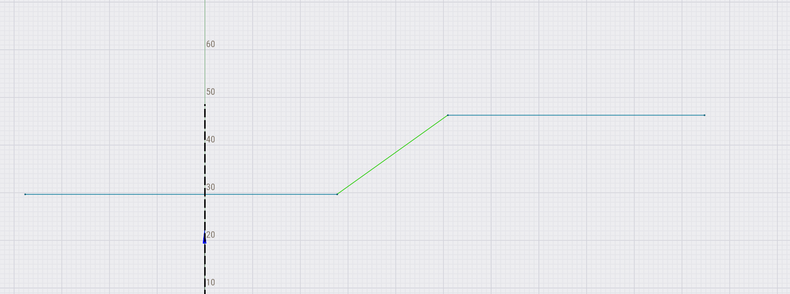 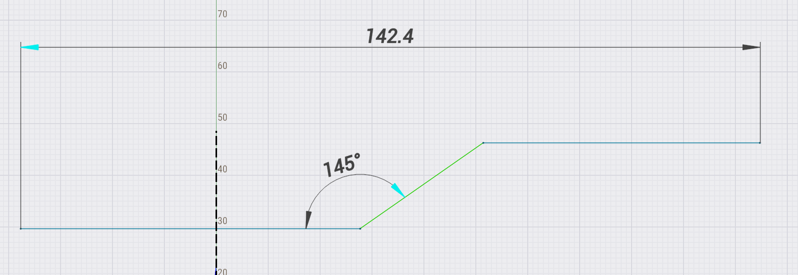

<strong>ホットキー</strong>

<strong>マウス右クリック:</strong> 終了します。

<strong>ミラー</strong> 選択したスケッチ要素をミラーします。

スケッチの線を対称軸として、マウスで選択します。

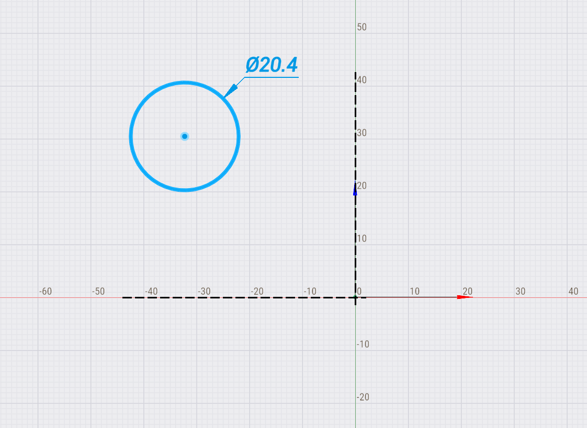 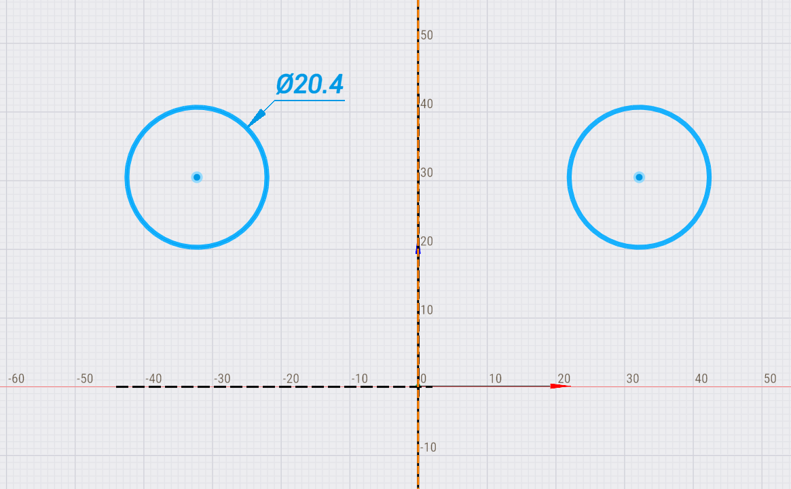

<strong>ホットキー</strong>

<strong>マウス右クリック:</strong> 終了します。

<strong>円形パターン</strong> 選択した要素の円形パターンを作成します。

1. 上部のフィールドにコピーする数を入力します。

2. スケッチ上の点を選択して、パターンの中心点を定義します。

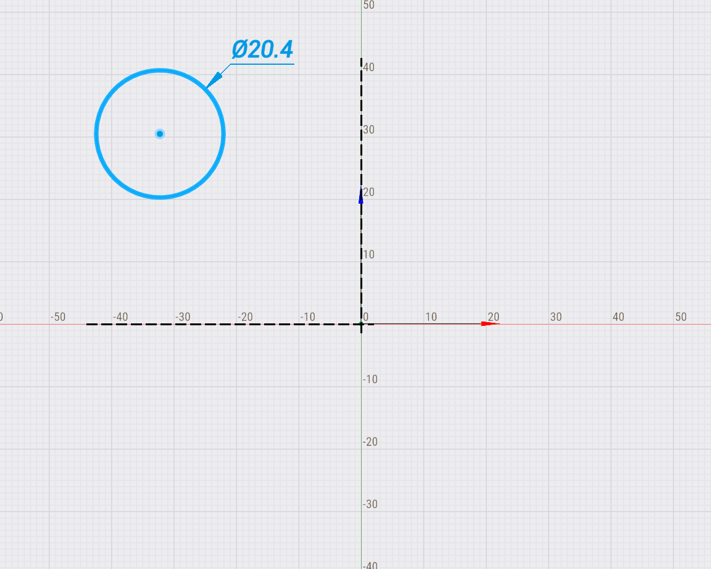 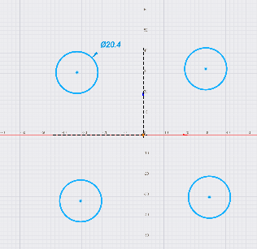

<strong>コピー数</strong> コピーする要素の数を指定します。

<strong>ホットキー</strong>

<strong>マウス右クリック</strong>: 終了します。

<strong>テキスト</strong>カスタムテキストを作成できます。

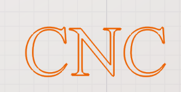

<strong>ヘリクサルギア</strong> ギアプロファイルを作成できます。

<strong>ヘリックの角度</strong> 平歯車 またはヘリカルギアを 3D モデルで選択するための角度を設定します。

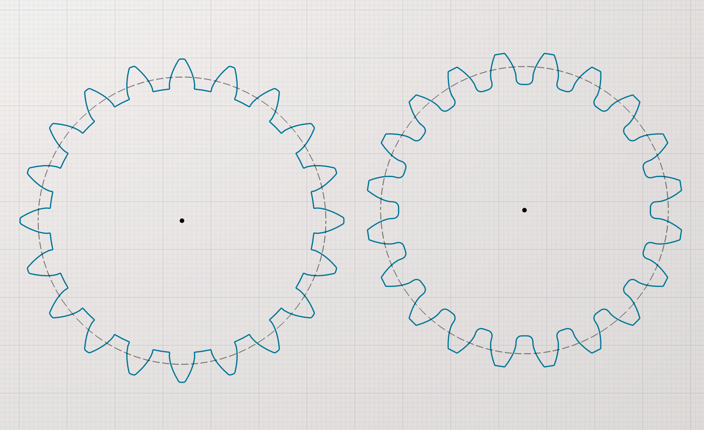

<strong>Mill プロファイル</strong> カッターのプロファイルを作成できます。

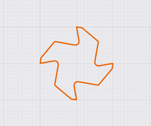

<strong>デカール画像を挿入</strong> 画像を挿入して輪郭を描くことができます。

<strong>開く</strong> <strong>*.gsf</strong> 形式の図面を読み込むことができます。

<strong>名前を付けて保存：</strong>図面を <strong>*.gsf</strong> 形式で保存できます。

### 図面作成主要機能

詳細を表示

<strong>作図モードで曲線を選択すると、（左クリックまたは右クリック）、線種の変更や拘束の設定など、さまざまな設定を行うことができます。</strong>

作図モードでは、3つの主線を選択できます。

- <strong>メイン</strong> - パーツとその表示面を描画するために使用します。

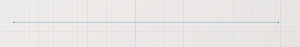

- <strong>構築</strong> - オブジェクトの見えない輪郭を表す線です。

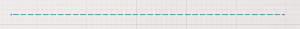

- <strong>中心線</strong> - 軸線および円の中心線の指定

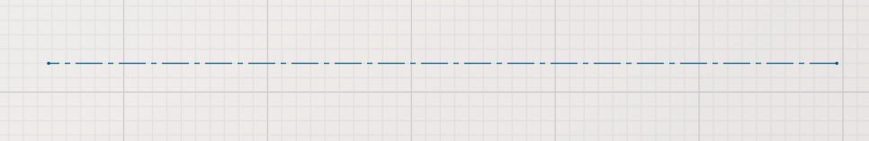

<strong>ロックポジション</strong> 角度や寸法などの制限を設定できます。これにより、オブジェクトは空間内で動かなくなります。

<strong>ロック角度</strong> 要素の角度を制限することができます。

<strong>水平にする</strong> 曲線を水平にします。対象の曲線が輪郭の一部でも使用できます。

<strong>中心線</strong> 円/半径の中心線を設定できます。

<strong>寸法</strong> 寸法を設定できます。原則として、寸法は図面の原点（ゼロ点）から対象要素までの寸法が設定されます。

<strong>ディフィーチャー</strong> 要素を除外することができます。（複合図形、輪郭など）

<strong>複数の要素（例えば2つの線分）を選択すると、次の拘束を使用できます。</strong>

<strong>制限を解除するには、制限記号を選択してDELキーを押してください。</strong>

<strong>等長</strong> 長さを制限します。（2つのセグメントの長さが等しくなる）。<strong>等号</strong>で示されます。

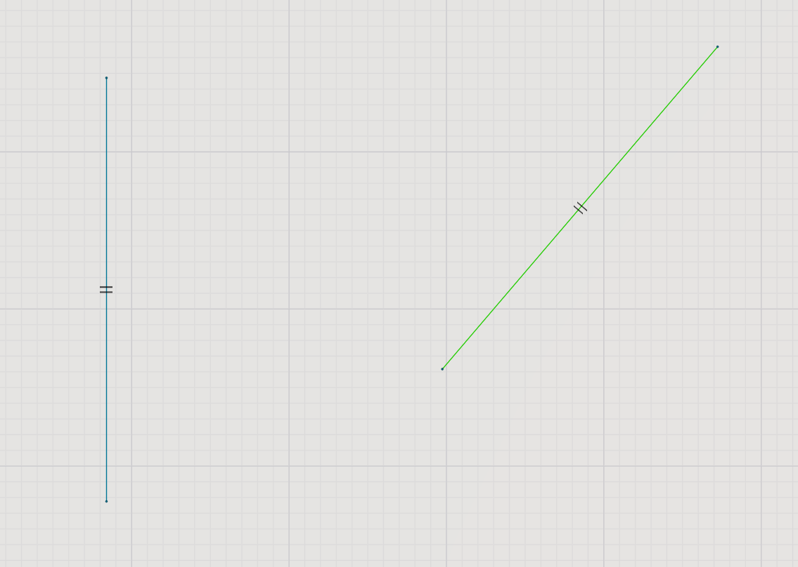

<strong>平行</strong> 2つの要素を平行にします。いずれかの要素を選択すると、制限記号が表示されます。

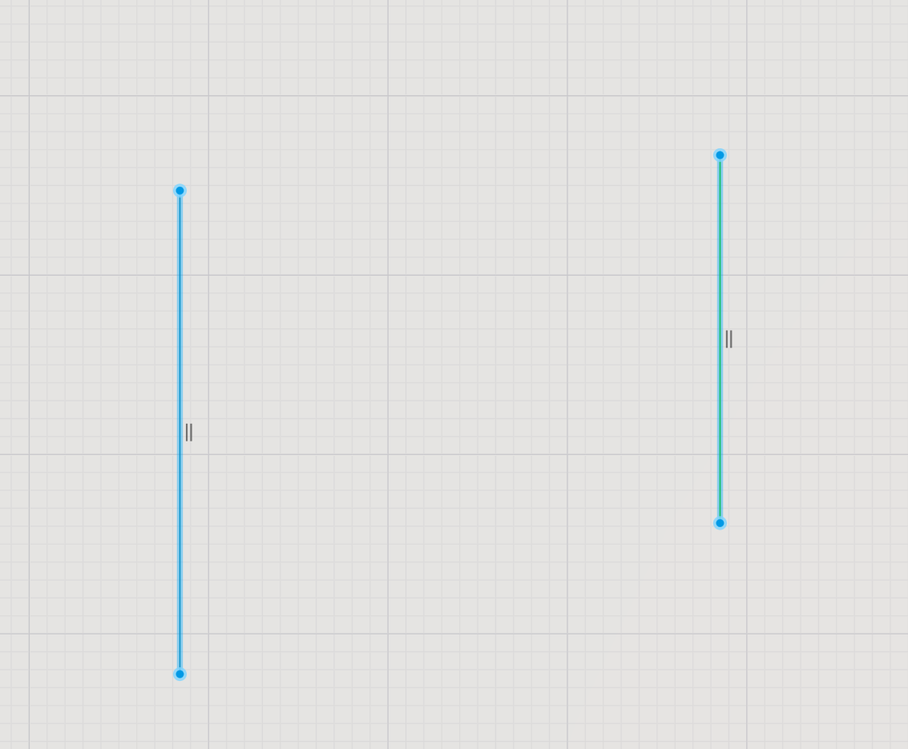

<strong>垂直</strong> 2つの要素を垂直にします。

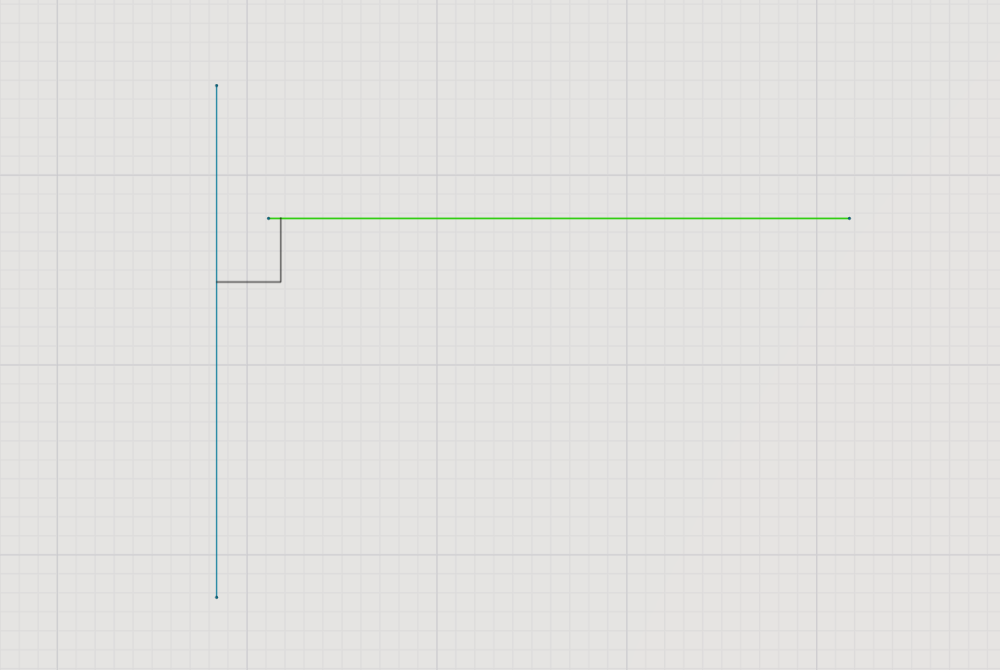

<strong>同一線上</strong> 1本の直線に2つのカーブを配置できます。

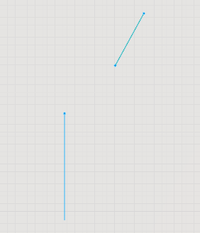 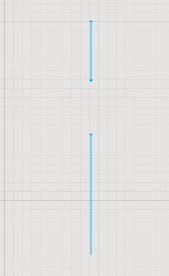

<strong>図面作成では、さまざまなキー操作も積極的に活用されます。</strong>

- 移動するには、要素を選択し、Shiftキーを押しながらドラッグします。

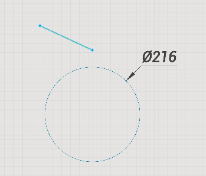 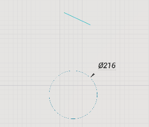

コピーを作成するには、要素を選択します。点をつかんで、Ctrlキーを押します。

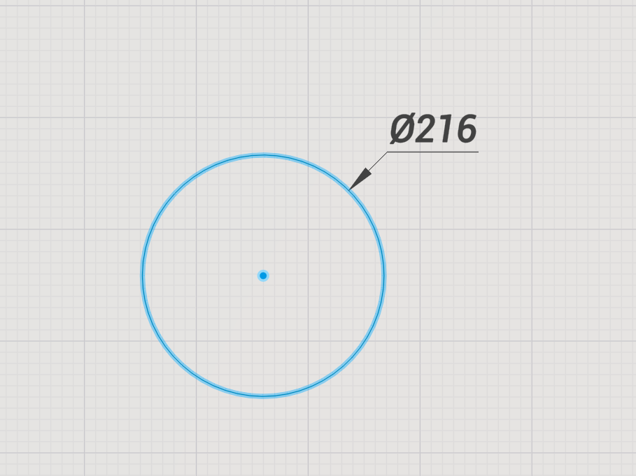 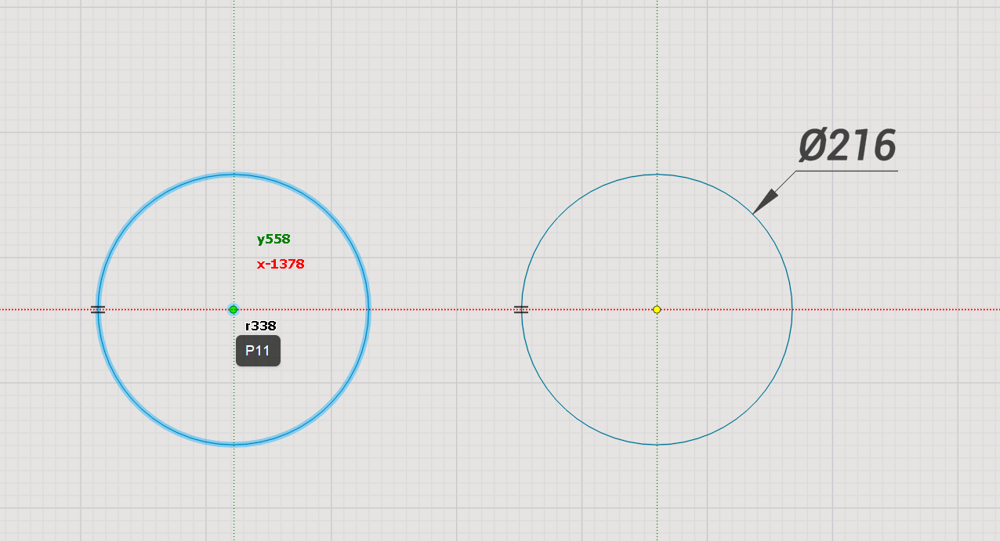

移動するには、要素をつかんでCtrlキーを押します。

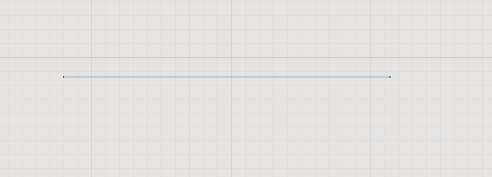 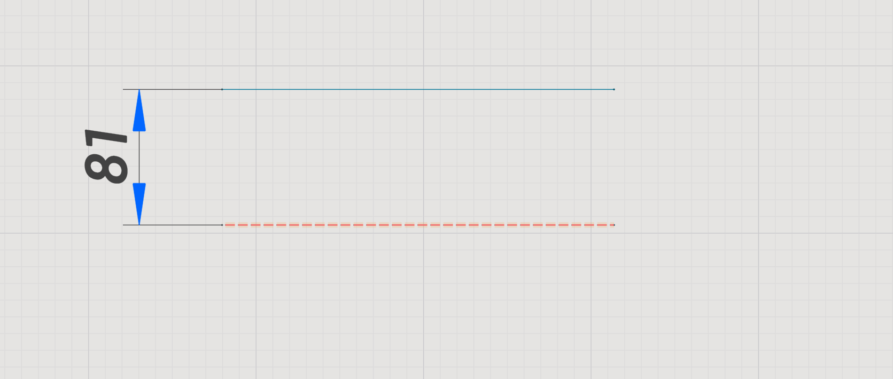

