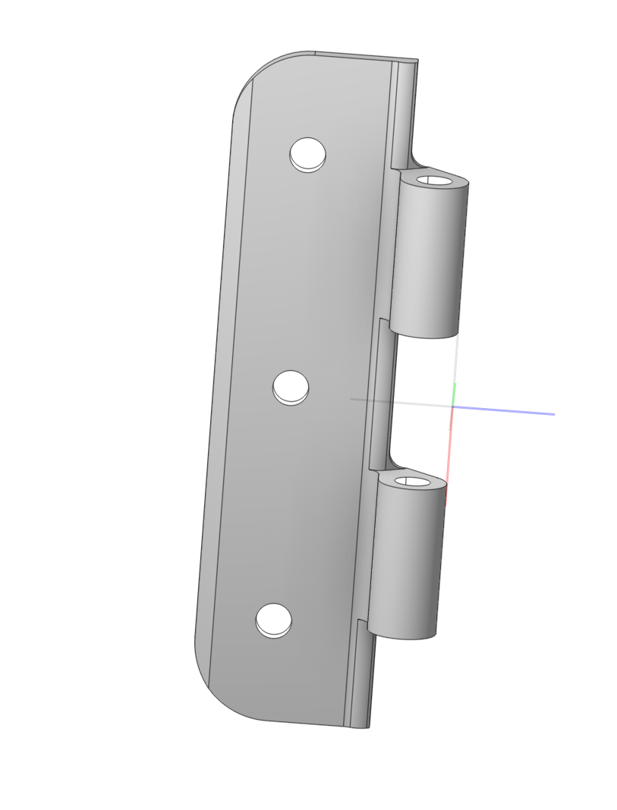
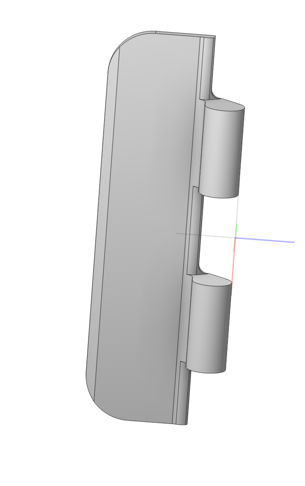
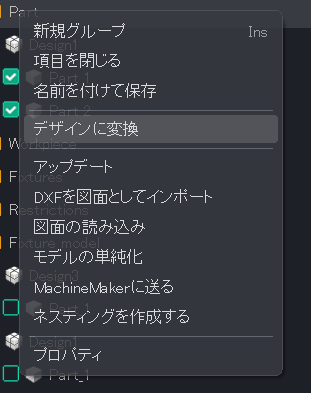
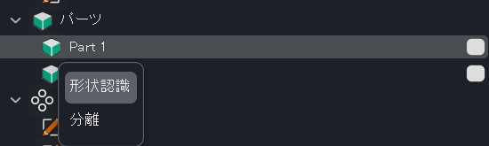
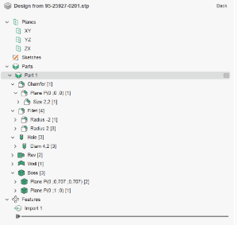
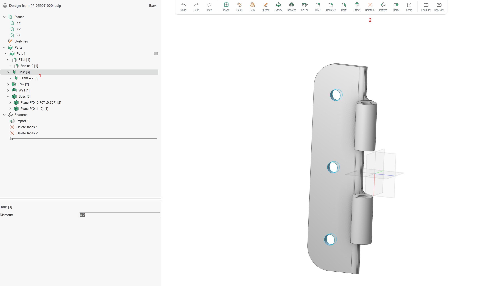
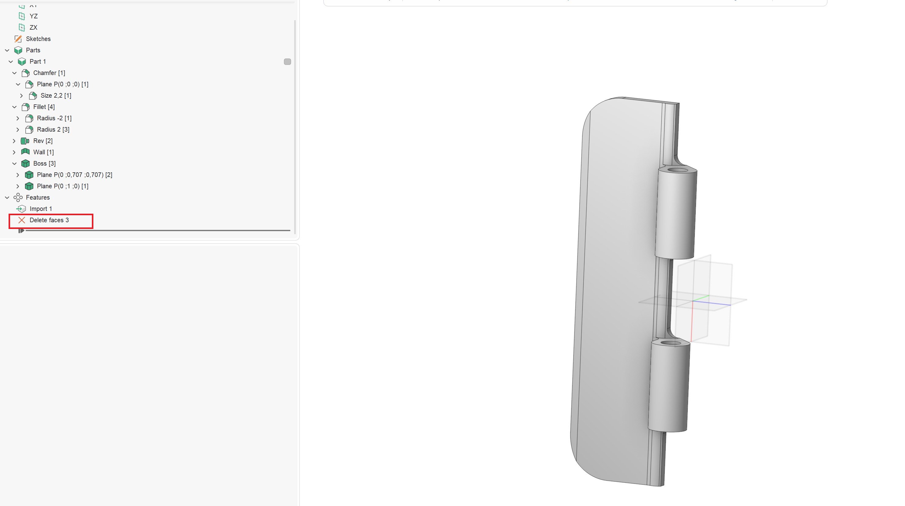
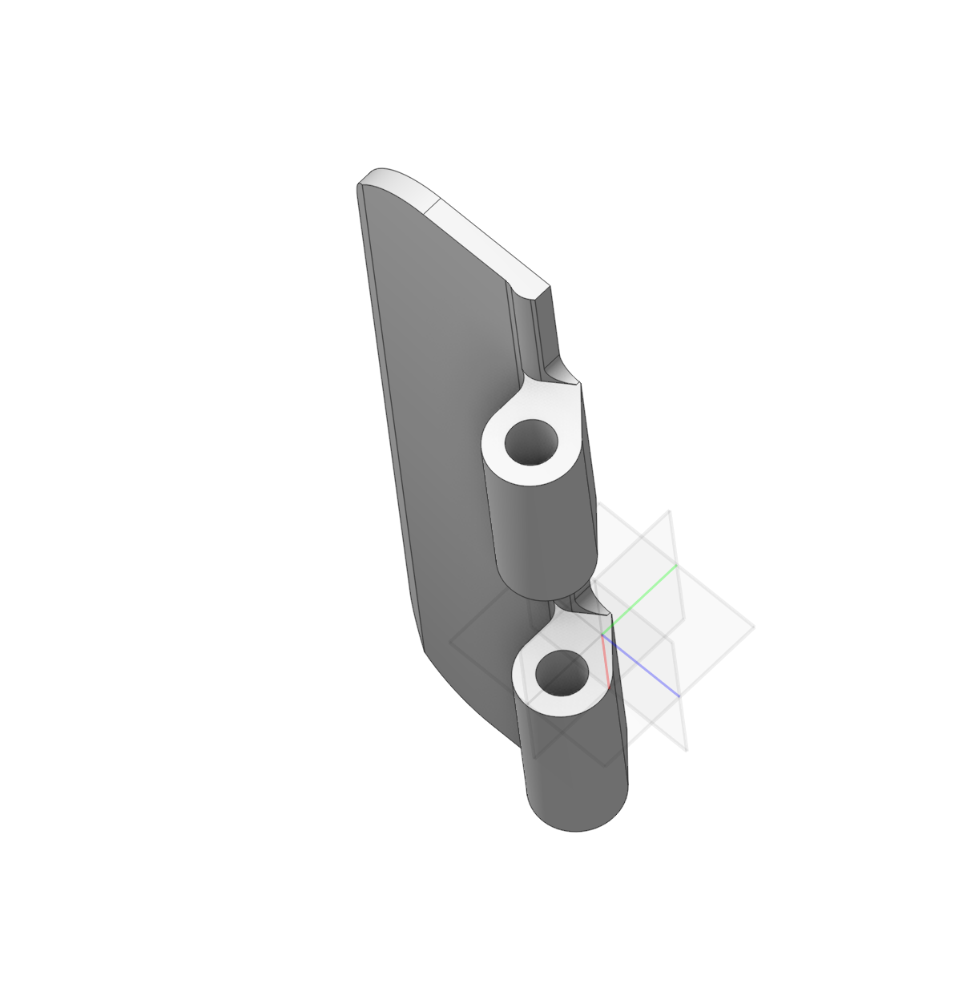
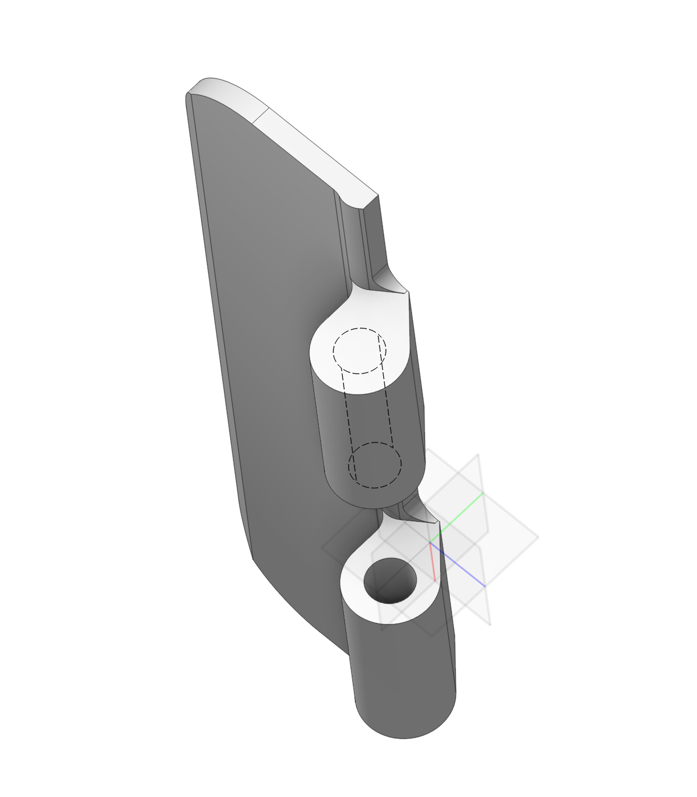

# 3Dモデルからブランクを作成する方法

 

## 適用分野：

この機能を使用することで、ブランクを素早く作成したり、モデルを簡略化（穴やポケットの削除など）して加工を単純化したりできます。 <strong>他のCADシステムからの外部ファイルにも対応しています。</strong>

<strong>例</strong>：後続の加工で使用するため、外部ファイルから素材（ブランク）を作成する

1. 3DモデルをCAMシステム形式に変換します。 モデルツリーでモデルを右クリックし、 <strong>デザインに変換</strong> を選択します。

 

2. <strong>デザイン</strong>モードでモデルを開いたら、構築ツリーでモデルを右クリックし、 <strong>形状認識</strong>を選択します。

3. これにより、穴やポケットなどの典型的なフィーチャーが構築ツリー内でハイライト表示されます。

4. <strong>delete</strong>または<strong>offset</strong>ツールを使用して、条件に合ったワークを作成できます。

 

別のサーフェスを選択して簡略化することもできます。 <strong>サーフェスを除去</strong> 機能を使用してください。

 

サーフェスをオフセットする必要がある場合は、<strong>オフセット</strong>機能を使用してください。

  
