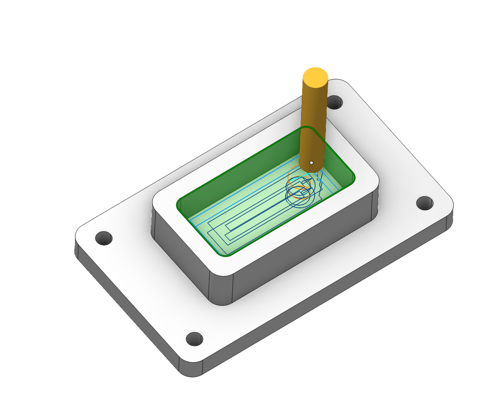
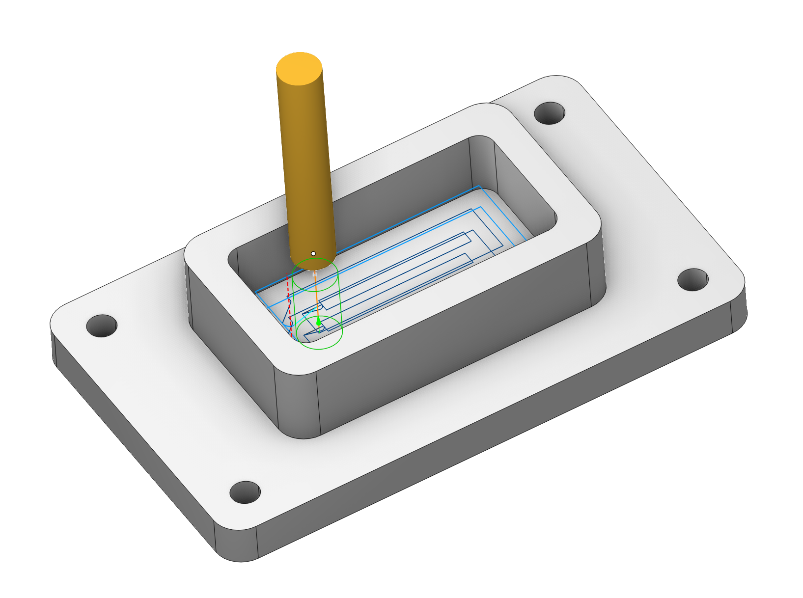
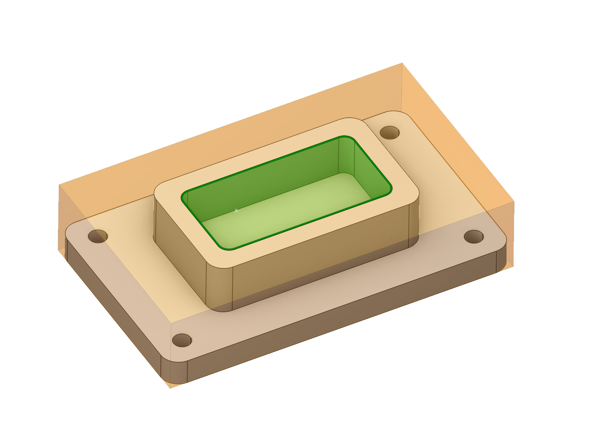
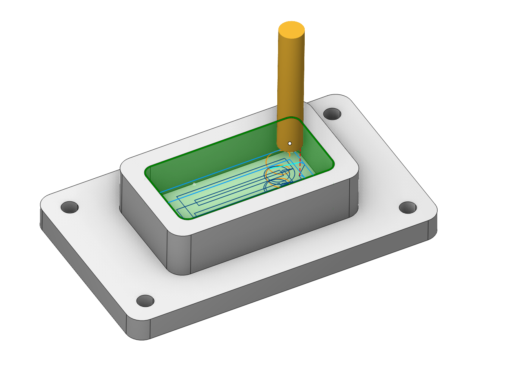
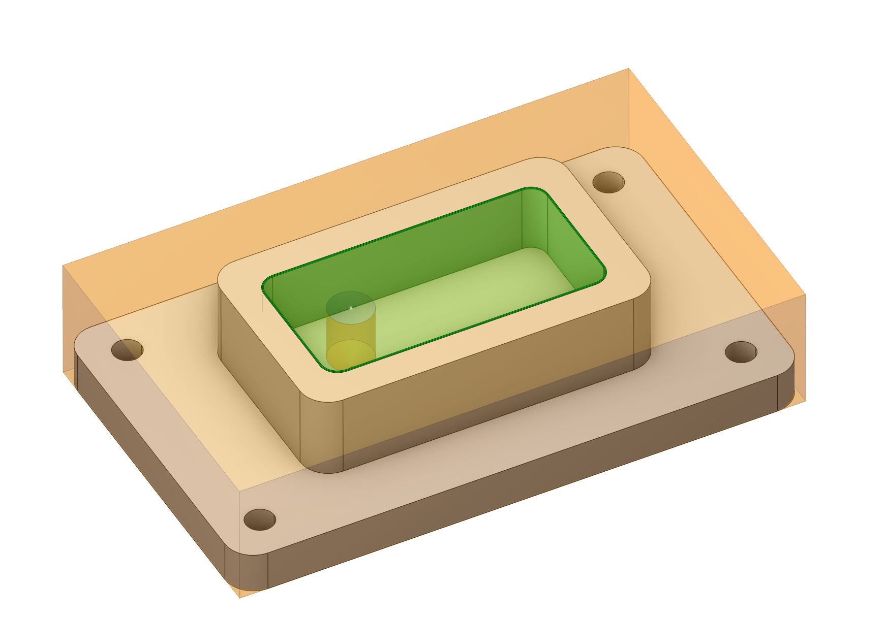
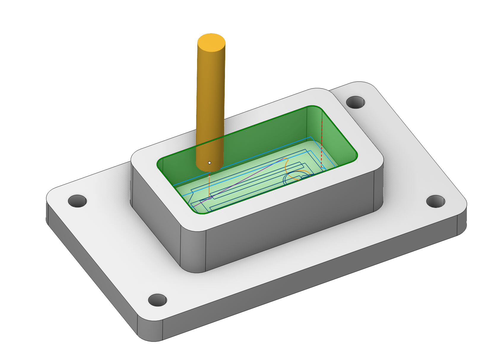
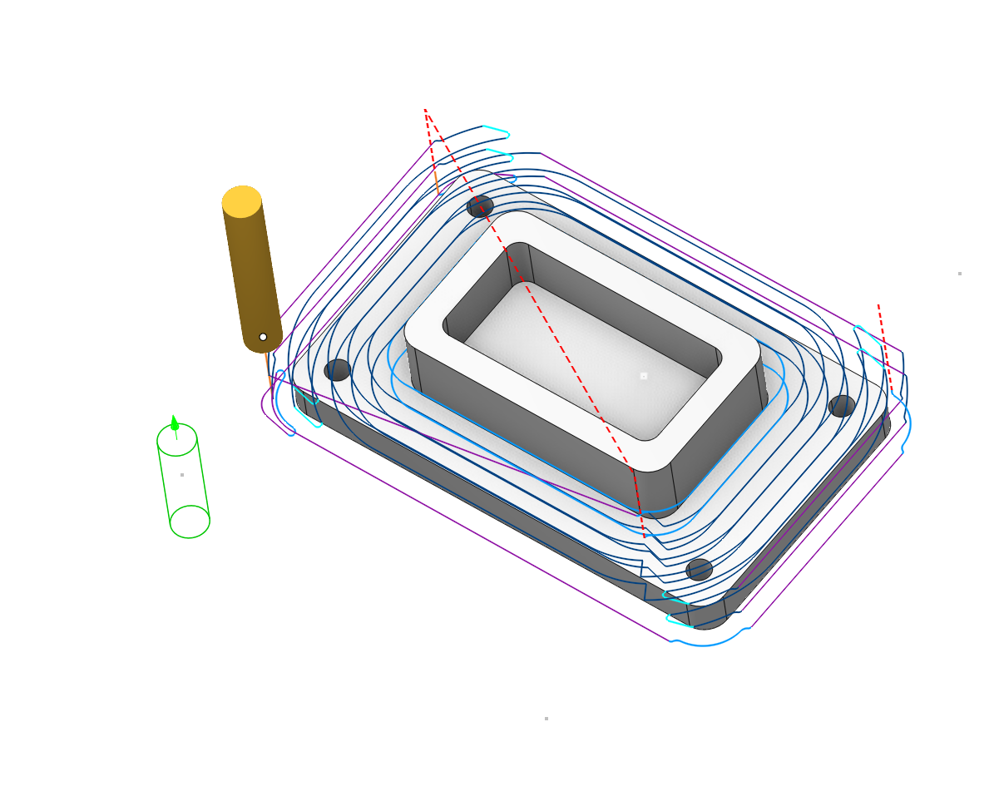
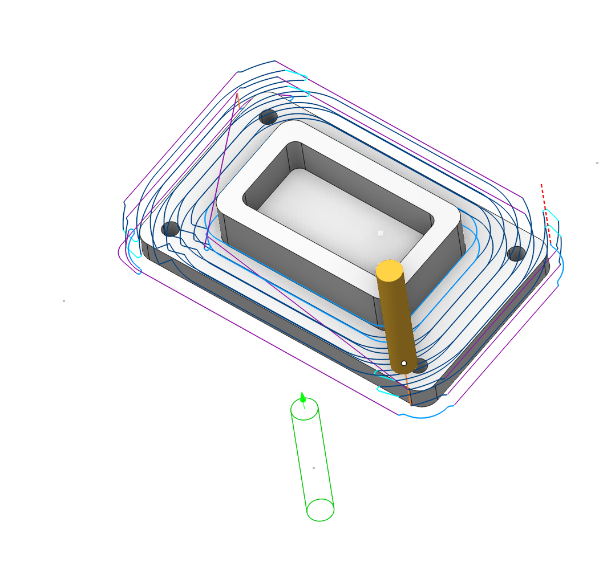

# Bohrungen und Einfahrpunkte

 

## Anwendungsbereich:

Beim **Wasserlinien-Schruppen** ([Details](736.md)) und **Taschenfräsen** ([Details](256.md)) kann das Werkzeug über eine geeignete Vorbohrung einfahren, wenn der Bearbeitungsbereich von außen nicht zugänglich ist. Alle Bohrpunkte des Bearbeitungsprozesses werden in einer gemeinsamen Liste mit Koordinaten, Bohrtiefe und Werkzeugdurchmesser gespeichert. Punkte können hinzugefügt oder entfernt werden.

## Bohrungen definieren:

**Center (Mittelpunkt).** Erstellt eine Bohrung anhand ihres Mittelpunkts.

**Create (Erstellen).** Erstellt eine Bohrung durch Koordinateneingabe. [Details](706.md)

**Recognize (Erkennen).** Erkennt Bohrungen im Bauteil automatisch. [Details](406.md)

**Pattern (Muster).** Erstellt eine Bohrungsanordnung nach einem Muster. [Details](407.md)

**Properties (Eigenschaften).** Öffnet die Elementeigenschaften. Der Dialog kann auch durch Doppelklick auf einen Listeneintrag geöffnet werden. [Details](706.md)

**Sorting (Sortierung).** Sortiert die Bohrungsliste anhand der gewählten Parameter. [Details](10158.md)

**Delete (Löschen).** Entfernt einen Eintrag aus der Liste.

Beim Ausräumen eines abgeschlossenen Bereichs, beispielsweise einer auf der aktuellen Ebene von außen nicht zugänglichen Tasche, sucht das System zunächst anhand von Koordinaten, Tiefe und Durchmesser nach einem geeigneten Listenpunkt. Ist keiner vorhanden, wird automatisch ein neuer Punkt berechnet und in die Liste aufgenommen.

**Beispiel:**

Das Projekt enthält nur die Operation **Roughing waterline**.

 

Das Projekt enthält zunächst **Hole Machining** und anschließend **Waterline Roughing**.

 

*Hinweis: Sollen genau festgelegte Bohr- bzw. Einfahrpunkte verwendet werden, müssen sie mit ihren Parametern vor dem Berechnen der Operation in die Liste eingetragen werden.*

Die Punkte der gemeinsamen Liste können als Eingabedaten für die Bohrungsbearbeitung verwendet werden.

Punkte außerhalb der Rohteilgrenzen dienen beim Wasserlinien-Schruppen und Taschenfräsen als bevorzugte Absenkpunkte außerhalb des Materials. Ist der Bearbeitungsbereich von außen zugänglich, sucht das System einen geeigneten Listenpunkt anhand seiner Koordinaten, der zulässigen Absenktiefe und des maximalen Abstands zum Bearbeitungsbereich, der durch den Durchmesser bestimmt wird. Bei mehreren geeigneten Punkten wird der nächstgelegene verwendet. Gibt es keinen geeigneten Punkt, wird die Absenkposition automatisch frei gewählt.

 
