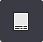
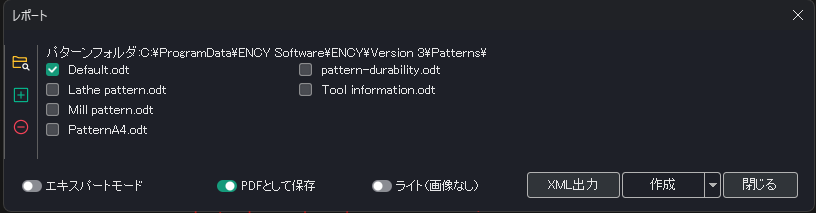
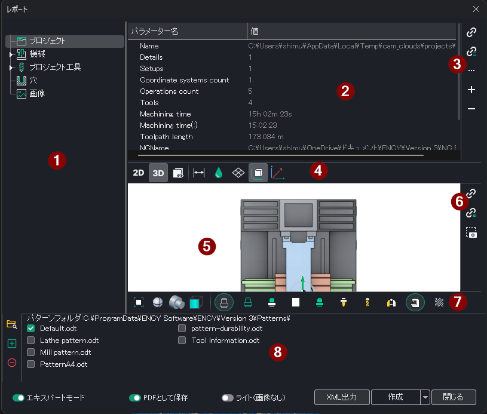
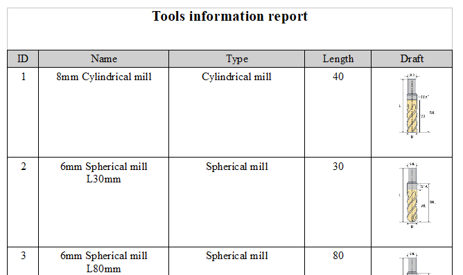
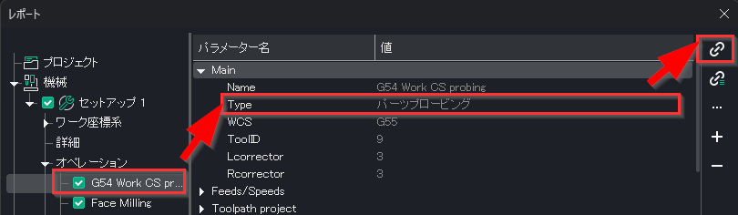
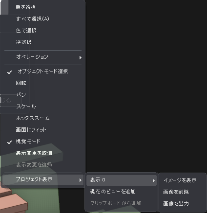

# Bearbeitungsbericht

Das System erstellt Bearbeitungsberichte, die in einem ODT-fähigen Textverarbeitungsprogramm bearbeitet werden können. Die Ausgabe erfolgt als **ODT** oder **PDF**; für die PDF-Ausgabe ist eine Internetverbindung erforderlich. Das Programm zum Öffnen des Berichts wird in den Einstellungen festgelegt.

Öffnen Sie die Berichtserstellung über  auf der Registerkarte **Machining**.

Standardmäßig zeigt der Hauptbereich die Vorlagen aus dem Vorgabeordner. Mehrere Vorlagen können gemeinsam ausgewählt werden, um die entsprechenden Berichte in einem Schritt zu erstellen.

Rechts befinden sich Schaltflächen zum Hinzufügen und Entfernen von Vorlagen sowie zum Ändern des Vorgabeordners.

**Save as PDF.** Wählt PDF als Ausgabeformat; eine Internetverbindung ist erforderlich.

**Expert mode.** Öffnet die vollständige Ansicht zum Erstellen und Bearbeiten von Vorlagen sowie zum Anpassen weiterer Berichtsparameter.

Die vollständige Ansicht enthält folgende Bereiche:

1 – Projektbaum mit den für den Bericht verfügbaren Informationen.

2 – Parameter des ausgewählten Elements. Diese Werte können in eine Berichtsvorlage übernommen werden.

3 – Schaltflächen zum Erstellen und Bearbeiten der Vorlage:

-  Erzeugt einen Vorlagenbefehl für einen einzelnen Parameter.

-  Erzeugt einen Vorlagenbefehl zur Ausgabe eines Parameters als Wertefolge.

-  Öffnet zusätzliche Befehle.

-  Fügt einen benutzerdefinierten Parameter hinzu.

-  Entfernt einen benutzerdefinierten Parameter.

4 – Einstellungen für die im Bericht ausgegebenen Bilder.

Das System wählt die Ansicht und erzeugt Bemaßungen automatisch. Maße werden nur in den Ansichten von oben, unten, links, rechts, vorn und hinten angezeigt. Dargestellt werden drei Abstände zum Ursprung und drei Gesamtabmessungen.

5 – Grafikfenster mit dem Bild des im Baum ausgewählten Elements.

6 – Weitere Schaltflächen zum Erstellen und Bearbeiten von Berichtsvorlagen.

7 – Einstellungen für Zeichnungsansichten. Rohteil, Ausgangsmodell, Werkzeugbahn, Ursprung und Achsen können über die entsprechenden Schaltflächen eingeblendet werden.

8 – Vorlagenliste.

Wählen Sie Vorlagen aus und klicken Sie auf . Das Programm zum Öffnen der ODT-Ausgabe wird in den Einstellungen festgelegt.

*Hinweis: Soll der Bericht später erneut verwendet werden, muss er manuell gespeichert werden.*

Beispiel eines erzeugten Berichts:

## Berichtsvorlagen erstellen und bearbeiten.

Verschiedene Vorlagen ermöglichen eine flexible Gestaltung von Inhalt und Format.

Die Vorlage wird direkt in einem Textverarbeitungsprogramm mit ODT-Unterstützung bearbeitet.

Platzhalter für die Werteersetzung werden ausschließlich in Kommentarobjekten der Vorlage angegeben.

Für eine Variable wird ihr vollständiger Pfad in der Struktur der stcx-Datei benötigt. Die Schaltflächen in den Bereichen 3 und 6 der vollständigen Ansicht erzeugen die entsprechenden Angaben.

Um beispielsweise den Operationstyp auszugeben, erstellen Sie einen Kommentar in der Vorlage (**Ctrl + Shift + C**) und führen Sie im Berichtsfenster die folgende Aktion aus:

Der erzeugte Befehl gibt im Beispiel den Wert **Roughing waterline** im Bericht aus.

Andere Werte werden auf dieselbe Weise eingefügt.

Benutzerdefinierte Variablen werden mit folgender Syntax beschrieben:

**VAR** (**Variable Name**, **Title**, **Default Value**).

Beispiel:

`VAR (Detail, Detail, Case)`

Nach Auswahl einer Vorlage werden die verfügbaren Variablen im RTK-Fenster angezeigt.

Eine Variable kann an beliebiger Stelle der Vorlage definiert werden. Der Aufruf hat folgendes Format:

`${Variable name}`

Beispiel:

`${Detail}`

*Befehle und Variablen dürfen ausschließlich in Kommentarobjekten stehen.*

Für Bilder stehen eigene Befehle zur Verfügung.

**Vorlagenbilder verwenden**

Fügen Sie ein Bild in das Dokument ein und legen Sie dessen Format und Eigenschaften fest. Bei der Berichtserstellung wird nur die Bildquelle ersetzt; die eingestellten Eigenschaften bleiben erhalten.

In OpenOffice wird der Bildausgabebefehl beispielsweise im Feld **Name** auf der Registerkarte **Settings** eingetragen.

Die Projektbilder werden über **Project Views** im Kontextmenü des Grafikfensters verwaltet.

**Add current view.** Erstellt ein Bild der aktuellen Ansicht und fügt es zu den Projektbildern hinzu.

**Add from clipboard.** Fügt ein Bild aus der Zwischenablage zu den Projektbildern hinzu.

Vorhandene Bilder können angezeigt und gelöscht werden.

Beim Löschen werden die Indizes der übrigen Bilder nicht verschoben.

Die mitgelieferten Beispiele und Lektionen zur Berichtserstellung erläutern den Aufbau solcher Vorlagen.
