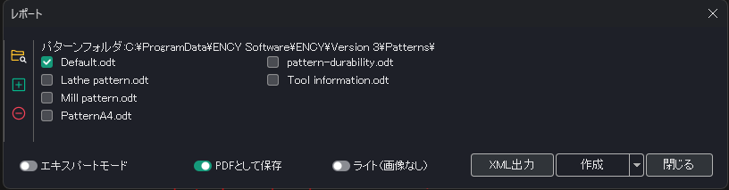
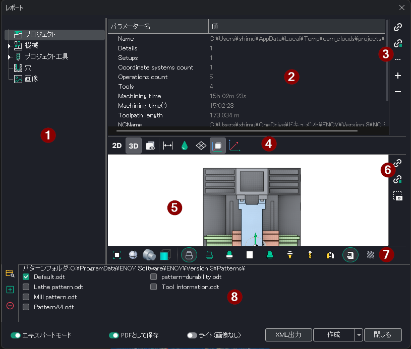
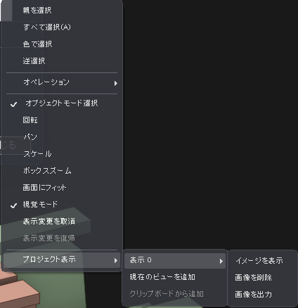

# Machining report



## Application area:

A machining report is a document generated from project data using an ODT pattern. Reports can contain operation sheets, setup sheets, tool lists, hole coordinates and machining times. The output format is ODT or PDF.

Use reports to print setup instructions for a machine operator, prepare a tool list for the tool room, or produce documents in your company's format using a custom pattern. Several patterns can be selected at once: a separate report is generated for each pattern in sequence.

## Creating a report:

1. Click **Reports** in the machining process window. [Details](88.md).
2. Select the check boxes next to the required patterns.
3. Enable **Save as PDF** if PDF output is required.
4. Click **Create**.

The report is created in the application's temporary folder as `<project>_<pattern>.odt` or `<project>_<pattern>.pdf`. Windows opens it using the default application for the file type.

**Saving the report.** Save a copy if the document is needed later. The temporary folder is cleared when another report is generated and when the **Reports** window closes. To specify the destination and file name before generation, open the menu on **Create** and select **Save as...**. The report then opens from the selected location.

PDF conversion uses the built-in converter and does not require LibreOffice. The converter supports JPEG images and uses fonts installed in Windows. If conversion fails, the ODT document opens instead. To edit an ODT report or pattern, use an editor that supports ODT.

## The Reports window:

**Patterns.** Lists ODT files from the patterns folder and files added individually. Select the check boxes to include patterns in generation. The window remembers selected patterns and manually added files. Only ODT patterns are supported.

**Patterns folder.** Displays the folder path in expert mode. The standard folder is `C:\ProgramData\ENCY Software\ENCY\Version 3\Patterns`.

<details>
<summary>Click here to expand..</summary>

- **Change folder.** Selects another folder containing patterns.
- **Add pattern file.** Adds an ODT pattern from any folder to the list.
- **Remove pattern.** Removes a manually added pattern from the list without deleting its file. This command is unavailable for patterns loaded from the patterns folder.

</details>

**Pattern vars.** Appears when a selected pattern declares `Var` variables. Enter their values before generating the report. **Reset values** in the panel's context menu restores the defaults from the pattern.

**Save as PDF.** Generates PDF output instead of ODT.

**Expert mode.** Expands the window to inspect project data, prepare pattern commands and configure report images.

**Light (no images).** Generates reports without images to reduce generation time.

**Export XML.** Saves the report's project data to an XML file with an accompanying image folder. Use this export to inspect data paths when editing patterns or to process data in another application. If **Use external STCX-editor** is enabled and an editor is configured in the system settings, the exported file opens in that editor.

**Create.** Generates reports from the selected patterns. Its **Save as...** menu specifies the output location.

**Close.** Closes the window.

## Supplied patterns:

The available set depends on the installed version. Check the **Patterns** folder for the actual files.

| Pattern | Contents |
| --- | --- |
| `Default.odt` | Project, setups and operations, tools, and holes with coordinates. |
| `Lathe pattern.odt` | Turning sheet with cutting conditions, inserts and tool overhang. |
| `Mill pattern.odt` | Milling sheet with feeds, spindle speeds, cutter parameters and three project images. |
| `Tool information.odt` | Tools used by operations, including diameter, tooth count, feed per tooth, step and toolpath length. |
| `pattern-durability.odt` | Operation and tool information, spindle speed and operation levels. |
| `PatternA4.odt` | A4 sheet with the machine, operations, tools and machining times. |

## Expert mode:

Select **Expert mode** to display the data tree, parameter table and image controls.



### Project data tree:

**Area 1.** Contains the project, machine, project tools, holes and images. Selecting an item displays its parameters in area 2 and its image in area 5. Clear an item's check box to exclude it from the report. Disabled operations are excluded from report data.

### Item parameters:

**Area 2.** The **Parameter name** and **Value** columns show the selected item's data available for output in the report.

### Pattern commands:

**Area 3.** Provides commands for preparing patterns. A generated command is copied to the clipboard; paste it into a comment in the ODT pattern.

<details>
<summary>Click here to expand..</summary>

- **Make link to parameter.** Copies a command that outputs the selected value.
- **Make link for parameter in array.** Copies a command with `ForEach` to output values from a collection, such as operations, tools or setups.
- **Additional commands.** Opens commands for tables, value formatting, dates, variables and placeholder images. Their use is described under **Creating and editing patterns** below.
- **Add custom parameter.** Adds a project-stored field to the selected item, such as a drawing number or an operation note. Specify an English identifier, caption and value.
- **Remove custom parameter.** Removes the selected custom field.

</details>

### Image settings:

**Area 4.** Controls the images included in the report.

<details>
<summary>Click here to expand..</summary>

- **2D mode.** Uses a static custom image.
- **3D mode.** Generates an image from a 3D view.
- **View layout.** Selects one view, two horizontal or vertical views, three views and one large view, four equal views, or no views.
- **Dimensions.** Displays automatically placed dimensions in standard top, bottom, left, right, front and back views. Isometric views do not display dimensions. Up to six nonzero dimensions are shown: three overall dimensions and three distances from the model to the coordinate system origin.
- **Background.** Controls the image background.
- **Show CS.** Controls coordinate system visibility.
- **Show WCS.** Controls workpiece coordinate system visibility.
- **Ground plane.** Controls ground plane visibility.
- **Copy settings.** Applies the image settings to all operations.

</details>

### Graphic window:

**Area 5.** Previews the image for the selected tree item. The image tools load an external image, load an additional image, add text, clear the image, and save the view with or without scaling. Use the 2D or 3D mode appropriate for the image being prepared.

### Image references:

**Area 6.** **Make link to parameter** copies an image command for the selected item. **Make link for parameter in array** copies an image command for a collection. **Screen shot** captures the current view.

### Object visibility:

**Area 7.** Controls which objects appear in the image: part, workpiece, model, fixtures, job assignment, toolpath, tool, holder, machine and machining result. The panel also controls the display mode.

### Pattern list and list controls:

**Area 8.** Contains the patterns to generate. The adjacent folder, add and remove buttons manage this list. Their behavior is described under **The Reports window** above.

## Project views:

Open **Project Views** from the graphic window's context menu to manage images saved with the project.

**Add current view.** Creates an image from the current view. Specify its size in the dialog; the default is the graphic window size.

**Add from clipboard.** Adds an image from the clipboard.

**Saved views.** Each view has commands to show, delete or export its image. Selecting an occupied view slot offers to replace its image. Deleting an image leaves an empty slot; subsequent image indices do not change.

`ProjectImage[N]` accesses a project view by its zero-based index. For example, `ProjectImage[0]` refers to the first view. If no views have been saved, standard-view images are available for the report.



## Creating and editing patterns:

Prepare pattern commands using the **Reports** window: select an item and a parameter, click a link button, then paste the command from the clipboard into a Writer comment. The following examples use this workflow. The command reference at the end explains the syntax for inspecting or modifying existing patterns.

### Preparation:

1. Copy `Default.odt` under a new name and open the copy in LibreOffice Writer or OpenOffice Writer. Alternatively, create an ODT document with a table in the required format.
2. Open **Reports** and enable **Expert mode**. Keep the pattern open in Writer alongside the **Reports** window.
3. Place commands in comments where their values should appear. Use one command per comment line. Comments are removed from the generated report.

### Filling the report header:

Prepare a two-column table in Writer. In the left column, enter **Machine**, **NC program name**, **Project** and **Operation count**. The right column will contain values from the project.

1. Place the cursor in the cell next to **Machine** and select **Insert → Comment**. In LibreOffice and OpenOffice, the shortcut is **Ctrl+Alt+C**; another editor may use a different shortcut.
2. In **Reports**, select **Machine** in the tree (area 1), then **Name** in the parameter table (area 2).
3. Click **Make link to parameter**, the upper link button in area 3. The command is copied to the clipboard.
4. Return to the comment in Writer and press **Ctrl+V**. The pasted command is `ProjectXML.Machines.Name`.
5. Repeat the procedure for the other cells using the project parameters listed below. Create a separate comment in each destination cell.
6. Save the ODT pattern. If it is outside the patterns folder, add it using **Add pattern file**. Select its check box in **Reports**, click **Create**, and check the values in the generated document.

| Header field | Tree item | Parameter |
| --- | --- | --- |
| NC program name | **Project** | **NCName** |
| Project | **Project** | **Name** |
| Operation count | **Project** | **Operations count** |

To display the project file name without its folder path, apply **Extract file name** before pasting the command, as described under **Formatting a value** below.

### Creating a tool or operation list:

1. In Writer, create a table with a header row and one row for values. For a tool list, use columns such as **Number**, **Type** and **Comment**.
2. In the **Reports** tree, expand **Project tools**, select a tool, and select its number parameter in the parameter table.
3. Click **Make link for parameter in array**, the second link button in area 3.
4. Insert a comment in the **Number** cell of the data row and paste the command with **Ctrl+V**. The command is `ProjectXML.Tools.ForEach.Numbers.Number`.
5. Select the parameters for the other columns and repeat the same steps, using **Make link for parameter in array** for each column.
6. Save the pattern and generate a report. The data row repeats for each included tool.

**Make link to parameter.** Outputs the value of the selected item. For an item in a collection, the generated path identifies that item with an index such as `[N]`.

**Make link for parameter in array.** Outputs the value for every item in the collection. In a table, the data row repeats for those items.

Use the same procedure for an operation list: select an operation and its name, type or machining-time parameter, then copy an array link for each column. Disabled operations and unchecked tree items are excluded.

**Operations grouped by setup.** In **Additional commands → Setup tables**, select **Table block (for setups)**. Paste the copied `SetupItem` marker into a comment at the beginning of the table block to repeat for each setup, following the arrangement in `Default.odt`.

**Table header.** In **Setup tables**, copies `TableHeader` for a header row that must not repeat.

**Table end.** In **Setup tables**, copies `TableEnd` for the end of the table, which must not repeat.

**Row block.** In **Additional commands**, copies `TableItem` to mark a repeating row block.

### Formatting a value:

The formatting commands modify the command currently in the clipboard. Select the required format after clicking a link button and before pasting into Writer.

1. Select a numeric parameter, such as a hole diameter, and click the single-value or array link button.
2. Open **Additional commands → Item tolerance** and select the number of decimal places. For example, **3 digits** adds `:3` to the copied command.
3. Paste the resulting command into the destination cell's comment. For a list of hole diameters, it has the form `ProjectXML.Holes.ForEach.Diameter:3`.

**Extract file name.** To output the project name without its folder path, select **Project → Name**, click **Make link to parameter**, then choose **Additional commands → Extract file name**. Paste the resulting `ProjectXML.Project.Name:Name` into the comment.

**Extract file name without extension.** Apply this item instead to omit both the path and the file extension. It adds `:NameNoExt` to the copied command.

### Inserting the date and time:

1. Insert a comment at the desired position in the pattern.
2. In **Reports**, select **Additional commands → Date** or **Time**. The command is copied to the clipboard.
3. Paste it into the comment. Use a separate line or comment for each command.

### Creating pattern variables:

Pattern variables are fields filled in before report generation, such as the part, material, coolant or program number.

1. Select **Additional commands → Create variable for pattern**.
2. Enter a name using Latin characters without spaces, a caption and a default value. For a material field, use `Material` as the name and **Material** as the caption.
3. Click **To clipboard** to copy the generated declaration and variable reference.
4. Paste the clipboard contents into a pattern comment, keeping each command on its own line, and save the pattern.
5. Select the pattern in **Reports**. Its fields appear in **Pattern vars**. Enter the required values and click **Create**.

For examples of variables in supplied patterns, inspect the part, material and fixture fields in `Lathe pattern.odt`. **Reset values** in the panel's context menu restores the defaults from the pattern.

### Adding a custom project parameter:

Use a custom parameter for data belonging to a project item, such as a drawing number or an operation note. Unlike a pattern variable, this parameter is saved in the project.

1. Select the required tree item and click **Add custom parameter**.
2. Enter an English identifier, a caption and a value in the dialog, then confirm the entry.
3. Select the new parameter in the parameter table and click **Make link to parameter**. The copied command contains `.CustomProps.` followed by the parameter name.
4. Paste the command into a pattern comment, save the pattern and generate the report.

### Inserting an image:

1. Insert a placeholder image of the required size into the ODT pattern. **Additional commands → Get empty image** supplies an empty placeholder.
2. In the **Reports** tree, select the required image under **Images**, or select the tool or operation whose image is needed. Check its preview in area 5.
3. In area 6, click **Make link to parameter** for one image or **Make link for parameter in array** for an image for each item. The image command is copied to the clipboard; examples are `ProjectImage[0]` and `OpToolImage.ForEach`.
4. Open the placeholder image properties in Writer. On **Options**, paste the copied command into **Name**.
5. Save the pattern and generate a report to check the image size and text wrapping.

The generated image fits the placeholder frame while retaining its size and text wrapping. If no matching image is available, the frame is removed.

Alternatively, paste the copied image command into a comment: the image is inserted at its original size without scaling.

### Using formulas:

Formulas require an addition to the command copied by a link button. Copy the required numeric parameter, paste it into a cell comment, and wrap the path in `Formula(...)`; include a conversion function if required. For example, `ToMinutes` converts a numeric duration in seconds to minutes. Check the parameter's units before applying a conversion.

An expression can use data paths, pattern variables, cell references and repeated-row numbers. In a table cell, the expression becomes a Writer formula. The supported syntax and conversion functions are listed in the reference below.

### Command reference:

<details>
<summary>Click here to expand..</summary>

This reference is for inspecting an existing pattern or modifying commands manually. For normal pattern preparation, use the link buttons and **Additional commands** as shown above.

**Data source.** Report data is prepared as STCX (XML) when **Reports** opens. Save it using **Export XML** to inspect its structure.

- **ProjectXML.** Full project: `Project`, `Machines` with `Setups`, `Parts`, `WorkpieceCS`, `Tools`, `Holes` and `Project_images`.
- **Technology.** Operations, including names, tools, times and toolpath lengths.
- **OpXmlParams.** Operation parameters.
- **ProjectTools.** Project tools.
- **MachineName.** Machine name.
- **CustomData.** Service values, including date and time.

**Path.** Levels are separated by dots; paths are case-insensitive. Examples are `ProjectXML.Machines.Name` and `ProjectXML.Project.Machining_time`.

**Attribute.** Braces access an attribute: `Technology.ForEach{Name}`.

**Index.** `[N]` selects an item starting from zero, for example `ProjectImage[0]` or `OpXmlParams.ForEach.ToolSection.Tools[0].Number`.

**ForEach.** Iterates over a collection and repeats a table data row. Examples are `ProjectXML.Tools.ForEach.Numbers.Number` and `ProjectXML.Machines.Setups.ForEach.Operations.ForEach.Main.Name`.

**Table markers.** `TableHeader` marks the header, `TableItem` a repeating row block, `TableEnd` the table end, and `SetupItem` a block for each setup.

**Formatting suffixes.** `:0` through `:5` set decimal places; `:Name` extracts a file name; `:NameNoExt` extracts it without an extension.

**Date and time.** `CustomData[10]{ItemValue}` outputs the date; `CustomData[11]{ItemValue}` outputs the time.

**Variables.** `Var (Name,Caption,Default value)` declares a variable and `${Name}` references it. A name must not contain spaces; a default value may contain commas. A declaration can be placed anywhere in the pattern.

```text
Var (Detail,Part,Case)
${Detail}
```

**Custom parameter.** The path is `<item path>.CustomProps.<name>`.

**Image commands.** Use `[N]` for one image or `ForEach` for a collection.

| Command | Image |
| --- | --- |
| `ToolImages` | Tool drawing. |
| `ToolingImages` | Tool setup and tooling points. |
| `OpToolImage` | Operation tool. |
| `CommonToolImage` | Common tool image. |
| `HolderImage` | Tool holder. |
| `ModelImage` | Model. |
| `PartImage` | Part. |
| `WorkpieceImage` | Workpiece. |
| `FixtureImage` | Fixtures. |
| `GeometryImage` | Geometry. |
| `JobImage` | Job assignment. |
| `ToolPathImage` | Toolpath. |
| `MachineResImage` | Machining result. |
| `SetupImage` | Setup. |
| `OperationImage` | Operation. |
| `LCSImage` | Coordinate system. |
| `ViewImages` | Views. |
| `FormImage` | Full graphic view. |
| `ProjectImage` | Saved project views. |

The six rotated-image command names are `ToolingImagesR`, `ToolImagesR`, `ViewImagesR`, `OpToolImageR`, `CommonToolImageR` and `ProjectImageR`. They reference the corresponding rotated-image resources. The application automatically creates 90° rotated copies for `ToolImagesR` and `OpToolImageR`; the other variants require the corresponding resource to be available. Adding `R` to an arbitrary command name is not supported.

**Formulas.** `Formula(...)` can contain `${Name}` variables, data paths, cell references such as `[.B2]`, and `#row` or `#lastrow` in repeated rows. The conversion functions are:

`ToMeters`, `ToMM`, `ToInch`, `ToMM_Inch`, `ToFeet`, `ToMils`, `ToIPR`, `ToIPM`, `ToSFM`, `ToMperMin`, `ToHours`, `ToMinutes`, `ToSeconds`, `ToDeg`, `ToRad`, `RaToRz`, `RzToRa`, `ToRPM`, `ToKmH`, `ToMS`, `ToMMmin`.

The application stores an initial calculated value in a table cell. After substitutions and conversion expansion, its evaluator supports addition, subtraction, multiplication, division and parentheses. Other formula operations require recalculation in Writer.

</details>
