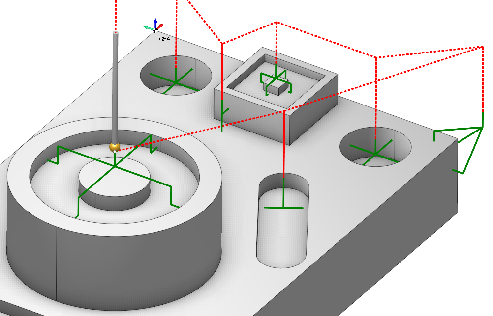
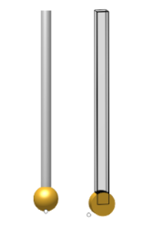

# プロービング

新しいオペレーション グループとして、「 プロービング」が追加されました。専用の測定機器と固定サイクルを使用して、パーツおよび工具の測定を行います。

測定サイクルは、旋盤、フライス盤、およびロボットで使用できます。

測定サイクルを使用することで、工具の健全性、パーツの寸法や角度、およびパーツの加工要素を確認できます。これにより、正確な加工が可能となり、エラーを防止することができます。

通常、測定にはプローブや三次元測定機（CMM：Coordinate Measuring Machine）などの専用装置が必要です。

これらの測定サイクルの主な目的は、以下の通りです。

- パーツの重要なサーフェスの寸法管理およびレポートへの出力
- パーツの設置決め誤差や実物の幾何寸法の誤差を補正するための測定
- 工具の寸法誤差を検出するための測定
- 工具の破損管理

このシステムには、測定サイクルに基づいてツールパスを生成するための専用オペレーションが用意されています。

- Mill パーツの測定
- Mill 工具の測定
- 旋削パーツの測定
- 旋削工具の測定

これらのオペレーションは、実質的に同じです。これは、オペレーションの目的（例：工具など）に応じて、一部のパラメータのデフォルト値が上書きされるだけです。

新しい プロービングツールの グループが追加されました。１つは軸方向用（工具基準点が軸上にあるもの）、もう1つは側面用（工具基準点を側面に配置できるもの）の2種類の工具が用意されています。

