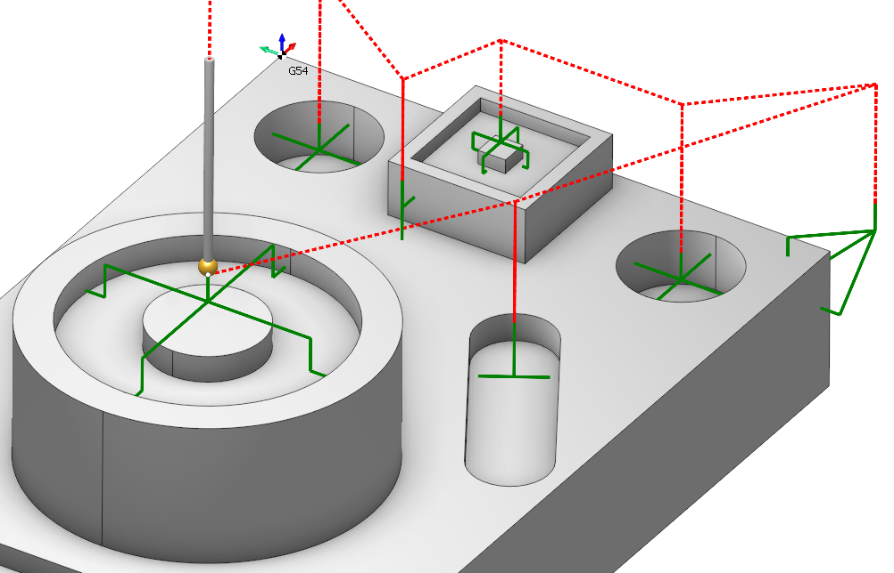
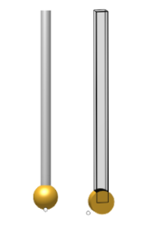

# Medição com apalpador



Foi adicionado um novo grupo de operações: Apalpação. Medição de peças e ferramentas com equipamentos de medição especiais e ciclos fixos.

Os ciclos de medição podem ser usados em tornos, fresadoras e robôs. Os ciclos de medição permitem verificar a integridade da ferramenta e determinar as dimensões das peças, os ângulos e os elementos usinados da peça. Com isso, é possível obter uma usinagem mais correta e evitar erros.

Normalmente, são necessários dispositivos especiais para a medição, como apalpadores e CMM (máquina de medição por coordenadas).

Os principais objetivos desses ciclos estão listados abaixo:

- controle das dimensões das superfícies críticas das peças com saída para o relatório;
- medição de uma peça para compensar as imprecisões na localização da peça e as dimensões geométricas das peças reais;
- medição para detectar imprecisões nos tamanhos das ferramentas;
- controle de quebra de ferramentas.

O sistema tem operações especiais para criar um percurso de ferramenta com base em ciclos de medição:

- Apalpação da peça;
- Apalpação da ferramenta;
- Apalpação da peça no torno;
- Apalpação da ferramenta de torneamento.

```
Essas operações são praticamente as mesmas. Ele apenas substitui os valores padrão de alguns parâmetros, dependendo da finalidade da operação (por exemplo, uma ferramenta).
```

Foi adicionado um novo grupo de ferramentas de apalpação: uma ferramenta para o caso axial (ponto de referência da ferramenta no eixo) e outra para o caso de torneamento (os pontos de referência da ferramenta podem ficar na lateral).


