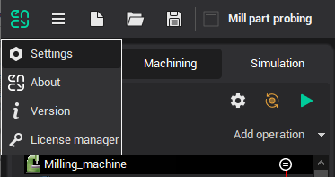
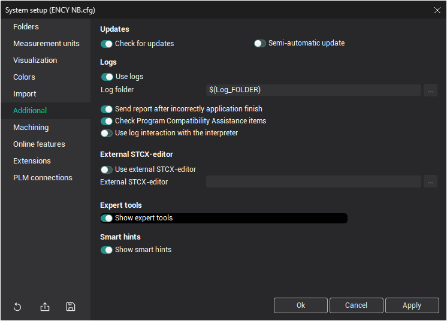
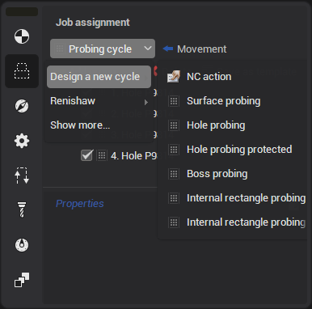
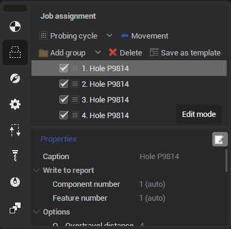
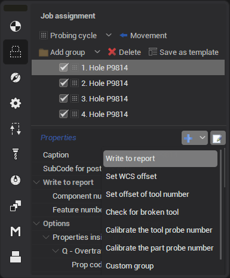
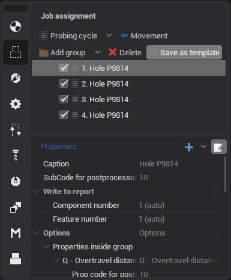
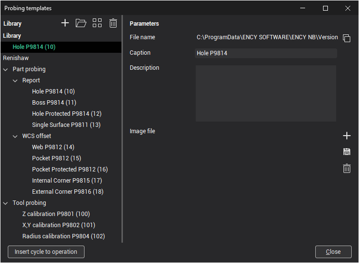

# Criação de ciclos de medição

Você pode criar seus próprios ciclos de apalpação com propriedades individuais para uso futuro. Os novos ciclos de apalpação podem ser reunidos em uma [biblioteca](1412.md), que é um arquivo separado com a extensão **scpbl**. Essa biblioteca pode ser compartilhada com outros usuários.

Primeiro, ative as ferramentas de especialista. Para isso, abra **Settings**. Em seguida, passe para a guia **Additional**, ative **Show expert tools** nas opções exibidas e clique em **Ok**. Depois disso, os ciclos vazios ficarão disponíveis.

Você pode adicionar um dos ciclos vazios. Clique em **Probing cycles** na guia **Job assignment** (definição da tarefa) do ciclo selecionado. A lista de ciclos disponíveis está no submenu **Design a new cycle**. Há 15 ciclos e um elemento adicional **NC action**. Mais informações sobre esses ciclos estão [aqui](1414.md).

Depois de adicionar o ciclo necessário, não é necessário definir seus parâmetros geométricos, pois esses parâmetros precisarão ser definidos ao [usar esse ciclo](1415.md) no futuro. O principal é especificar suas propriedades que serão armazenadas no modelo criado com base nesse ciclo.

Para adicionar propriedades, clique no botão **Edit** com o ícone de lápis. Depois disso, o campo **SubCode for postprocessor** e o botão **Add custom property** com o ícone de adição serão exibidos. O campo **SubCode for postprocessor** é o código exclusivo do ciclo. Ele é usado no pós-processador para identificar o ciclo de forma inequívoca e interpretar seus parâmetros. Consulte também a documentação do pós-processador, "Ciclo de apalpação **WProbing**".

Clique em **Add custom property** para adicionar uma propriedade da lista suspensa. Há 8 propriedades com parâmetros próprios na lista:

- **Write to report** - grava os valores medidos em uma linha do relatório. Há dois parâmetros: **Component number** e **Feature number**. Esses parâmetros são incrementados automaticamente, mas você também pode inserir os valores manualmente;
- **Set WCS offset** - define o zero do sistema de coordenadas do bruto. Isso pode ser feito de diferentes maneiras (deslocar globalmente todos os CS, deslocar um dos G54-G59, deslocar por meio de parâmetros ou por meio de um CS local). Você pode escolher uma das quatro opções: **Global (all G54-G59)**, **One WCS (one of G54-G59 )**, **Parametrical offset (G10 L2 P1 XYZ)**, **Local CS offset (G52 XYZ)**. O parâmetro **CS number** está disponível para **One WCS (one of G54-G59 )** e **Parametrical offset (G10 L2 P1 XYZ)**. Nele, você pode especificar o CS necessário;
- **Set offset of tool number** - define o zero da ferramenta. É necessário o número da ferramenta e do corretor em que os deslocamentos serão gravados;
- **Check for broken tool** - verifica o desvio das dimensões da ferramenta em relação às de referência e gera um erro se ele ultrapassar os limites. Também é necessário o número da ferramenta e do corretor de onde as dimensões serão obtidas para comparação;
- **Calibrate the tool probe number** - calibra o apalpador de ferramentas. É necessário o número do apalpador e do seu corretor;
- **Calibrate the part probe number** - calibra o apalpador de peças. É necessário o número do apalpador e do seu corretor;
- **Custom group** - cria um elemento para agrupar propriedades personalizadas;
- **Custom property** - propriedade personalizada para adicionar um parâmetro extra. Você pode definir: **Prop code for postprocessor**, **Property type** (double, integer, Boolean. string) e **Value**.

Os códigos de acesso para parâmetros em CLData são descritos na documentação do pós-processador "Ciclo de apalpação **WProbing** - Parâmetros adicionais".

Depois de preparar o modelo de ciclo, é preciso adicioná-lo à biblioteca. Clique em **Save as template**.

A janela **Probing templates** será aberta. Um novo modelo será adicionado a essa janela. Se as bibliotecas personalizadas tiverem sido criadas anteriormente, o modelo estará localizado nessa biblioteca; caso contrário, será criada uma nova biblioteca. As alterações nessa janela são salvas quando a janela é fechada. Mais informações sobre como trabalhar com a janela **Probing templates** estão [aqui](1412.md).

