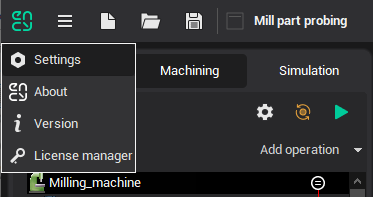
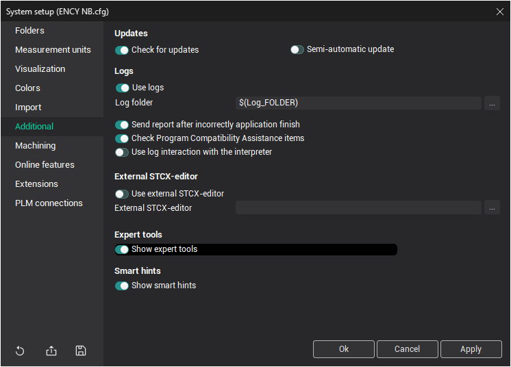
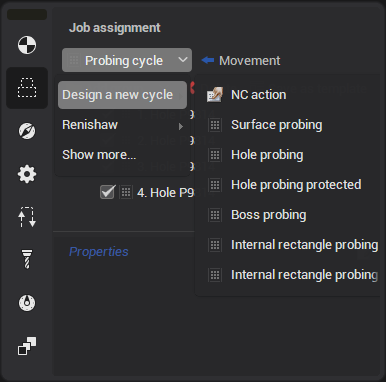
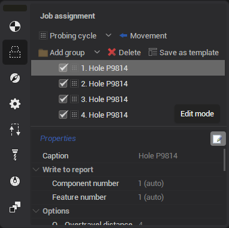
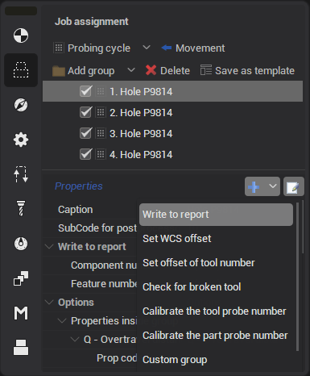
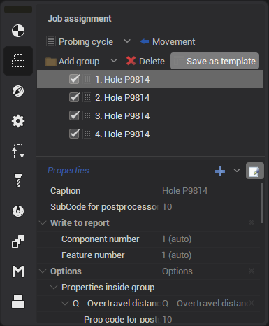
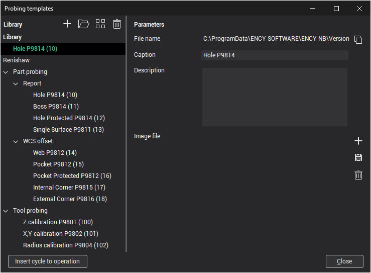

# 独自のプロービングサイクル（テンプレート）の作成

独自のプロービングサイクルを作成し、個別のプロパティを設定して、後で使用することができます。新しく作成したプロービングサイクルは、`scpbl`拡張子の独立したファイルとして[ライブラリ](1412.md) にまとめることができます。このライブラリは、他のユーザーと共有することができます。

まず最初に、エキスパートルールを有効にする必要があります。これを行うには、`システム設定`を開きます。次に、 `追加設定`タブに切り替え、表示されるオプションで `エキスパートツールを表示`を有効にし、 `Ok`をクリックします。その後、空のサイクルが利用可能になります。

空のサイクルを追加するには、選択したサイクルの `ジョブ割り当て` タブにある`プロービングサイクル`をクリックします。`新しいサイクルを作成`サブメニューから、利用可能なサイクルのリストを確認できます。ここには、15種類のサイクルと、追加要素として`NC動作`が用意されています。このサイクルについての詳細は[こちら](1414.md)を参照してください。

必要なサイクルを追加した後は、そのサイクルのジオメトリパラメータを設定する必要はありません。これらのパラメータは、後で[このサイクルを使用する](1415.md)際に設定するためです。重要なのは、このサイクルを基に作成するテンプレートに保存されるプロパティを指定することです。プロパティを追加するには、鉛筆アイコンのついた `編集`ボタンをクリックします。その後、 `ポストプロセッサー用サブコード`フィールドと、プラスアイコンの付いた`カスタムプロパティ追加` ボタンが表示されます。`ポストプロセッサー用サブコード`のフィールドには、サイクル固有のコードを指定します。このコードは、ポストプロセッサーでサイクルを一意に識別し、そのパラメータを解析するために使用されます。詳細については、ポストプロセッサーのドキュメント「プロービングサイクル **WProbing**」も参照してください。

`カスタムプロパティ追加` をクリックすると、ドロップダウンリストからプロパティを追加できます。

リストには、それぞれ固有のパラメータを持つ、次の 8つのプロパティが用意されています。

- `レポートに書き込む`</strong> - 測定値をレポートの行に記録します。次の2つのパラメータがあります。 `コンポーネント番号`、`フィーチャー番号` これらのパラメータは自動にインクリメント（自動で連番を割り当て）されますが、手動で値を入力することもできま
- `WCSオフセットを設定` - ワーク座標系（WCS）をゼロ位置を設定します。設定方法には、全てのワーク座標系を一括でシフトする方法、G54〜G59 のいずれか1つをシフトする方法、パラメータを使用する方法、ローカル座標系を使用する方法、があります。 4 つのオプションの中から 1 つを選択できます。 `グローバル(全G54-G59)` `1つのWCS（G54〜G59 のいずれか1つ）` `パラメトリックオフセット(G10 L2 P1 XYZ)` `ローカル座標系オフセット (G52 XYZ)` `1つのWCS（G54〜G59 のいずれか1つ` および `パラメトリックオフセット（G10 L2 P1 XYZ）`では、`CS 番号` パラメータを使用できます。ここで、必要な座標系を指定できます。
- `工具番号のオフセットを設定`- 工具のゼロ位置を設定します。オフセットを書き込む工具番号と補正番号を指定するが必要があります。
- `工具破損チェック`- 工具寸法の基準値からの偏差を確認し、許容範囲を超えた場合にエラーを発生させます。また、比較用の寸法を取得するための工具番号と補正番号を指定する必要があります。
- `工具プローブ番号をキャリブレーション`- 工具測定用プローブを校正します。対象のプローブ番号および補正番号を指定する必要があります。
- `パーツプローブ番号をキャリブレーション`- パーツ プローブを校正します。対象の プローブ番号および補正番号を指定する必要があります。
- `カスタムグループ` - カスタムプロパティをグループ化するための要素を作成します。
- `カスタムプロパティ` - 追加パラメータを設定するためのカスタムプロパティです。次の項目を設定できます。 `ポストプロセッサー用プロパティコード`、`プロパティタイプ`(double、integer、Boolean、string)、`値`

CLData 内のパラメータにアクセスするためのコードについては、 ポストプロセッサのドキュメント "プロービングサイクル**WProbing**- 追加パラメータ" を参照してください。

サイクルテンプレートの準備ができたら、それをライブラリーに追加する必要があります。`テンプレートとして保存`をクリックしてください。

`プロービングテンプレート`ウィンドウが開きます。このウィンドウに、新しいテンプレートが追加されます。以前にカスタムライブラリーを作成している場合は、テンプレートはそのライブラリー内に保存されます。カスタムライブラリーを作成していなければ、新しいライブラリーが作成されます。このウィンドウで行った変更は、ウィンドウを閉じる際に保存されます。 `プロービングテンプレート` ウィンドウの操作方法については[こちら](1412.md)を参照してください。

