# 事前定義された測定サイクルの使用

測定サイクルを使用するには、まず使用可能な測定オペレーションを作成します。測定オペレーションは、<strong>Probing</strong>グループにあります。フライス盤とロボットでは、<strong>Millパーツプロービング</strong>と<strong>Mill工具プロービング</strong>を使用できます。旋盤では、<strong>旋盤パーツプロービング</strong>と<strong>旋盤工具プロービング</strong>を使用できます。複合旋盤を選択した場合は、4種類すべてのオペレーションを使用できます。

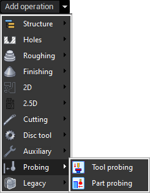

## パーツプロービング

リストからパーツプロービングオペレーションを追加し、<strong>ジョブ割り当て</strong>タブに切り替えて、既存のサイクルのいずれかを追加します。<strong>Probing cycles</strong>ボタンクリックすると、コンテキストメニューが表示されます。<strong>もっと見る</strong>を選択すると、[<strong>プロービングテンプレート</strong>](1412.md) ウィンドウが開きます。ここには、独自のプロパティが設定された、すぐに使用可能なサイクルを含むライブラリが用意されています。これらのライブラリは、<strong>Probing cycles</strong>ボタンのコンテキストメニューからもアクセスできます。

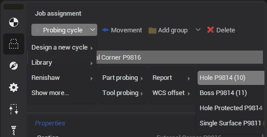

ここでは、<strong>穴プロービング</strong>を例に、サイクルの操作方法を説明します。

デフォルトの<strong>Renishaw</strong>ライブラリにある<strong>Report</strong>グループから、新しいプロービングサイクル<strong>Hole P9814</strong>を追加します。

追加したサイクルのプロパティが、<strong>ジョブ割り当て</strong>タブの下部に表示されます。

<strong>図形の測定</strong>を使用して、サイクルの計算に必要なパラメータを設定します。

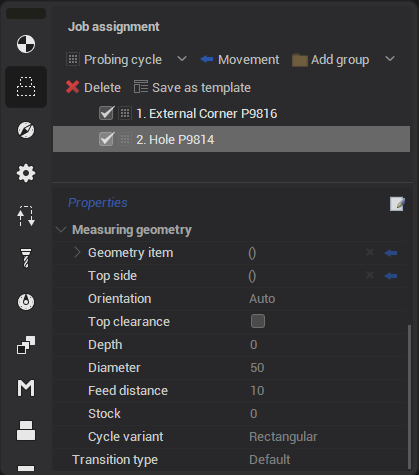

フィールド右側の矢印をクリックし、グラフィックスウィンドウでサーフェスを選択して、<strong>図形アイテム</strong> または<strong>上面</strong>を追加します。選択したサーフェスは、自動的に現在のフィールドに追加されます。

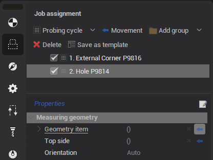

その他のパラメータは、対応するフィールドに手動で入力します。一部のサイクルパラメータは、インスペクターおよびグラフィックスウィンドウの両方で編集できます。

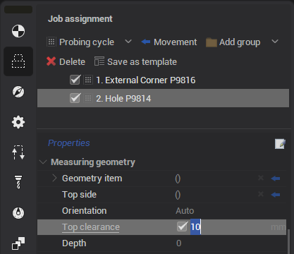

## 移行

<strong>リンク</strong>タブに切り替えて、プロービングサイクル間の移行パラメータを設定します。

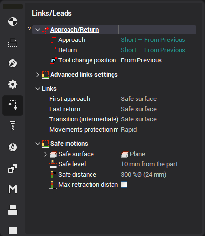

このタブには、標準パラメータに加えて、測定オペレーション用の新しいパラメータが追加されています。

- <strong>最初のアプローチ</strong> - オペレーションの最初のサイクル開始位置へのアプローチを作成します。
- <strong>最後のリターン</strong> - オペレーションの最後のサイクルからのリターン動作を作成します。
- <strong>移行 (中間)</strong> - オペレーション内のサイクル間の移行を作成します。
- <strong>安全距離</strong> - サイクルのアプローチおよびリターン時の距離を設定します。値の設定方法は、mm単位での指定と工具径に対する割合（％）での指定の2種類があります。

上記の移行には、共通して使用される3種類の設定値があります。

- <strong>ショート</strong> - 移行を直接生成します。
- <strong>安全距離</strong> - <strong>安全距離</strong>フィールドで指定した距離まで退避してから移行を生成します。
- <strong>安全サーフェス</strong> - 安全サーフェスまで退避してから移行を生成します。

<strong>移行 (中間)</strong>には、追加の設定値として<strong>直交</strong>があります。移行の開始点と終了点が同じZ高さにある場合は、直接移動します。開始点が低い場合は、最初に終了点の高さまで上昇してから、直接移動します。終了点が低い場合は、開始点と同じ高さで終了点の真上にある点まで直接移動し、その後、終了点へ直接移動します。

また、使用する送り速度を選択することもできます。 (<strong>動作保護モード</strong>)

- <strong>早送り</strong> - 早送りで移動します。
- <strong>非</strong><strong>保護</strong> - 長距離リンク送りで移動します。
- <strong>保護</strong> - 短距離リンク送りで移動します。

## サイクルフォーマット

CLDataにサイクルを出力する際の形式を選択できます。設定するには <strong>加工設定</strong>タブに移動します。

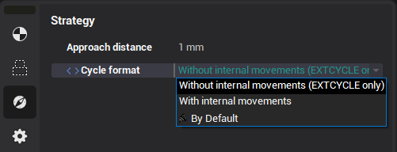

<strong>サイクルフォーマット</strong>には2つの設定値があります。

- <strong>内部移動なし (EXTCYCLEのみ)</strong> - サイクルの動作を、callsub を伴う独立した<strong>EXTCYCLE</strong> コマンドとして出力します。 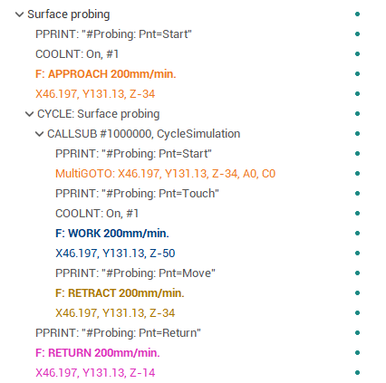
- <strong>内部移動あり</strong> - サイクルの動作を、独立した <strong>EXTCYCLE</strong>コマンドを使用せずに出力します。 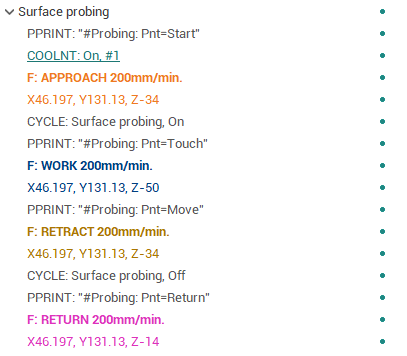

## 工具プロービング

工具プロービングにおけるサイクルのパラメータ設定および移行の設定は、ワークプロービングとまったく同じです。

プローブは工具として扱うだけでなく、テーブル上の所定の位置に固定されたパーツとして扱うこともできます。このようなプローブは、通常、工具の初期校正や健全性確認に使用されます。

正しく動作させるためには、 <strong>パーツ</strong>グループを追加する必要があります。

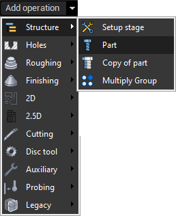

このグループ内で、工具ごとに個別の測定オペレーションを作成する必要があります。

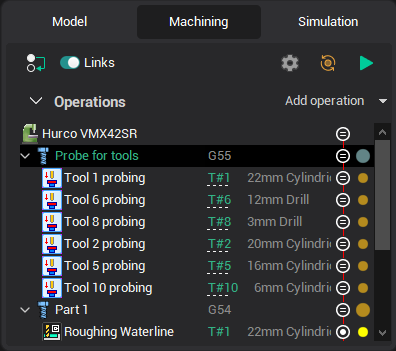

<strong>セットアップ</strong>タブに切り替えて、 <strong>パーツ番号</strong>を設定する必要があります。 <strong>パーツ番号</strong>はプローブIDとして使用できます。

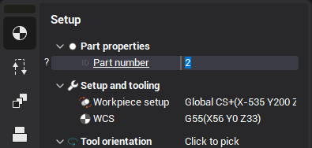

工具プロービングオペレーションの作成と使用の例は、配布データの「Probing」フォルダにある「Tool probing」プロジェクトを参照してください。
