# 事前定義された測定サイクルの使用

測定サイクルを使用するには、まず利用可能なオペレーションのいずれかを作成する必要があります。測定オペレーションは `プロービング`グループに含まれています。

フライス盤およびロボットでは、`Millパーツプロービング`および`Mill工具プロービング` オペレーションを使用できます。旋盤では、`旋盤パーツプロービング`および`旋盤工具プロービング` オペレーションを使用できます。

なお、複合旋盤を選択した場合は、これら4種類すべてのオペレーションを使用することができます。

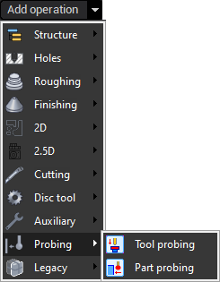

## パーツプロービング

リストからパーツプロービングオペレーションを追加し、`ジョブ割り当て`タブに切り替えて、既存のサイクルのいずれかを追加します。`Probing cycles`ボタンクリックすると、コンテキストメニューが表示されます。`もっと見る`を選択すると、[<strong>プロービングテンプレート</strong>](1412.md) ウィンドウが開きます。ここには、独自のプロパティが設定された、すぐに使用可能なサイクルを含むライブラリが用意されています。これらのライブラリは、`Probing cycles`ボタンのコンテキストメニューからもアクセスできます。

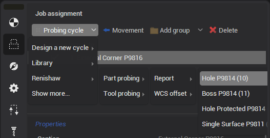

ここでは、`穴プロービング`を例に、サイクルの操作方法を説明します。

デフォルトの<strong>Renishaw</strong>ライブラリにある`Report`グループから、新しいプロービングサイクル`Hole P9814`を追加します。

追加したサイクルのプロパティが、`ジョブ割り当て`タブの下部に表示されます。

`図形の測定`を使用して、サイクルの計算に必要なパラメータを設定します。

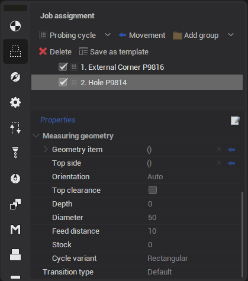

フィールド右側の矢印をクリックし、グラフィックスウィンドウでサーフェスを選択して、`図形アイテム` または`上面`を追加します。選択したサーフェスは、自動的に現在のフィールドに追加されます。

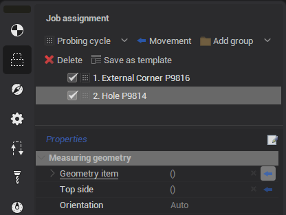

その他のパラメータは、対応するフィールドに手動で入力します。一部のサイクルパラメータは、インスペクターおよびグラフィックスウィンドウの両方で編集できます。

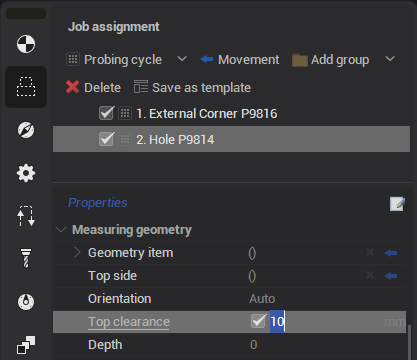

## 移行

`リンク`タブに切り替えて、プロービングサイクル間の移行パラメータを設定します。

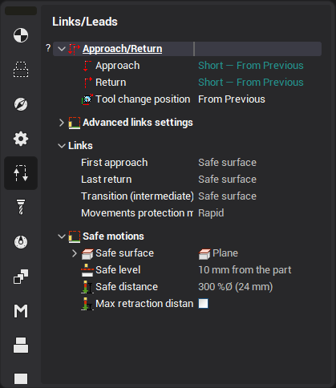

このタブには、標準パラメータに加えて、測定オペレーション用の新しいパラメータが追加されています。

- `最初のアプローチ` - オペレーションの最初のサイクル開始位置へのアプローチを作成します。
- `最後のリターン` - オペレーションの最後のサイクルからのリターン動作を作成します。
- `移行 (中間)` - オペレーション内のサイクル間の移行を作成します。
- `安全距離` - サイクルのアプローチおよびリターン時の距離を設定します。値の設定方法は、mm単位での指定と工具径に対する割合（％）での指定の2種類があります。

上記の移行には、共通して使用される3種類の設定値があります。

- `ショート` - 移行を直接生成します。
- `安全距離` - `安全距離`フィールドで指定した距離まで退避してから移行を生成します。
- <strong>`安全サーフェス` - 安全サーフェスまで退避してから移行を生成します。

`移行 (中間)`には、追加の設定値として `直交` があります。

- 移行の開始点と終了点が同じZ高さにある場合は、直接移動します。
- 開始点が終了点より低い場合は、まず終了点と同じZ高さまで上昇し、その後、終了点まで直接移動します。
- 終了点が開始点より低い場合は、まず開始点と同じZ高さを保ったまま終了点の真上まで移動し、その後、終了点まで降下します。

また、使用する送り速度を選択することもできます。 (`動作保護モード`)

- `早送り` - 早送りで移動します。
- `非保護` - 長距離リンク送りで移動します。
- `保護` - 短距離リンク送りで移動します。

## サイクルフォーマット

CLDataにサイクルを出力する際の形式を選択できます。設定するには `加工設定`タブに移動します。

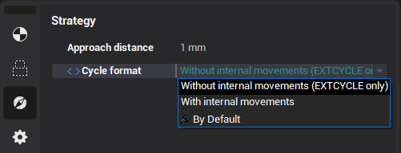

`サイクルフォーマット`には2つの設定値があります。

- `内部移動なし (EXTCYCLEのみ)` - サイクルの動作を、callsub を伴う独立した`EXTCYCLE` コマンドとして出力します。 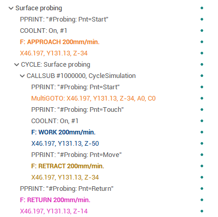
- `内部移動あり` - サイクルの動作を、独立した `EXTCYCLE`コマンドを使用せずに出力します。 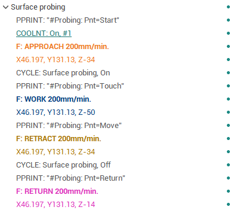

## 工具プロービング

工具プロービングにおけるサイクルのパラメータ設定および移行の設定は、ワークプロービングとまったく同じです。

プローブは工具として扱うだけでなく、テーブル上の所定の位置に固定されたパーツとして扱うこともできます。このようなプローブは、通常、工具の初期校正や健全性確認に使用されます。

正しく動作させるためには、 `パーツ`グループを追加する必要があります。

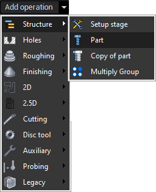

このグループ内で、工具ごとに個別の測定オペレーションを作成する必要があります。

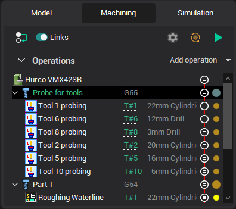

`セットアップ`タブに切り替えて、 `パーツ番号`を設定する必要があります。 `パーツ番号`はプローブIDとして使用できます。

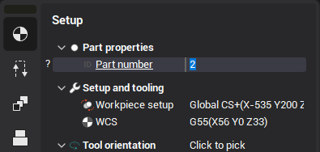

工具プロービングオペレーションの作成および操作に関する例については、配布プロジェクト内の「プロービング」フォルダにある「工具プロービング」を参照してください。
