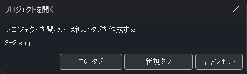

# マルチプロジェクトインターフェース

<strong>マルチプロジェクト</strong>では、複数のウィンドウを「タブ」として組み合わせ、複数のプロジェクトで同時に作業ができます。 <strong>マルチプロジェクト</strong> インターフェイスを使って、別々のインスタンスに新しいプロジェクトをアタッチし、作成ができます。マルチプロジェクト インターフェイスを使用せずに、 <strong>1 つのウィンドウ</strong>だけで作業することもできます。

## 追加ウィンドウを開くためのオプション：

1. <strong>現在のシステムウィンドウから別のウィンドウを開く：</strong> <strong>ワークフローは以下のようになります。</strong>  + ユーザーアクション 
  - システムウィンドウを開いた状態で、 <strong>新しいタブで新規プロジェクト</strong> ボタンをクリックします。<strong>新規プロジェクト</strong> にカーソルを合わせ、ドロップダウンリストから<strong>新しいタブで新規プロジェクト</strong> を選択します。プロジェクトリストに新しいタブが表示されます。
  - システムウィンドウを開いた状態で、 <strong>新しいタブで新規プロジェクト</strong> ボタンをクリックします。<strong>プロジェクトを開く</strong>  にカーソルを合わせ、ドロップダウンリストから<strong>新しいタブでプロジェクトを開く</strong> を選択します。
  - 特定のプロジェクトの上にカーソルを合わせ、 <strong>プロジェクトを開く </strong> ドロップダウンリストから、さらに表示される2つ目のドロップダウンリストで<strong>新しいタブでプロジェクトを開く</strong>を選択することで、そのプロジェクトを開くこともできます。
  - マシンセットアップでプロジェクトを開くには、 <strong>新しいタブでマシンセットアップ付き新規プロジェクト</strong> ボタンをクリックします。 プロジェクトリストに新しいウィンドウが表示されます。
2. <strong><strong>外部システムを通して追加のウィンドウを開く</strong>：</strong>

- システムウィンドウを開いた状態で、CADシステムウィンドウの <strong>外部CADシステムからのエクスポート</strong> オプションをクリックします。
- システムウィンドウを開いた状態で、 <strong>Machine Makerからのエクスポート</strong> オプションをクリックします。
- システムウィンドウを開いた状態で、 <strong>プロジェクトライブラリからエクスポート</strong> オプションをクリックします。
- プロジェクトのアイコンをダブルクリックするか、 <strong>ドラッグアンドドロップ</strong> 機能を使ってプロジェクトを起動します。

<strong>ワークフローは以下のようになります。</strong>

 ----> = 

## 外部システムから追加ウィンドウを開く際の注意点：

1. ウィンドウが <strong>空</strong> (オペレーション、部品などがない)の場合、インポートされたファイルはこのウィンドウにロードされます。
2. 現在のウィンドウに変更がある場合（それが空でない場合）、システムはどのウィンドウにインポートを実行するかを選択するように求められます。

したがって、ユーザーは<strong>シングルタブ</strong>モードで作業するか、<strong>複数のタブ</strong>を同時に使用する（マルチプロジェクトモード）かを選択して作業できます。

複数タブで作業中に<strong>システムを終了する場合</strong> 、未保存の変更があると保存を促すメッセージが表示されます。最初は現在のタブからプロジェクトを保存するよう求められ、これはすべてのタブのプロジェクトが閉じるか保存されるまで続きます。

## プロジェクトナビゲーション

<strong>プロジェクトリストでの作業</strong>

- <strong>プロジェクト名パネル</strong> は現在のタブで開いているプロジェクトファイルの名前を表示します。 
- <strong>タブの数</strong> は、現在のシステムウィンドウで結合されたプロジェクトの数に対応します。
- 新しいタブが作成され、既存のタブに追加されるとき、<strong>アニメーション付きの読み込み進行バー</strong>が表示されます。 
- 複数のタブがある場合、 <strong>アクティブなプロジェクトのタイトル</strong> は他のタブに比べて暗い色でハイライトされます。アクティブでないプロジェクトのタイトルをクリックすると、 <strong>アクティブなプロジェクト</strong>になります。さらに、非アクティブなタブの <strong>プロジェクト名パネル</strong> にカーソルを置くと、閉じるボタンが表示されます。 
- <strong>計算</strong>がタブで実行されている場合（ツールパス計算、加工シミュレーションなど）、簡単な説明が表示されます。

<strong>[Ctrl+C]</strong> と <strong>[Ctrl+V]</strong>、または <strong>Copy</strong> と <strong>Paste</strong> コマンドを使用して、異なるタブ間でオペレーションをコピーすることもできます。

<strong>マルチプロジェクトモードでは、同じ名前で2つのウィンドウを開くことはできません。このような場合、システムはエラーメッセージを表示します。</strong>
