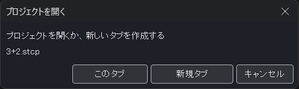
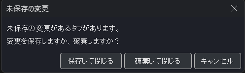
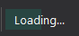
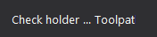

# Interface multiprojeto

<strong>Multiproject</strong> permite combinar várias janelas como "abas" para trabalhar simultaneamente em vários projetos. A interface <strong>multiproject</strong> permite anexar e criar novos projetos em instâncias separadas. No entanto, ainda é possível optar por trabalhar com <strong>uma única janela</strong>, sem usar a interface multiprojeto.

## Opções para abrir uma janela adicional:

1. <strong>Abertura de uma janela adicional a partir da janela atual do sistema:</strong> <strong><strong>O fluxo de trabalho será o seguinte</strong>:</strong>  + ações do usuário = 
  - Com a janela do sistema aberta, clique no botão <strong>New Project in New Tab</strong>. Passe o ponteiro sobre <strong>New Project</strong> e selecione <strong>New Project in New Tab</strong> na lista suspensa. Uma nova aba aparecerá na lista de projetos.
  - Com a janela do sistema aberta, clique no botão <strong>New Project in New Tab</strong>. Passe o ponteiro sobre <strong>Open Project</strong>  e selecione <strong>Open Project in New Tab</strong> na lista suspensa.
  - Também é possível abrir um projeto passando o ponteiro sobre um projeto específico na lista suspensa <strong>Open Project</strong>  e selecionando <strong>Open Project in New Tab</strong> na segunda lista suspensa.
  - Para abrir um projeto com configuração de máquina, clique no botão <strong>New Project with machine setup in a New Tab</strong>. Passe o ponteiro sobre <strong>New Project</strong>  e selecione <strong>New Project with machine setup in new tab </strong> na lista suspensa. Uma nova janela aparecerá na lista de projetos.
2. <strong><strong><strong>Abertura de uma janela adicional por meio de sistemas externos</strong>:</strong></strong>

- Com a janela do sistema aberta, clique na opção <strong>Export from External CAD System</strong> na janela do sistema CAD.
- Com a janela do sistema aberta, clique na opção <strong>Export from Machine Maker</strong>.
- Com a janela do sistema aberta, clique na opção <strong>Export from Project Library</strong>.
- Abra um projeto com um clique duplo no ícone do projeto ou arrastando-o (<strong>drag-and-drop</strong>).

<strong><strong>O fluxo de trabalho será o seguinte</strong>:</strong>

 ----> = 

## Pontos importantes ao abrir uma janela adicional por meio de sistemas externos:

1. Se a janela estiver <strong>vazia</strong> (sem operações, peças etc.), os arquivos importados serão carregados nessa janela.
2. Se houver alterações na janela atual (e ela não estiver vazia), o sistema solicitará que você escolha em qual janela a importação deve ser realizada.

Assim, o usuário decide como deseja trabalhar: no modo de <strong>aba única</strong> ou com <strong>várias abas</strong> simultaneamente (modo multiprojeto).

Ao <strong>sair</strong> do sistema trabalhando com várias abas que tenham alterações não salvas, o sistema oferecerá salvá-las. Primeiro, solicitará salvar o projeto da aba atual, e isso continuará até que todos os projetos de todas as abas sejam fechados ou salvos.

## Navegação entre projetos:

<strong>Trabalho com a lista de projetos:</strong>

- O <strong>painel do nome do projeto</strong> exibe o nome do arquivo do projeto aberto na aba atual 
- <strong>O número de abas</strong> corresponde ao número de projetos combinados na janela atual do sistema.
- <strong>Uma barra de progresso de carregamento animada</strong> aparece quando uma nova aba é criada e adicionada às existentes 
- Quando há várias abas, <strong>o título do projeto ativo</strong> é realçado com uma cor mais escura que a dos demais. Clicar no título de um projeto inativo o torna <strong>o projeto ativo</strong>. Além disso, ao passar o ponteiro sobre o <strong>painel do nome do projeto</strong> de uma aba inativa, aparece o botão de fechamento. 
- Se um <strong>cálculo</strong> estiver em execução em uma aba (por exemplo, cálculo do percurso da ferramenta ou simulação da usinagem), é exibida uma breve descrição.

Também é possível copiar operações entre abas diferentes usando <strong>[Ctrl+C]</strong> e <strong>[Ctrl+V]</strong> ou os comandos <strong>Copy</strong> e <strong>Paste</strong>.

<strong>No modo multiprojeto, não é possível abrir duas janelas com o mesmo nome. Nesse caso, o sistema exibirá uma mensagem de erro.</strong>
