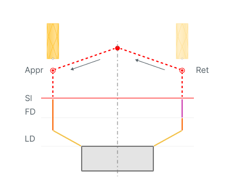
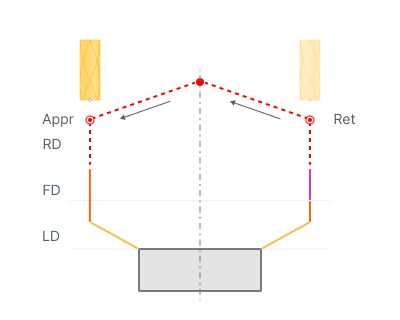
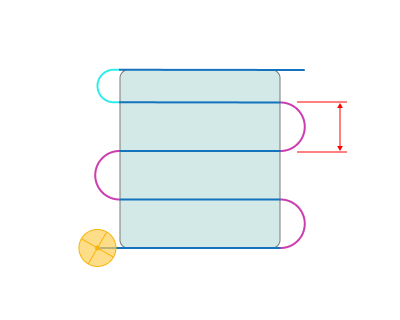
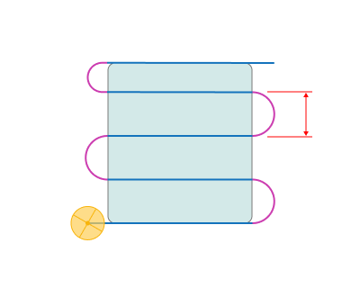
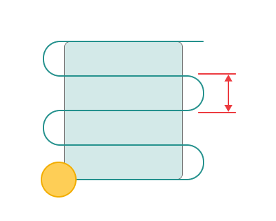
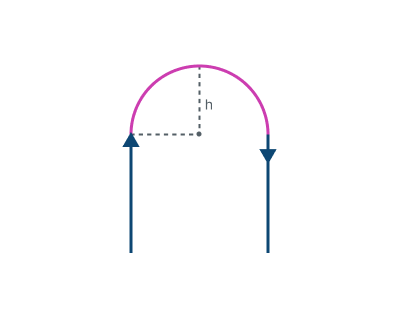

# クラッディング加工のリンク動作

## 

## 適用分野:

このグループでは、切込み動作および加工領域間の遷移動作に関する設定を行います。

<strong>最初のリンク /</strong> <strong>最後のリンク</strong> アプローチ、リターン動作の基本ルールを設定します。

拡大

<strong>直線</strong>

このルールでは、工具は次の順序でワークへ進入します。 1. <strong>工具交換位置</strong> 2.<strong>Appr</strong>- 進入 3. <strong>LD</strong> - リード（有効な場合） 退避は、上記とは逆の順序で行われます。 1. <strong>LD</strong> - リード（有効な場合） 2.<strong>Ret</strong> - リターン 3. <strong>工具交換位置</strong>

<strong>安全サーフェス上</strong>

このルールでは、工具は次の順序でワークへ進入します。 1. <strong>工具交換位置</strong> 2.<strong>Appr</strong>- 進入 3.<strong>SL</strong> - 安全高さ 4. <strong>FD</strong> - 送り距離 5. <strong>LD</strong> - リード（有効な場合） 退避は、上記とは逆の順序で行われます。 1. <strong>LD</strong> - リード（有効な場合） 2. <strong>FD</strong> - 送り距離 3. <strong>SL</strong> - 安全高さ 4. <strong>Ret</strong> - リターン 5. <strong>工具交換位置</strong>

<strong>早送り距離</strong>

このルールでは、工具は次の順序でワークへ進入します。 1. <strong>工具交換位置</strong> 2. <strong>Appr</strong>- 進入 3. <strong>RD</strong> - 早送り距離 4. <strong>FD</strong> - 送り距離 5. <strong>LD</strong> - リード（有効な場合） 退避は、上記とは逆の順序で行われます。 1. <strong>LD</strong> - リード（有効な場合） 2. <strong>FD</strong> - 送り距離 3. <strong>RD</strong> - 早送り距離 4. <strong>Ret</strong> - リターン 5. <strong>工具交換位置</strong>

<strong>隣接リンク</strong>

拡大

<strong>連続</strong>

隣接する加工パス間の移行は、工具を退避させることなく、ワークに沿って「<strong>ショートリンク送り速度</strong>」で連続的に行われます。<strong>「有効送り速度」</strong>を「早送りなし」に設定すると、クラッディングビードを連続して形成できます。この設定は、移行距離が「<strong>最大隣接リンク距離</strong>」以下の場合にのみ適用されます。

> 注記
>
> >
> <strong>エリアクラッディング</strong> および<strong>3Dクラッディング</strong>加工では、<strong>平行</strong>方法の場合、遷移動作は外形輪郭の等距離線に沿って生成されます。<strong>オフセット</strong>方法の場合は、最短距離の直線移動として生成されます。

<strong>ショートリンク</strong> 隣接する加工パス間の移行は、「ショートリンク」の設定に従って、通常の短いリンク動作として実行されます。

<strong>最大隣接リンク距離</strong>

隣接する2つの加工パスの終点間において、移行を連続した隣接リンクとして扱うことができる最大距離を指定します。この距離を超える場合、遷移は「<strong>ショートリンク</strong>」または「<strong>ロングリンク</strong>」として生成されます。

> 注記
>
> >
> ショートリンクは、この値から「<strong>ショートリンク最大距離</strong>」までの範囲で適用されます。ショートリンクは、この値から「<strong>ショートリンク最大距離</strong>」までの範囲で適用されます。

<strong>ショートリンク / ロングリンク</strong>

拡大

<strong>直線</strong> リンクは最短距離の直線経路で生成されます。

<strong>円滑化</strong> 加工パス間を滑らかなベジェスプラインで遷移します。

<strong>安全サーフェス上</strong>

<strong>送り距離</strong>から<strong>安全高さ</strong>までのリンク動作を設定します。 <strong>FD</strong> - 送り距離 <strong>SL</strong> - 安全高さ

<strong>早送り距離</strong>

<strong>早送り距離</strong>から開始するリンク動作を設定します。 <strong>RD</strong> - 早送り距離

<strong>ショートリンク最大距離</strong> ショートリンクタイプでリンクを生成する最大距離を設定します。

<strong>円滑化リンク高さ</strong> 隣接する2つの加工パスを結ぶ直線（弦）に対する、リンク円弧の高さを指定します。指定した値は、基準となるケース（理想的なジグザグ加工）では正確に適用されます。それ以外の加工パターン（平行・往復、オフセットなど）では、実際の円弧高さは指定値と異なる場合があります。

