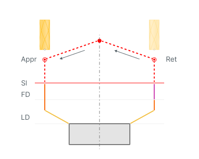
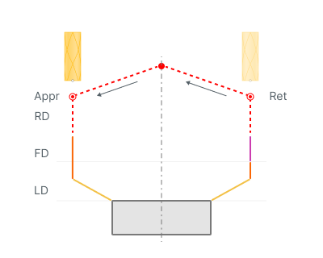
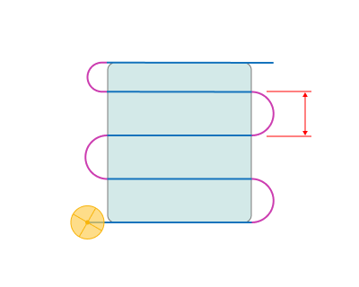
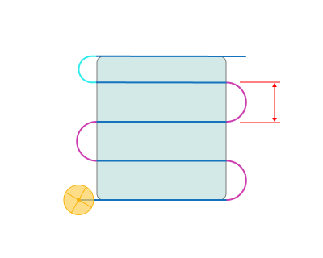
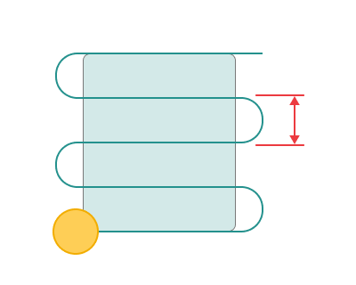
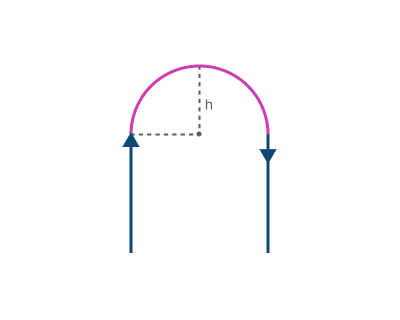

# Ligações em operações de revestimento

## 

## Área de aplicação:

Este grupo define as configurações de entrada no corte e de transições entre áreas.

<strong>First links /</strong> <strong>Last links.</strong> Define a regra geral de aproximação/retorno.

Clique aqui para expandir...

<strong>Straight.</strong>

Com esta regra, a aproximação à peça é realizada assim: 1. <strong>Tool change position</strong> 2.<strong>Appr</strong> - aproximação 3. <strong>LD</strong> - entradas e saídas (se estiverem ativadas). O retorno é realizado na ordem inversa: 1. <strong>LD</strong> - entradas e saídas (se estiverem ativadas) 2.<strong>Ret</strong> - retorno 3. <strong>Tool change position</strong>

.png)

<strong>On Safe Surface.</strong>

Com esta regra, a aproximação à peça é realizada assim: 1. <strong>Tool change position</strong> 2.<strong>Appr</strong> - aproximação 3.<strong>SL</strong> - nível seguro 4. <strong>FD</strong> - distância de avanço 5. <strong>LD</strong> - entradas e saídas (se estiverem ativadas). O retorno é realizado na ordem inversa: 1. <strong>LD</strong> - entradas e saídas (se estiverem ativadas) 2. <strong>FD</strong> - distância de avanço 3. <strong>SL</strong> - nível seguro 4. <strong>Ret</strong> - retorno 5. <strong>Tool change position</strong>

<strong>By Rapid Distance.</strong>

Com esta regra, a aproximação à peça é realizada assim: 1. <strong>Tool change position</strong> 2. <strong>Appr</strong> - aproximação 3. <strong>RD</strong> - distância de avanço rápido 4. <strong>FD</strong> - distância de avanço 5. <strong>LD</strong> - entradas e saídas (se estiverem ativadas). O retorno é realizado na ordem inversa: 1. <strong>LD</strong> - entradas e saídas (se estiverem ativadas) 2. <strong>FD</strong> - distância de avanço 3. <strong>RD</strong> - distância de avanço rápido 4. <strong>Ret</strong> - retorno 5. <strong>Tool change position</strong>

<strong>Neighbor links.</strong>

Clique aqui para expandir...

<strong>Continuous.</strong>

As transições entre passadas vizinhas são feitas continuamente ao longo da peça com o avanço <strong>Short link feed</strong>, sem retrair a ferramenta. Em combinação com <strong>Effective feeds</strong> definido para todos os avanços que não são rápidos, isso produz um cordão de revestimento contínuo. Aplica-se somente a transições mais curtas que <strong>Neighbor link max distance</strong>.

> Nota
>
> Nas operações <strong>Area cladding</strong> e <strong>Cladding 3D</strong>, na estratégia <strong>Parallel</strong> a transição segue a equidistante do contorno externo; na estratégia <strong>Offset</strong> ela é construída como o movimento direto mais curto.

<strong>As short link.</strong> As transições entre passadas vizinhas são executadas como ligações curtas comuns, de acordo com a configuração <strong>Short links</strong>.

<strong>Neighbor link max distance.</strong>

Distância máxima entre os pontos finais de duas passadas vizinhas na qual a transição é tratada como uma ligação contínua entre passadas vizinhas. Se a distância for maior, a transição é construída como <strong>Short link</strong> ou <strong>Long link</strong>.

> Nota
>
> As ligações curtas atuam no intervalo entre este valor e <strong>Short link max distance</strong>. Se este valor atingir <strong>Short link max distance</strong>, esse intervalo deixa de existir e toda transição curta se torna uma ligação entre passadas vizinhas.

<strong>Short links / Long links.</strong>

Clique aqui para expandir...

<strong>Straight.</strong> As ligações são feitas pela menor distância.

.png)

<strong>Smooth.</strong> Transição suave por spline de Bézier entre as passadas.

-1.png)

<strong>On Safe Surface.</strong>

As ligações são feitas a partir da <strong>Feed distance</strong> até o <strong>Safe level</strong>. <strong>FD</strong> - distância de avanço <strong>SL</strong> - nível seguro

_add.png)

<strong>By Rapid Distance.</strong>

As ligações são feitas a partir da <strong>Rapid distance</strong>. <strong>RD</strong> - distância de avanço rápido

_add.png)

<strong>Short link max distance.</strong> Define a distância máxima na qual as ligações são feitas pelo tipo de ligação curta.

<strong>Smooth link height.</strong> Altura do arco da ligação acima da corda reta que conecta duas passadas vizinhas. O valor especificado é exato para o caso de referência — o ziguezague ideal. Em outras configurações (Parallel para frente/para trás, Offset etc.), a altura real do arco pode ser diferente.

