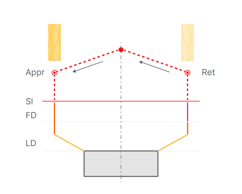
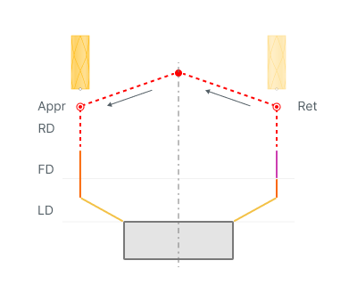
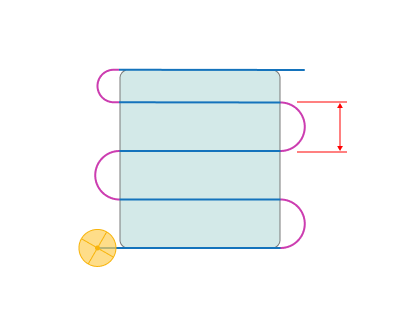
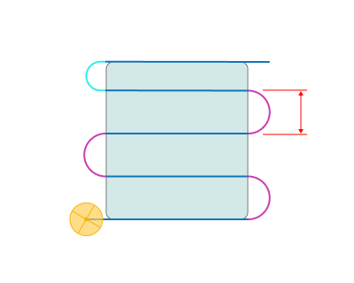
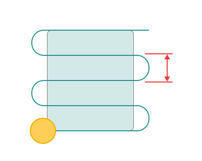
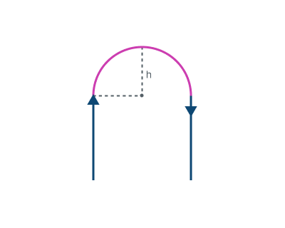

# Links in сladding operations

## 

## Application Area:

This group defines the settings for cutting in or transitions between areas.

**First links /** **Last links.** Defines the general rule of approach/return.

Click here to expand..

**Straight.**

With this rule, the approach to the part is carried out: 1. **Tool change position** 2.**Appr**- Approach 3. **LD** - Leads (If they are enabled) The returnl is carried out in the reverse order: 1. **LD** - Leads (If they are enabled) 2.**Ret** - Return 3. **Tool change position**

.png)

**On Safe Surface.**

With this rule, the approach to the part is carried out: 1. **Tool change position** 2.**Appr**- Approach 3.**SL** - Safe level 4. **FD** - Feed distance 5. **LD** - Leads (If they are enabled) The returnl is carried out in the reverse order: 1. **LD** - Leads (If they are enabled) 2. **FD** - Feed distance 3. **SL** - Safe level 4. **Ret** - Return 5. **Tool change position**

**By Rapid Distance.**

With this rule, the approach to the part is carried out: 1. **Tool change position** 2. **Appr**- Approach 3. **RD** - Rapid distance 4. **FD** - Feed distance 5. **LD** - Leads (If they are enabled) The returnl is carried out in the reverse order: 1. **LD** - Leads (If they are enabled) 2. **FD** - Feed distance 3. **RD** - Rapid distance 4. **Ret** - Return 5. **Tool change position**

**Neighbor links.**

Click here to expand..

**Continuous.**

Transitions between neighboring passes are made continuously along the part at the **Short link feed**, without retracting the tool. Combined with **Effective feeds** set to all non-rapid, this produces a continuous cladding bead. Applied only to transitions shorter than **Neighbor link max distance**.

> Note
>
> For **Area cladding** and **Cladding 3D** operations in the **Parallel** strategy the transition follows the equidistant of the outer contour; in the **Offset** strategy it is built as the shortest direct move.

**As short link.** Transitions between neighboring passes are executed as regular short links, according to the **Short links** setting.

**Neighbor link max distance.**

The maximum distance between the end points of two neighboring passes at which the transition is treated as a continuous neighbor link. If the distance is greater, the transition is built as a **Short link** or **Long link** instead.

> Note
>
> Short links operate in the gap between this value and the **Short link max distance**. If this value reaches the **Short link max distance**, that gap closes and every short transition becomes a neighbor link.

**Short links / Long links.**

Click here to expand..

**Straight.** Links are made by the shortest distance.

.png)

**Smooth.** Smooth Bezier spline transition between passes.

-1.png)

**On Safe Surface.**

The links made from from the **Feed distance** to the **Safe level**. **FD** - Feed distance **SL** - Safe level

_add.png)

**By Rapid Distance.**

The links made from from the **Rapid distance**. **RD** - Rapid distance

_add.png)

**Short link max distance.** Sets the maximum distance at which links are made by the short link type.

**Smooth link height.** Height of the link arc above the straight chord connecting two neighboring passes. The specified value is exact for the reference case — the ideal zigzag. In other configurations (Parallel forward/backward, Offset, etc.) the actual arc height may differ.

