# 拡張機能ストア

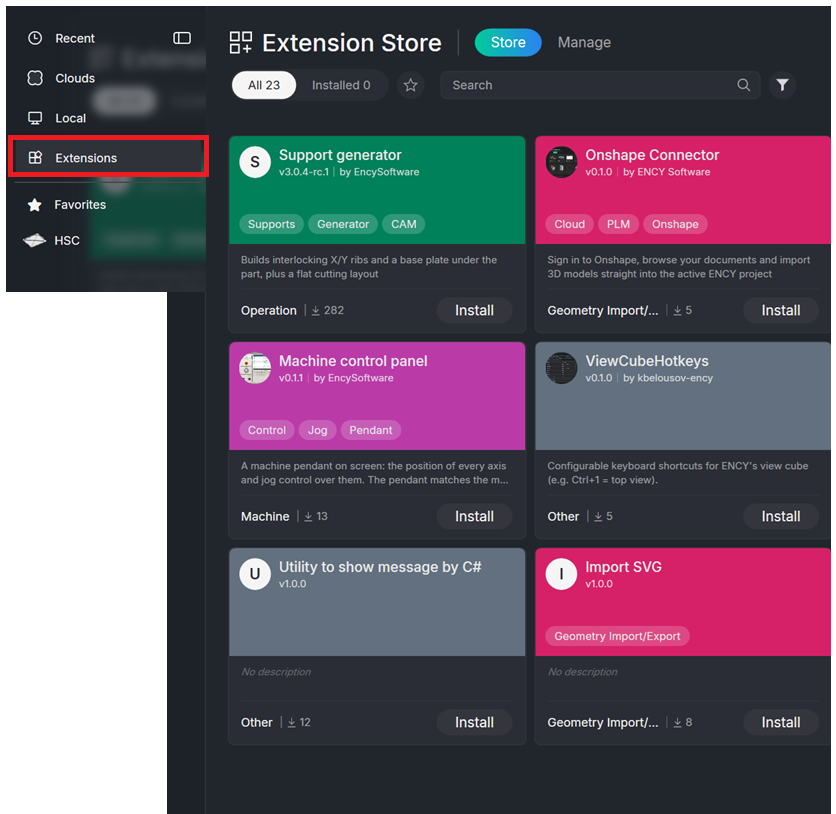

## 適用分野:

<strong>拡張機能ストア</strong>は、CAMシステム用の任意のアドオンを検索、インストール、更新、削除するための場所です。WebカタログとCAMアプリケーションを連携させます。Webストアフロントでは拡張機能の一覧を表示してインストールを開始でき、アプリケーション内のタブではローカルマシンへの実際のダウンロード、登録、削除を実行します。

ストアは次の用途で使用します。

<strong>•</strong> カテゴリ、発行元、タグ、価格別に拡張機能を参照

<strong>•</strong> 無料の拡張機能をCAMシステムに直接インストール

<strong>•</strong> 有料拡張機能の無料14日間トライアルを開始

<strong>•</strong> インストール済みの拡張機能を新しいバージョンに更新

<strong>•</strong> 不要になった拡張機能を削除

<strong>•</strong> 拡張機能のソースとローカル登録済みライブラリを管理

> 注記
>
> >
> <strong>拡張機能ストア</strong>のインターフェイスは、<strong>CAM</strong><strong>システムで選択されている言語に関係なく英語で表示されます</strong>。

### CAMエコシステムで拡張機能を操作する方法:

• <strong>Web</strong><strong>ストアフロント - [https://apps.encycam.com/](https://apps.encycam.com/)</strong> （カタログの参照、拡張機能の詳細表示、拡張機能の公開、ブラウザーからのインストール開始）

• <strong>アプリケーション内タブ -</strong> ホームページ（[詳細はこちら](file:///C:/display/SC1/.Home+Page+v19)） → <strong>拡張機能スア</strong> （ローカルマシン上での拡張機能のインストール、更新、有効化、無効化、削除）

• <strong>ExtensionManagerCLI -</strong> CAMアプリケーションの隣に配置されるコマンドラインユーティリティ（作成者および管理者による拡張機能のパッケージ化とローカル登録）

### 主な構成要素:

拡張機能ストアは、相互に連携する2つの部分で構成されています。

• <strong>Web</strong><strong>ストアフロント</strong> カタログはすべての訪問者が閲覧できます。サインインしたユーザーは、拡張機能をお気に入りに追加したり、トライアルをリクエストしたり、拡張機能を公開したりできます。作成者と管理者は、モデレーション画面と設定画面にアクセスできます。

拡大

• <strong>アプリケーション内タブ</strong> カタログ用の<strong>ストア</strong>ページと、インストール済み拡張機能およびフィード用の<strong>管理</strong>ページの2つのページがあります。タブ上部のリンクから、既定のブラウザーでWebストアフロントを開くことができます。

拡大

このタブは<strong>ホームページ</strong>から開きます。2つのページがあります。<strong>ストア</strong>（拡張機能カタログを参照し、拡張機能をインストールまたは更新します）と、<strong>管理</strong>（インストール済み拡張機能の一覧表示、有効化または無効化、ファイルからのインストール、フィード設定を行います）です。

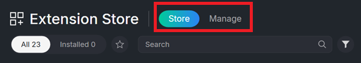

<strong>ストアページのツールバー</strong>

<strong>検索フィールド</strong> プロンプトテキストは<em>「検索</em><em>」</em>です。

<strong>並べ替えオプション</strong> 最近、名前、名前、種類の順があります。既定の順序はフィードに従います。

<strong>範囲切り替え すべて</strong>はフィードで提供されるすべての拡張機能を表示します。<strong>インストール済み</strong>は、このマシンにすでにインストールされている拡張機能のみを表示します。

<strong>お気に入り</strong> 星付きの拡張機能のみを表示するスター・フィルターです。

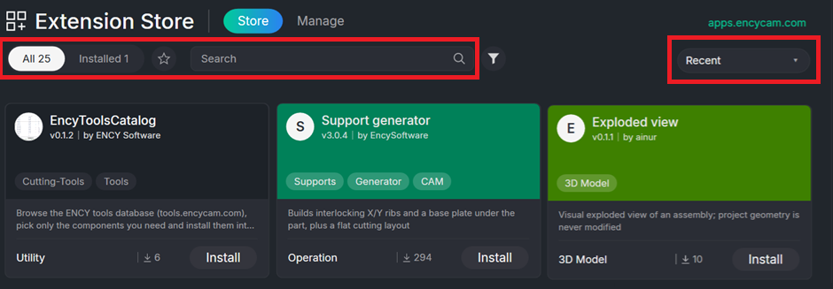

<strong>フィルターボタン。</strong>フィルターパネルを開きます。セクションは<strong>カテゴリ</strong>、<strong>価格</strong>（選択肢は<strong>すべて、無料</strong><strong>、有料</strong>）、<strong>発行元</strong>（既定は<strong>すべての発行元</strong>）、および検索プロンプト「タグを検索…」付きの<strong>タグ</strong>です。

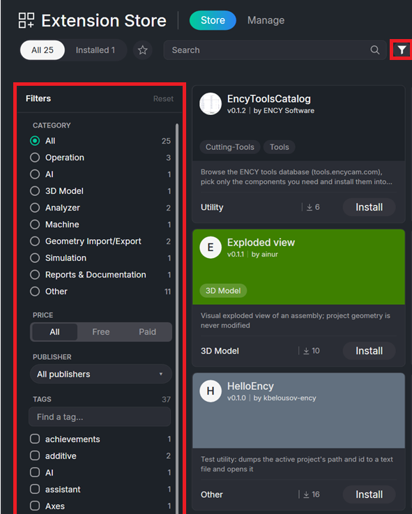

<strong>ストアページの拡張機能カード</strong>

カードには、カバー、アイコン、名前、発行元、バージョン、説明または「説明なし」、支払済みバッジ、拡張機能タイプ、ダウンロード数、お気に入りスターが表示されます。アクションボタンは状態に応じて、インストール、アップデート、アンインストール、表示、インストール済みに変わります。

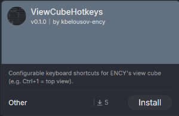

カードをクリックすると、拡張機能の説明と使用方法を確認できます。

各カードには次の項目が表示されます。

<strong>カバー</strong> 作成者が提供したスクリーンショット、カテゴリから生成された単色、またはスクリーンショットもカテゴリもない場合はエントリーポイントのアイコンが表示されます。

<strong>•</strong> <strong>名前、バージョン、発行元</strong>

<strong>•</strong> <strong>説明</strong> 作成者が空欄のままにした場合は、<em>「説明なし</em><em>」</em>というテキストが斜体で表示されます。

<strong>•</strong> <strong>タグ</strong> 最大3つのタグが表示され、その後に追加タグを示すインジケーターが表示されます。カテゴリ名と重複するタグは非表示になります。

<strong>• 支払済み</strong><strong>バッジ</strong> 拡張機能にライセンスが必要な場合に表示されます。

<strong>•</strong> <strong>モデレーション中バッジ</strong> 承認待ちの新しい拡張機能について、作成者に表示されます。

<strong>•</strong> <strong>ダウンロード数とカテゴリ名</strong>

<strong>•</strong> <strong>お気に入りスター</strong> サインインしているユーザーにのみ表示されます。

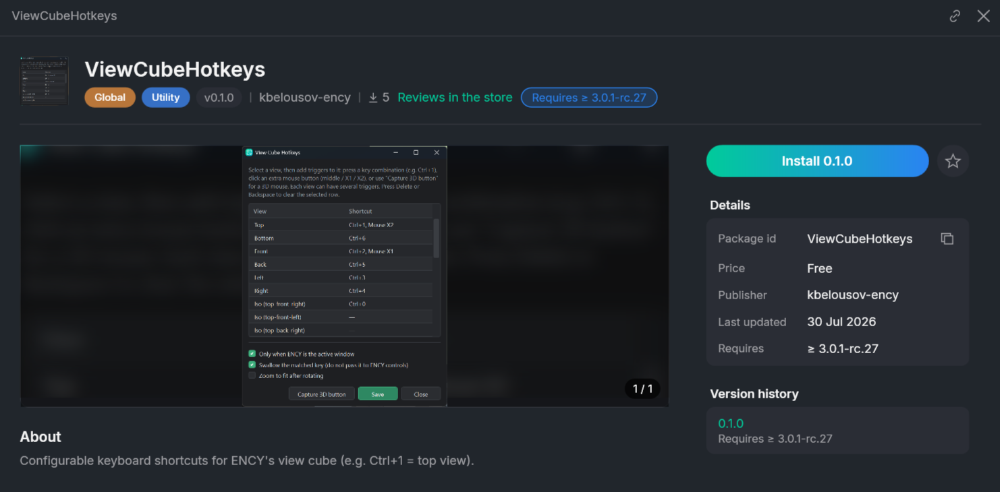

### 拡張機能のインストール

インストールには3つの開始方法があり、いずれも同じアプリケーション内プロセスに進みます。

拡大

<strong>Web</strong><strong>ストアフロントから</strong> 拡張機能ページで「Install in CAM system (v **version**)」を押します。

<strong>アプリケーション内カタログから</strong> カード上のInstallを押すか、詳細ビューを開いてInstall **version**を押します。

<strong>ファイルから 管理</strong><strong>ページ</strong>で「ファイルからインストール…」を押すか、<strong>.nupkg</strong>または<strong>.dext</strong>ファイルをタブにドラッグします。

<strong>インストール開始後</strong>、ボタンは進行状況インジケーターに変わり、「Looking in the store…」、「Searching the feeds…」、「Checking compatibility…」、「Downloading…」、「Reading package…」、「Installing…」、「Registering…」の各段階を通過します。

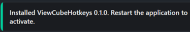

<strong>CAM</strong><strong>システムインターフェイスにおけるインストール済み拡張機能の場所</strong>

ストアはファイルをコピーして拡張機能を登録しますが、起動はしません。拡張機能が表示される場所は、拡張機能の作成者が定義したエントリーポイントによって異なります。

拡大

<strong>Utility</strong> 上部ツールバーのUtilitiesボタン、またはCtrl+Shift+Eショートカットで開くUtilitiesパレットです。

<strong>Operation Popup</strong> 加工ツリー内のオペレーションを右クリックしたときのメニューです。

<strong>Geometry Node Popup</strong> 幾何モデルツリー内のノードを右クリックしたときのメニューです。

<strong>Operation Solver</strong> プロジェクト内の操作として表示されます。拡張機能は操作とそのツールパスを計算します。

<strong>Global</strong>、<strong>CLData Converter</strong>、<strong>Utility Runner</strong> 表示される場所はありません。コードは起動時、ツールパス計算中、またはユーティリティ起動時に自動的に実行されます。

インストール済みの拡張機能が想定した場所に表示されない場合は、<strong>管理</strong>ページでライブラリまたはそのエントリーポイントが無効になっているか、CAMシステムの再起動が必要な可能性があります。

例として、<strong>Support Generator</strong>拡張機能がインストールされています。カードの説明には、起動方法の手順が記載されています。

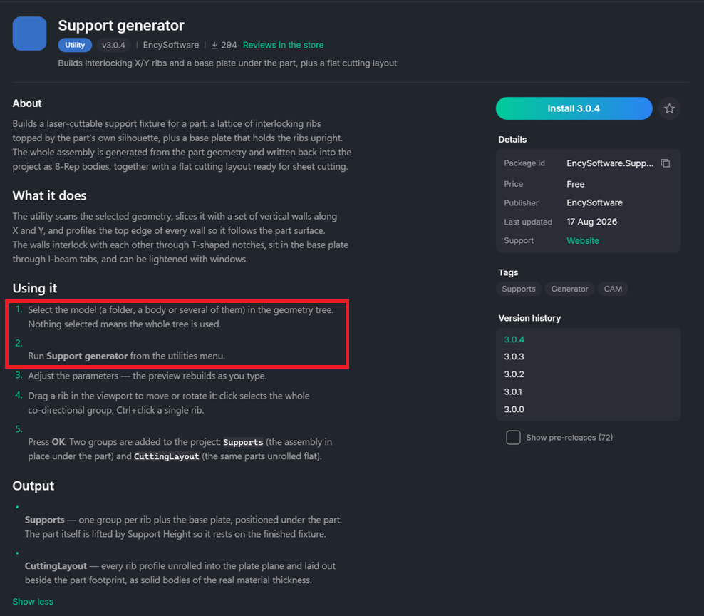

画面下部に、拡張機能がインストールされたことを示す通知が表示されます。

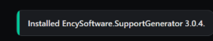

プロジェクトは<strong>フィーチャー認識</strong>プロジェクトライブラリから開きます。

<strong>モデル</strong>タブで、図形を選択し、<strong>サポートを生成</strong>します。

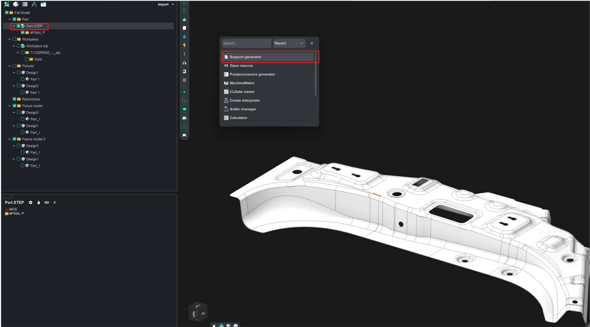

表示されるダイアログボックスで、必要なパラメーターを設定します。

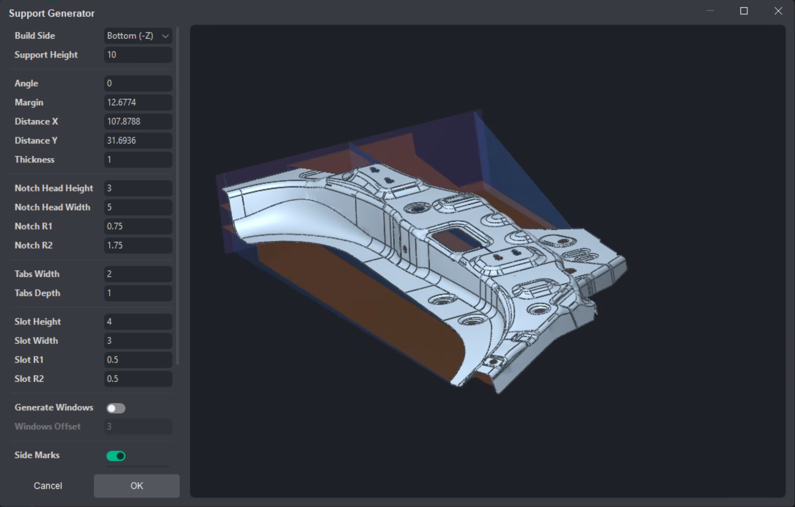

ダイアログボックスを閉じると、部品に必要なサポートが作成されます。

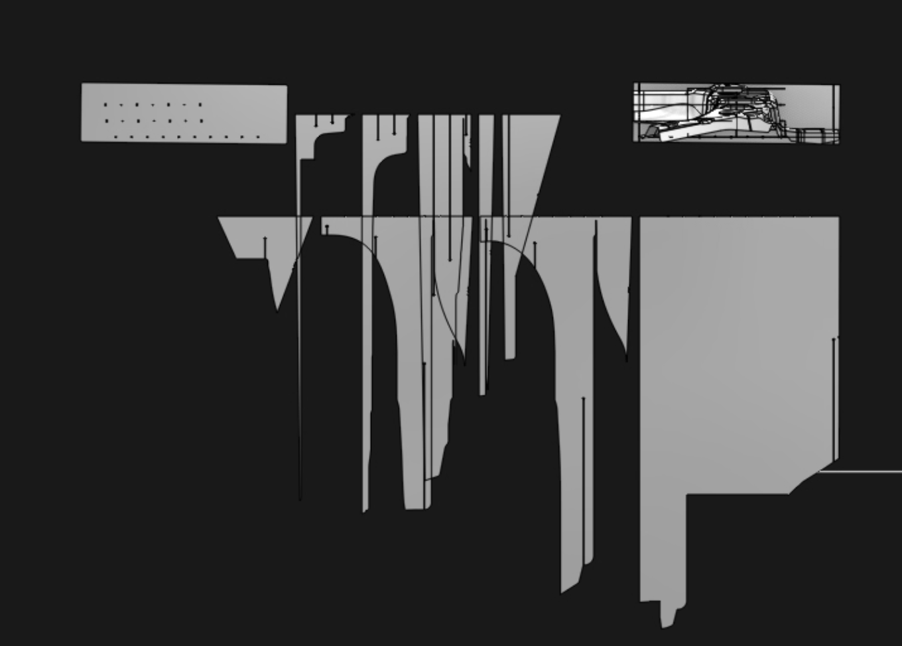

