# Loja de extensões

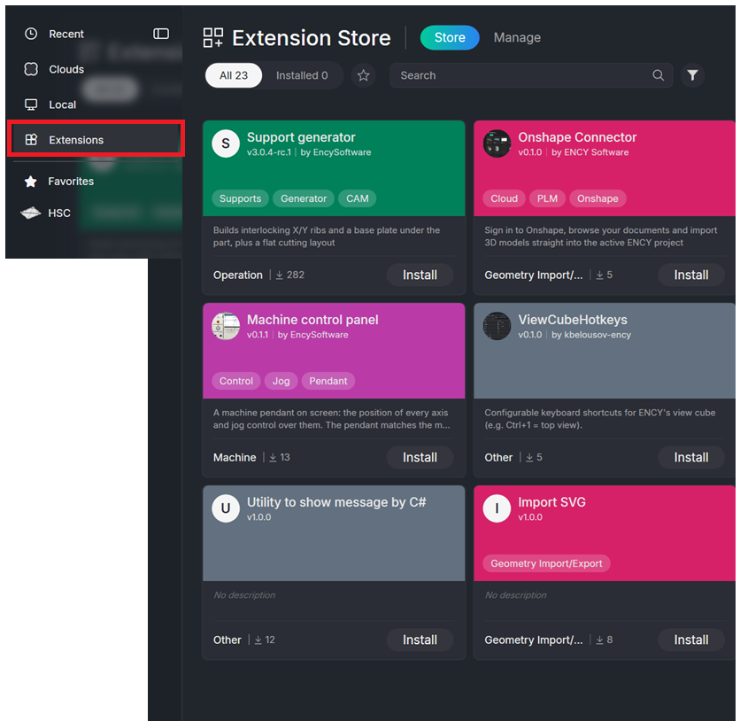

## Área de aplicação:

A **Extension Store** permite localizar, instalar, atualizar e remover extensões opcionais do sistema CAM. Ela integra um catálogo Web ao aplicativo: a loja Web apresenta as extensões e permite iniciar uma instalação, enquanto a guia no aplicativo realiza o download, o registro e a remoção no computador local.

A loja permite:

- consultar extensões por categoria, publicador, tag ou preço;

- instalar extensões gratuitas diretamente no sistema CAM;

- iniciar um período de avaliação gratuito de 14 dias para extensões pagas;

- atualizar extensões instaladas;

- remover extensões que não são mais necessárias;

- gerenciar fontes de extensões e bibliotecas registradas localmente.

> Nota
>
> A interface da **Extension Store** é exibida em **inglês, independentemente do idioma selecionado no sistema CAM**.

### Formas de trabalhar com extensões no ecossistema CAM:

- **Loja Web — [https://apps.encycam.com/](https://apps.encycam.com/).** Permite consultar o catálogo, visualizar detalhes, publicar extensões e iniciar a instalação pelo navegador.

- **Guia no aplicativo.** Acesse a página inicial ([Detalhes](10201021.md)) → **Extension Store** para instalar, atualizar, ativar, desativar e remover extensões no computador local.

- **ExtensionManagerCLI.** Utilitário de linha de comando localizado junto ao aplicativo CAM, destinado ao empacotamento e ao registro local de extensões por autores e administradores.

### Componentes principais:

A loja de extensões é composta por duas partes interligadas:

- **Loja Web.** O catálogo pode ser consultado por qualquer visitante. Usuários autenticados podem adicionar favoritos, solicitar avaliações e publicar extensões. Autores e administradores têm acesso às telas de moderação e configuração.

Clique aqui para expandir...

- **Guia no aplicativo.** Contém as páginas **Store**, com o catálogo, e **Manage**, com as extensões instaladas e as fontes de pacotes. Um link na parte superior abre a loja Web no navegador padrão.

Clique aqui para expandir...

A guia é aberta pela **página inicial**. A página **Store** permite consultar o catálogo e instalar ou atualizar extensões. A página **Manage** lista as extensões instaladas, permite ativá-las ou desativá-las, instalar arquivos locais e configurar fontes de pacotes.

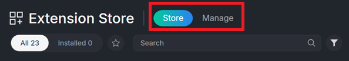

**Barra de ferramentas da página Store.**

**Campo de pesquisa.** Exibe o texto *Search*.

**Ordenação.** As opções são **Recent**, **Name**, **Publisher** e **Type**. A ordem padrão segue as fontes de pacotes.

**Escopo.** **All** mostra todas as extensões oferecidas pelas fontes de pacotes. **Installed** mostra somente as instaladas no computador.

**Favoritos.** O filtro com uma estrela mostra apenas as extensões marcadas como favoritas.

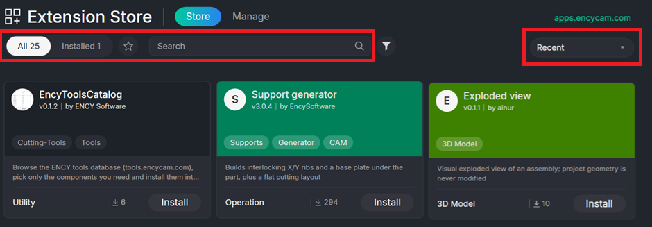

**Filtro.** Abre o painel de filtros, com as seções **CATEGORY**, **PRICE** — opções **All**, **Free** e **Paid** —, **PUBLISHER**, cujo padrão é **All publishers**, e **TAGS**, com o campo de pesquisa *Find a tag…*.

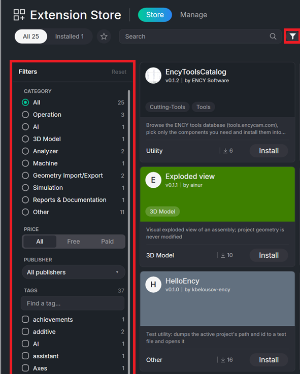

**Cartão da extensão na página Store.**

O cartão apresenta capa, ícone, nome, publicador, versão, descrição ou *No description*, indicação **Paid**, tipo da extensão, quantidade de downloads e estrela de favorito. O botão de ação varia conforme o estado: **Install**, **Update**, **Uninstall**, **View** ou **Installed**.

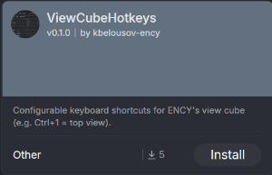

Clique no cartão para consultar a descrição e as instruções de uso da extensão.

Cada cartão apresenta:

- **Capa.** Captura de tela fornecida pelo autor, uma cor associada à categoria ou, na ausência de ambas, um ícone do ponto de entrada.

- **Nome, versão e publicador.**

- **Descrição.** Se não tiver sido preenchida pelo autor, o texto *No description* será exibido em itálico.

- **Tags.** São exibidas até três tags e um indicador de tags adicionais. A tag que repete o nome da categoria fica oculta.

- **Paid.** Indica que a extensão exige uma licença.

- **On moderation.** Indicação visível ao autor de uma nova extensão enquanto ela aguarda aprovação.

- **Quantidade de downloads e nome da categoria.**

- **Estrela de favorito.** Visível somente para usuários autenticados.

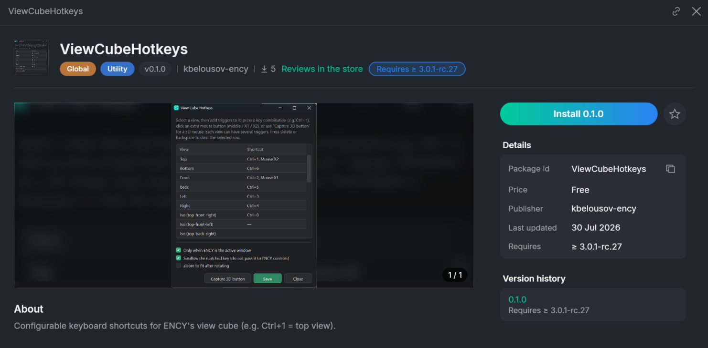

### Instalação de uma extensão.

A instalação pode ser iniciada de três formas, que utilizam o mesmo processo no aplicativo.

Clique aqui para expandir...

**Pela loja Web.** Na página da extensão, clique em **Install in CAM system**, com a versão indicada entre parênteses.

**Pelo catálogo no aplicativo.** Clique em **Install** no cartão ou abra a página de detalhes e clique em **Install** junto à versão desejada.

**Por um arquivo.** Na página **Manage**, clique em **Install from file…** ou arraste um arquivo **.nupkg** ou **.dext** para a guia.

**Andamento da instalação.** O botão passa a indicar o progresso nas etapas *Looking in the store…*, *Searching the feeds…*, *Checking compatibility…*, *Downloading…*, *Reading package…*, *Installing…* e *Registering…*.

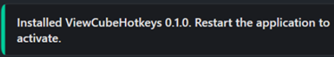

**Localização das extensões instaladas na interface do sistema CAM.**

A loja copia os arquivos e registra a extensão, mas não a executa. O local em que ela aparece depende do ponto de entrada definido pelo autor.

Clique aqui para expandir...

**Utility.** Painel de utilitários, aberto pelo botão **Utilities** da barra superior ou pelo atalho **Ctrl+Shift+E**.

**Operation Popup.** Menu de contexto de uma operação na árvore de usinagem.

**Geometry Node Popup.** Menu de contexto de um nó na árvore do modelo geométrico.

**Operation Solver.** Operação do projeto. A extensão calcula a operação e seu percurso da ferramenta.

**Global**, **CLData Converter** e **Utility Runner.** Não têm um local visível na interface. O código é executado automaticamente na inicialização, durante o cálculo do percurso ou ao iniciar um utilitário.

Se uma extensão instalada não aparecer no local esperado, a biblioteca ou seu ponto de entrada pode estar desativado na página **Manage**, ou pode ser necessário reiniciar o sistema CAM.

O exemplo a seguir utiliza a extensão **Support Generator**. A descrição do cartão informa como executá-la.

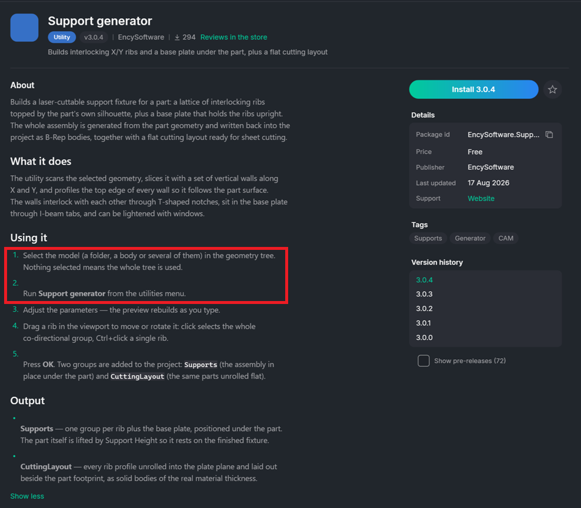

Uma notificação na parte inferior da tela confirma a instalação da extensão.

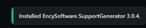

Abra o projeto na biblioteca de projetos **Recognize Features**.

Na guia **Model**, selecione a geometria da peça e execute o comando para **gerar os suportes**.

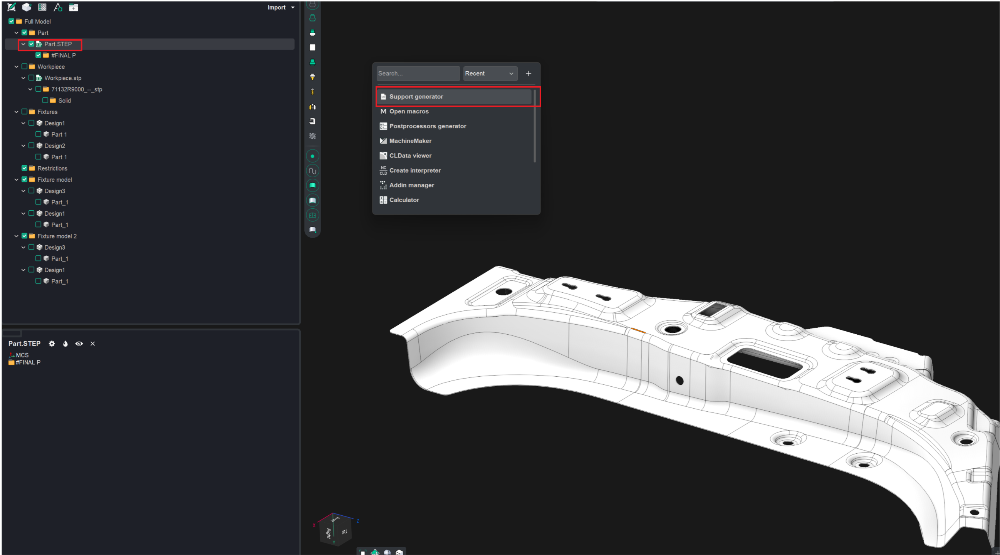

Na caixa de diálogo exibida, defina os parâmetros necessários.

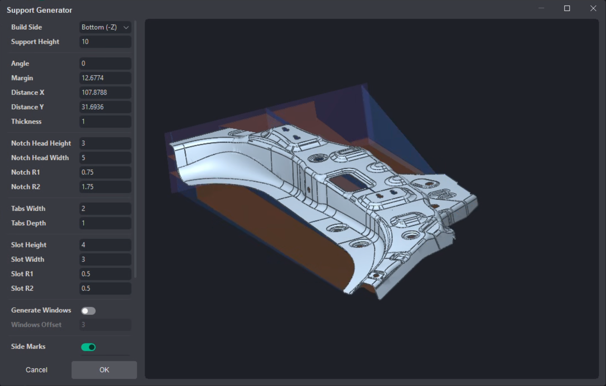

Ao fechar a caixa de diálogo, os suportes da peça serão criados.

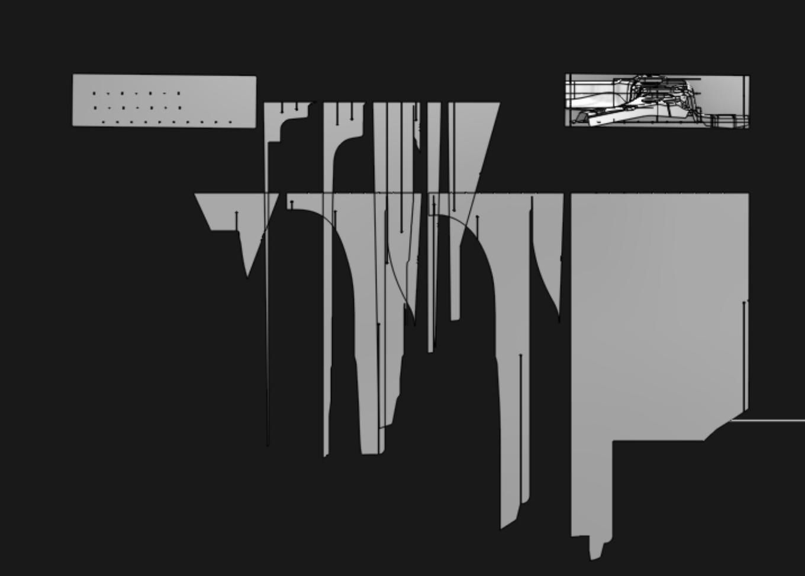

