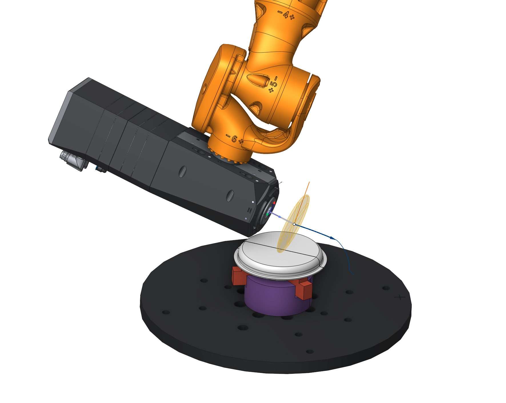
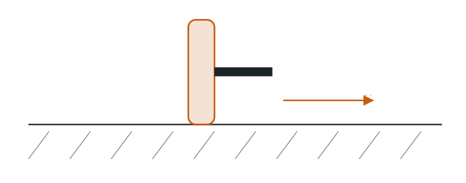
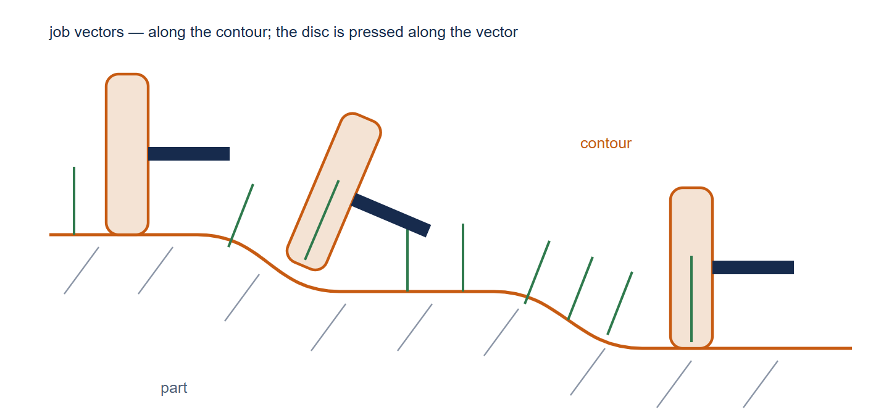
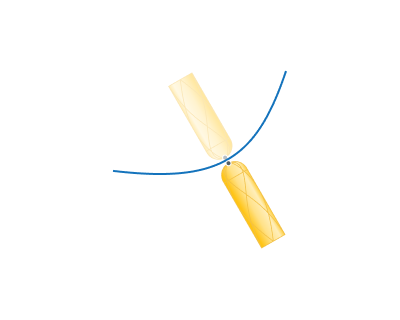
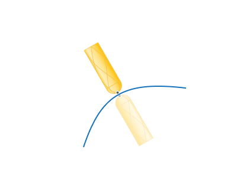

# 輪郭研磨

## 

## 適用分野:

この加工は、ディスク工具を使用し、指定された輪郭に沿って部品の壁面およびエッジを仕上げるためのものです。接触はディスク外周部で行われます。この加工は、3次元輪郭およびアンダーカット領域に対応しています。

### 加工原理

ディスクは加工対象のエッジを横切る向きに配置されます。送りは輪郭に沿って進み、工具の回転によってエッジを横切る方向の研磨動作が生じます。各ツールパス点におけるディスクの位置は、部品との接触によって決定されます。

接触しない区間、または部品がディスクに干渉する区間は、加工パスからトリムされます。残ったパスは、安全面上のリンク動作によって接続されます。

<em>上面図。輪郭軸は観察者の方向を向いています。ディスクは外周部でエッジに接触し、送りは輪郭に沿って進み、研磨動作はエッジを横切る方向に行われます</em><em>。</em>

## セットアップ:

<strong>セットアップ</strong>タブでは、プロジェクトの主要パラメーターを設定します。これには、装置上での部品の位置決め、部品の座標系などが含まれます。 [詳細を見る](1022.md)

## ジョブ割当て:

<strong>5D カーブ</strong> システムは、任意の曲線を部品表面へ投影して5軸ツールパスを生成します。この場合、工具接触点は表面に接触した状態で移動します。パスは、取り代またはレベルによって曲線からオフセットできます。工具軸は表面に対して垂直に配置されます。 [詳細を見る](https://confluence.encycam.com/pages/viewpage.action?pageId=137035070)

<strong>プロパティ</strong> 要素のプロパティを表示します。取り代を追加できます。また、リスト内の項目をダブルクリックしてこのメニューを呼び出すこともできます。

<strong>削除</strong> リストから項目を削除します。

<strong>制限</strong> 加工しない領域を指定できます。 [詳細を見る](101231.md)

<em>上面図。加工ベクトルは輪郭軸に対して垂直で、工具が部品に接触する側を定義します。ベクトルを反転すると加工側が切り替わります</em><em>。</em>

## 加工設定:

### 輪郭軸

加工ベクトルに対して垂直な基準方向を定義します。ロールモードでは、この方向によって固定工具軸も決定されます。

拡大

<strong>方向</strong> X、Y、Z、またはカスタムを選択します。既定の方向はZです。カスタムでは任意のベクトルを定義します。

<strong>原点</strong> 軸上の点のX、Y、Z座標を定義します。この点は、軸のグラフィカル表示の位置決めに使用されます。

<strong>基準座標系</strong> 軸を定義する座標系を指定します：グローバル座標系またはワーク座標系（WCS）。

### 工具接触点

### 工具接触点（TCP）は、加工中に工具とワーク表面または幾何要素との主要な相互作用点を定義する、切削工具上の特定位置です。この機能の主要パラメーターは、5次元サーフェシング加工と同じです。 詳細を見る

### 工具の向き

### 工具軸の姿勢を制御します。この機能の主要パラメーターは、5次元サーフェシング加工と同じです。 詳細を見る

<strong>工具軸方向を反転</strong> 工具軸ベクトルの方向を反転します。コンピューター支援製造（CAM）システムが意図した側とは反対側から誤って面を加工しようとする場合、またはツールパスを生成できない場合に、このパラメーターを使用します。

 
