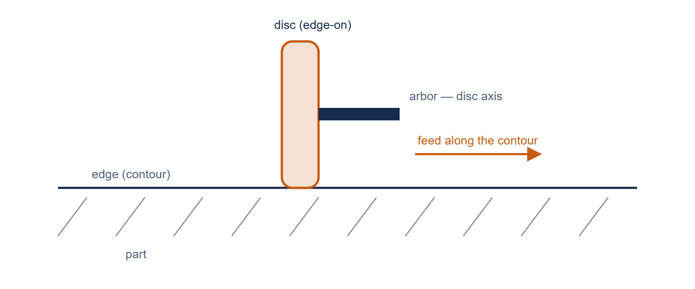
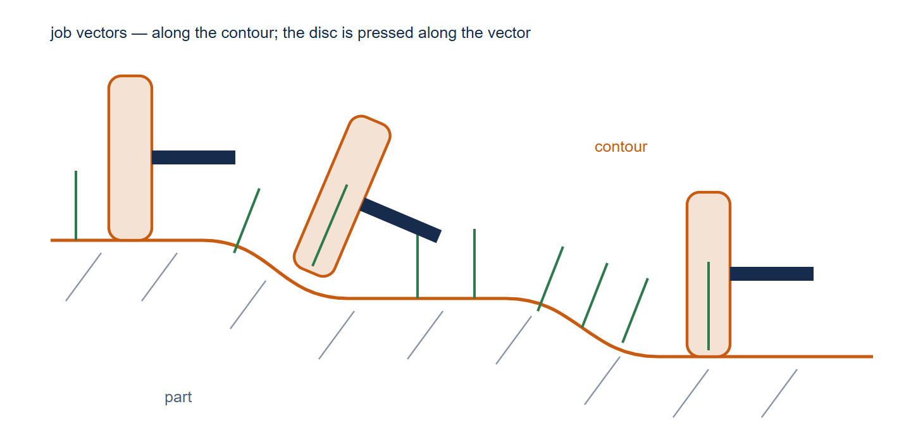
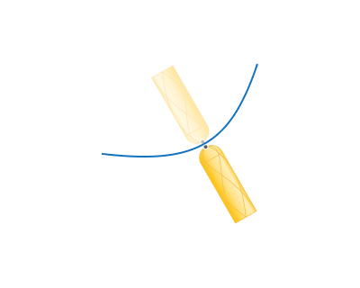
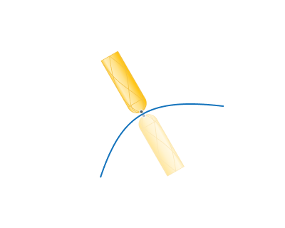

# Konturpolieren

## Anwendungsbereich:

Die Operation bearbeitet Bauteilwände und Kanten entlang vorgegebener Konturen mit einem Scheibenwerkzeug. Der Kontakt erfolgt am Scheibenumfang. Räumliche Konturen und Hinterschnitte werden unterstützt.

### Bearbeitungsprinzip.

Die Scheibe wird quer zur bearbeiteten Kante positioniert. Der Vorschub folgt der Kontur, während die Werkzeugdrehung eine Polierbewegung quer zur Kante erzeugt. Die Scheibenlage wird an jedem Bahnpunkt aus dem Kontakt mit dem Bauteil bestimmt.

Abschnitte ohne Kontakt oder mit Behinderung durch das Bauteil werden aus der Arbeitsbahn entfernt. Die verbleibenden Bahnen werden über die Sicherheitsfläche verbunden.

*Draufsicht. Die Konturachse zeigt zum Betrachter. Der Scheibenumfang berührt die Kante; der Vorschub verläuft entlang der Kontur, die Polierbewegung quer dazu.*

### Einrichtung:

Auf **Setup** werden grundlegende Projektparameter wie Bauteillage und Werkstückkoordinatensystem festgelegt. [Details](1022.md)

### Auftragszuweisung:

**5D Curve.** Erzeugt eine 5-Achsen-Bahn durch Projektion von Kurven auf die Bauteilfläche. Der Werkzeugkontaktpunkt bleibt auf der Fläche; die Werkzeugachse steht normal dazu. Bahnen können über Aufmaß oder Ebenen versetzt werden. [Details](10131.md)

**Properties (Eigenschaften).** Öffnet die Elementeigenschaften, beispielsweise zur Eingabe eines Aufmaßes. Auch durch Doppelklick auf einen Listeneintrag erreichbar.

**Delete (Löschen).** Entfernt ein Element aus der Liste.

**Restrictions (Begrenzungen).** Definiert nicht zu bearbeitende Bereiche. [Details](101231.md)

*Draufsicht. Die Auftragsvektoren stehen senkrecht zur Konturachse und bestimmen die Kontaktseite des Werkzeugs. Durch Umkehren der Vektoren wird die Bearbeitungsseite gewechselt.*

### Strategie:

#### Konturachse.

Bezugsrichtung senkrecht zu den Auftragsvektoren. Im Modus **Roll** bestimmt sie außerdem die feste Werkzeugachse.

Weitere Informationen anzeigen

**Direction (Richtung).** Wählt X, Y, Z oder **Custom**. Vorgabe ist Z; Custom ermöglicht einen beliebigen Richtungsvektor.

**Origin (Ursprung).** X-, Y- und Z-Koordinaten eines Achspunkts zur Positionierung der grafischen Achsdarstellung.

**Base CS (Bezugskoordinatensystem).** Koordinatensystem der Achsdefinition: **Global** oder **WCS**.

#### Werkzeugkontaktpunkt.

Definiert die Stelle am Werkzeug, die mit der Bauteilfläche oder den Geometrieelementen in Kontakt steht. Die grundlegenden Parameter entsprechen denen der 5D-Flächenbearbeitung. [Details](10135.md)

#### Werkzeugausrichtung

Steuert die Werkzeugachse. Die grundlegenden Parameter entsprechen denen der 5D-Flächenbearbeitung. [Details](10135.md)

**Inverse tool axis direction (Werkzeugachse umkehren).** Kehrt den Werkzeugachsenvektor um. Verwenden Sie diese Option, wenn die Bearbeitung auf der falschen Flächenseite angesetzt wird oder keine Bahn erzeugt werden kann.

 

### Parameter:

**Parameters.** Grundlegende Einstellungen dafür, wie Bauteil, Rohteil, Spannmittel und weitere Geometrie die Werkzeugbahn beeinflussen. [Details](100112.md)

### Verbindungen und An-/Abfahrbewegungen:

**Links/Leads.** Steuert Anfahren und Rückkehr, Verbindungen über die Sicherheitsfläche sowie die Abstände beim Ein- und Ausfahren aus der Arbeitsbahn.

Weitere Informationen anzeigen

**Parametergruppen:**

**Approach/Return.** Legt Anfahr- und Rückfahrregeln sowie die Werkzeugwechselposition fest. Diese Einstellungen bestimmen die Bewegung zum Bahnanfang und vom Bahnende weg. [Details](100116.md)

**Safe motions.** Definiert Sicherheitsfläche und Sicherheitshöhe für Verbindungen zwischen Arbeitsbahnen sowie Anfahren und Rückkehr. [Details](100117.md)

**Distances.** Enthält **Max retraction distance** für den axialen Rückzug und **Feed distance** für den Vorschubwechsel entlang der Werkzeugachse. [Details](100140.md)

### Vorschübe und Drehzahlen:

**Feeds/Speeds.** Legt Spindeldrehzahl, Eilgang und Vorschübe für die Bahnabschnitte fest. Die Drehzahl kann direkt oder über die Schnittgeschwindigkeit vorgegeben werden. Der vorgegebene Wert ist unterstrichen; der andere wird anhand des Werkzeugdurchmessers berechnet. [Details](100142.md)

### Transformationen:

**Transformations.** Koordinatentransformationen der berechneten Werkzeugbahn. [Details](10168.md)

### Bauteil:

**Part.** Geometrie zur Prüfung der Bahn auf unerwünschte Einschnitte. [Details](330.md)

### Rohteil:

**Workpiece.** Material, das in der Operation bearbeitet wird. [Details](738.md)

### Spannmittel:

**Fixtures.** Spannfutter, Greifer, Spannpratzen und weitere gesperrte Geometrie, die bei der Bahnberechnung berücksichtigt wird. [Details](10283.md)
