# ネスティング

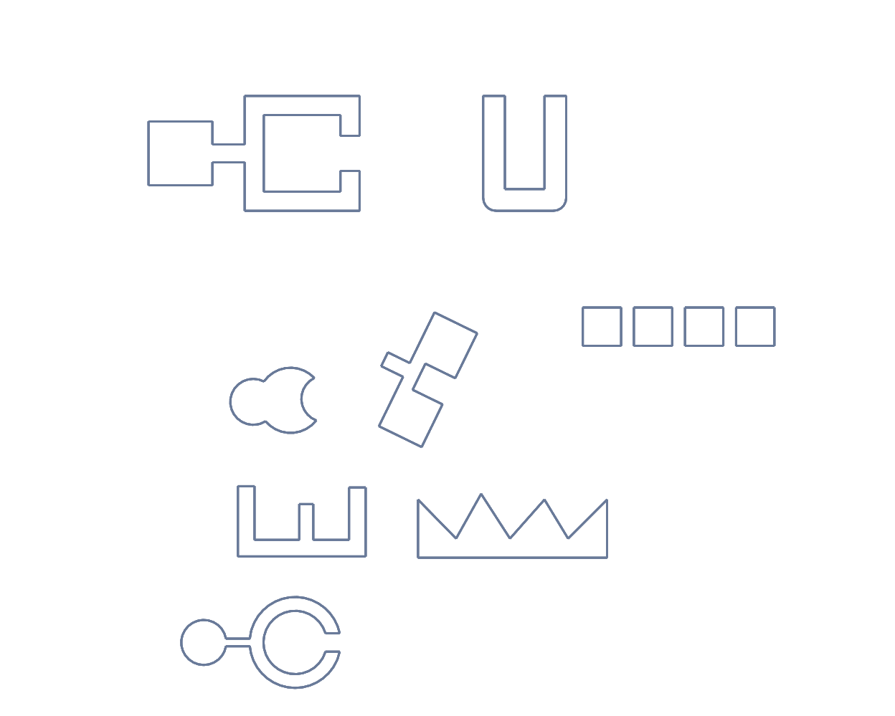 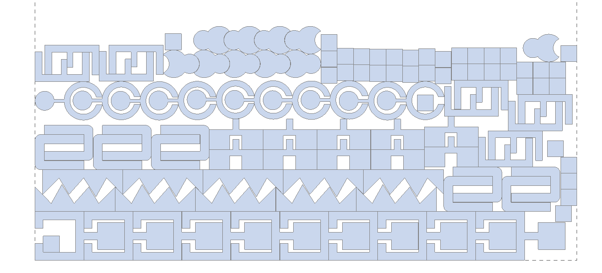

## 適用分野:

ネスティングツールは<strong>モデルタブ</strong>から使用できます。<strong>シートを右クリックし</strong>、<strong>ネスティングを作成</strong>を選択すると、選択した部品を自動的に配置し、材料使用率を最適化できます。

ネスティングツールは、選択した部品をシート上に自動配置し、材料使用率を最適化して廃材を削減します。レイアウトを生成する前に、シート寸法、間隔、マージン、部品のコピー数、回転、ミラー、木目方向、および配置ルールを設定します。

### ウィンドウ構成

拡大

<strong>1.</strong> <strong>オプション</strong> <strong>タブ</strong> ネスティング計算を定義する設定が含まれています。

<strong>2. パーツ</strong> <strong>タブ</strong> ネスティング可能な部品、計算されたシート、未配置の部品、および無視された部品を表示します。各部品の数量と個別の配置ルールを定義するために使用します。

<strong>3.</strong> <strong>実行ボタン</strong> 現在の設定を使用してネスティング計算を開始します。ボタン横の矢印から、追加の計算コマンドを開くことができます。

<strong>4.</strong> <strong>シート</strong> <strong>ナビゲーション</strong> ネスティング レイアウトに含まれるシートを切り替えます。［シートを追加］コマンドで別のシートを追加します。

<strong>5.</strong> <strong>シート</strong> <strong>パラメーター</strong> 現在のシートの長さ、幅、ギャップ、マージン、および基準点を定義します。

<strong>6.</strong> <strong>設定ボタン</strong> ネスティング設定を開きます。

<strong>7.</strong> <strong>ネスティング</strong> <strong>レイアウト</strong> 現在のシート上で計算された部品配置を表示します。選択したシート パラメーター、材料要件、および配置ルールに従ってレイアウトが生成されます。

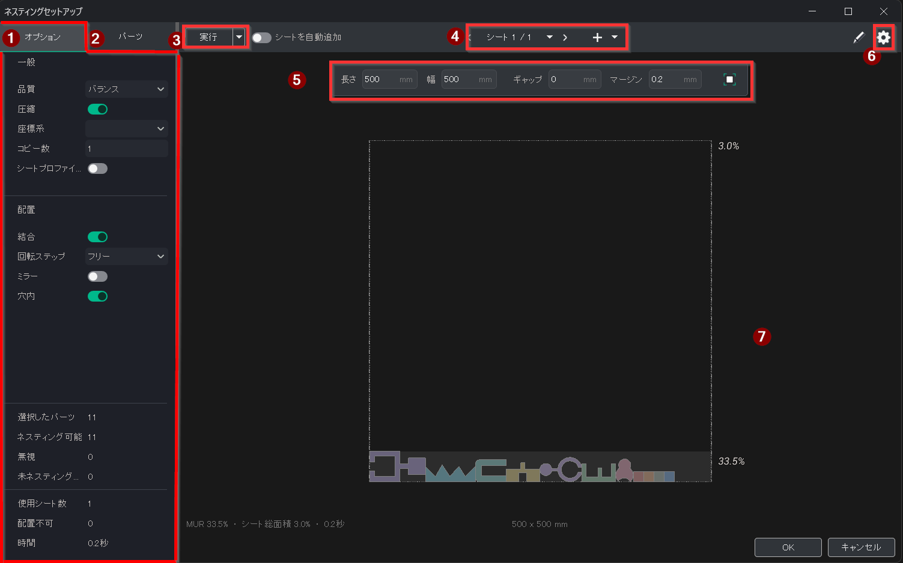

### オプションタブ

拡大

<strong>一般設定</strong>

<strong>品質</strong> 計算速度とネスティング品質のバランスを選択します。

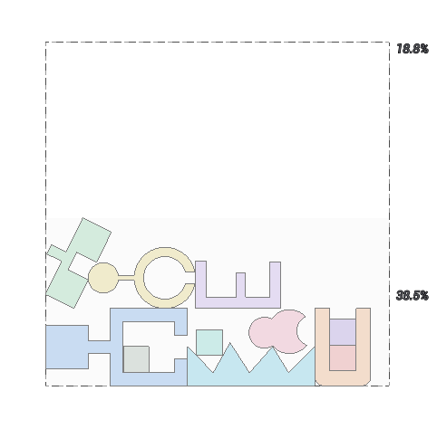 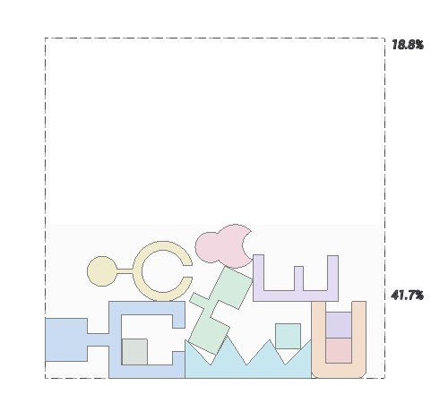 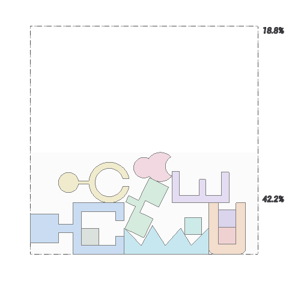

<strong>圧縮 ON</strong> の場合、可能な範囲で部品間の未使用スペースを削減します。

<strong>座標系</strong> シート レイアウトに使用する座標系を選択します。

<strong>コピー数（全パーツ）</strong> 選択したすべての部品に共通するコピー数を指定します。

 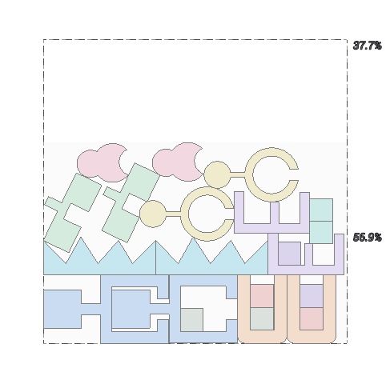

<strong>シートプロファイルを作成</strong> ネスティング作成後も、シートをプロジェクトに保持します。

<strong>配置</strong>

<strong>結合 ON</strong> の場合、互換性のある部品を同じシート上に一緒に配置できます。

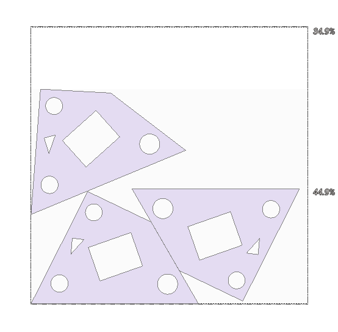 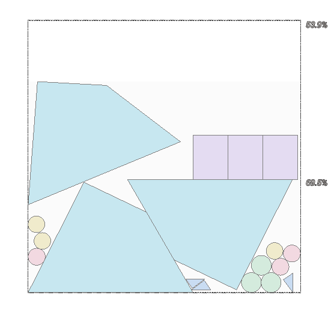

<strong>回転</strong> ネスティング中に許可する部品の回転を定義します。

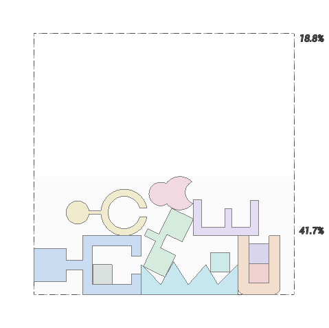 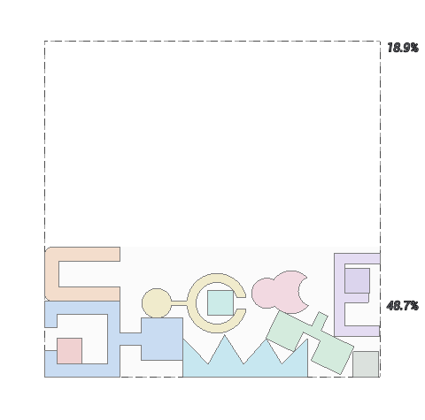 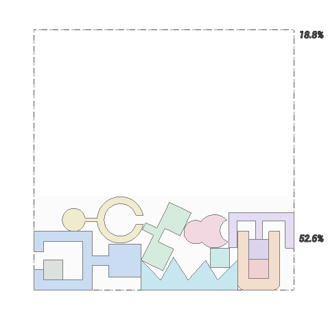 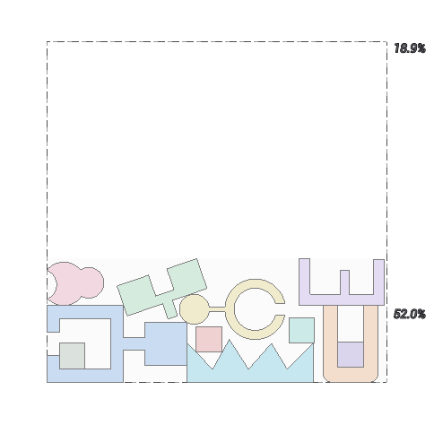 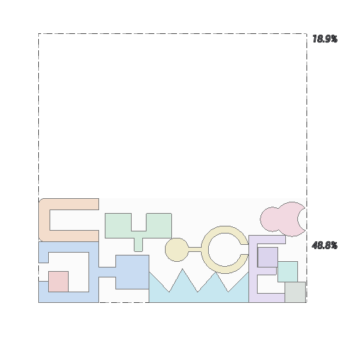

<strong>ミラー ON</strong> の場合、部品のミラー コピーを配置できます。

 

<strong>穴内 ON</strong> の場合、他の部品の適切な内部輪郭内に部品を配置できます。

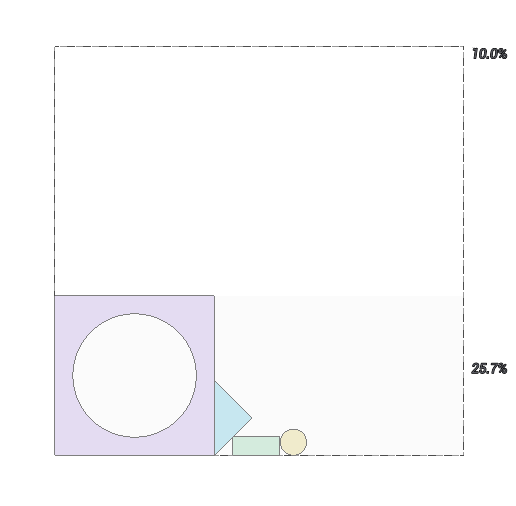 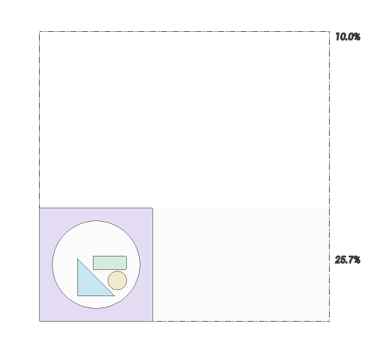

<strong>ネスティング結果</strong>

<strong>選択されたパーツ</strong> ネスティング対象として選択された部品数を表示します。

<strong>ネスティング可能</strong> 現在のネスティング条件を満たす選択部品の数を表示します。

<strong>無視</strong> 計算から除外された部品数を表示します。

<strong>未ネスティングのコピー</strong> 要求された部品コピーのうち、配置できなかった数を表示します。

<strong>使用シート数</strong> 計算されたレイアウトに必要なシート数を表示します。

<strong>適合しない</strong> 利用可能なシート形式に収まらない部品数を表示します。

<strong>時間</strong> ネスティング結果の計算に要した時間を表示します。

### パーツタブ

拡大

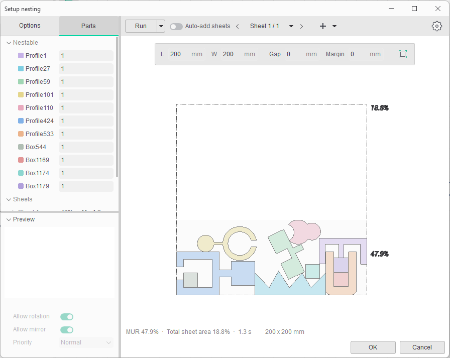

<strong>ネスティング可能</strong> ネスティングに含めることができる部品を一覧表示します。各部品の横にあるフィールドで必要数量を定義します。

<strong>シート</strong> 計算によって生成されたシートを表示します。項目には、材料使用率、配置済み部品数、および計算時間が表示されます。

<strong>未ネスティング</strong> 現在の条件で利用可能なシート上に配置できなかった部品が含まれます。

<strong>無視</strong> 計算から除外された部品が含まれます。

<strong>プレビュー</strong> 現在選択されている部品またはシートのプレビューを表示します。

<strong>回転を許可 ON</strong> の場合、ネスティング中に選択した部品の回転を許可します。

<strong>ミラーを許可 ON</strong> の場合、選択した部品のミラー配置を許可します。

<strong>優先度</strong> 選択した部品の配置優先度を定義します。

### シート パラメータ

プレビュー上部のコントロールで、現在のシートの寸法と配置制限を定義します。

拡大

<strong>長さ</strong> 現在のシートの長さを定義します。

<strong>幅</strong> 現在のシートの幅を定義します。

<strong>ギャップ</strong> 配置された部品間の最小距離を定義します。

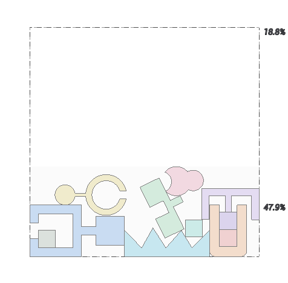 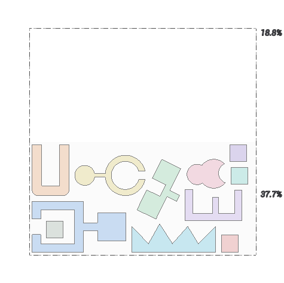

<strong>マージン</strong> シート端に沿った未使用の境界領域を定義します。

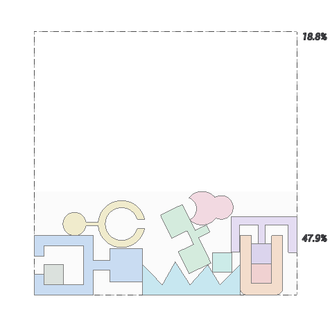 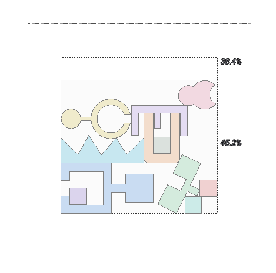

### 設定ボタン

拡大

<strong>新規シートの既定値</strong>ポップアップは、<strong>シートを追加</strong>の横にある矢印から開きます。ネスティングに追加されるシートの既定パラメーターを定義します。

<strong>ストック形式</strong> 定義済みのストック形式、または寸法を手動指定するための<strong>カスタム</strong>を選択します。

<strong>長さと幅</strong> 新しく追加される各シートの寸法を定義します。

<strong>ギャップ</strong> 新しいシート上に部品を配置する際に使用する技術的なギャップを定義します。

<strong>マージン</strong> 新しく追加される各シートの上、下、左、右の未使用領域を定義します。

### レイアウトの作成

拡大

<strong>モデルタブを開く</strong>

<strong>モデル</strong>タブを開きます。

<strong>モデルをインポートする</strong>

ENCY標準ライブラリから、次のモデルをインポートします。

Milling_25D\3 curves.3dm

<strong>ネスティングレイアウトを作成する</strong>

輪郭を右クリックし、コンテキストメニューから<strong>ネスティングを作成</strong>を選択します。

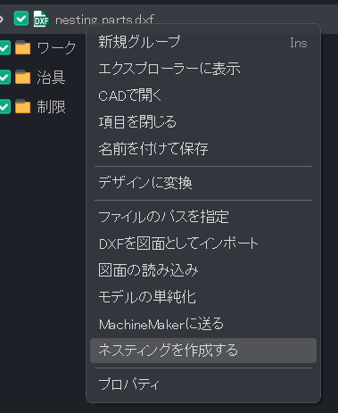

<strong>ネスティングウィンドウを開く</strong>

<strong>ネスティング設定</strong>ウィンドウが開きます。このウィンドウでは、ネスティングレイアウトを設定するためのパラメータを指定します。

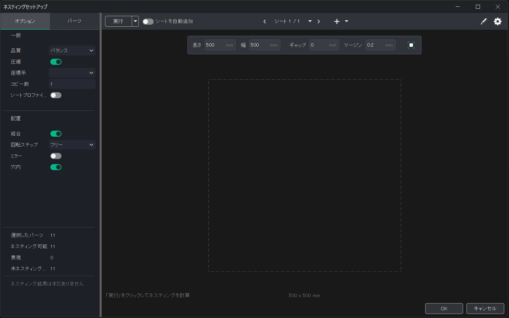

<strong>ネスティングパラメータを設定する</strong>

次のパラメータを設定します。

- <strong>コピー</strong>— 3
- <strong>回転</strong> — オフ
- <strong>幅</strong> — 100 mm
- <strong>長さ</strong> — 100 mm
- <strong>ギャップ</strong>— 3 mm
- <strong>マージン</strong> — 10 mm

続行する前に、すべてのパラメータが正しく入力されていることを確認してください。

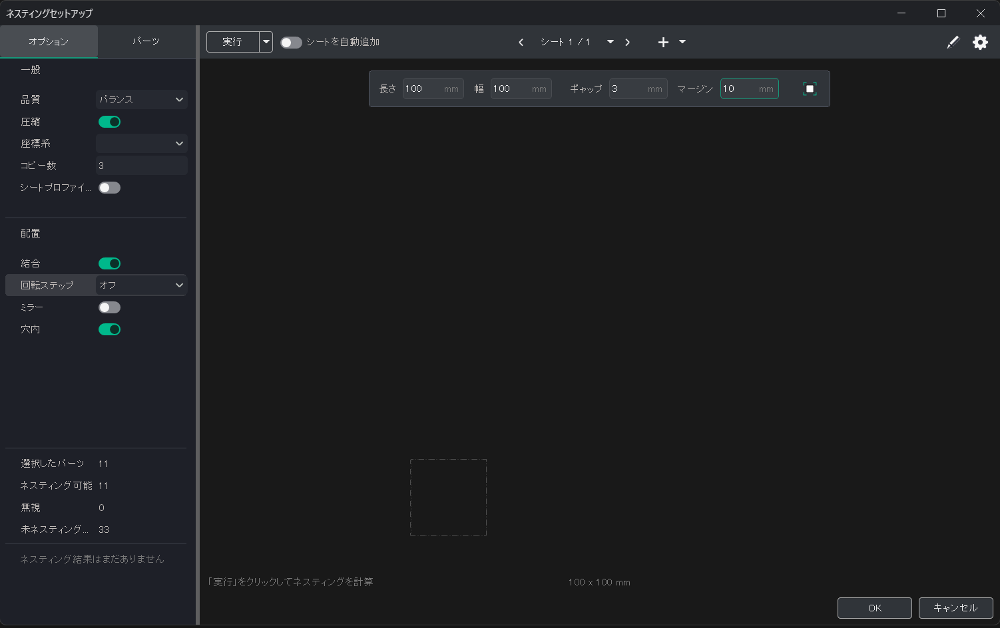

<strong>ネスティングを実行する</strong>

<strong>実行</strong>をクリックし、ネスティング処理が完了するまで待ちます。

レイアウトが作成されたら、結果を確認します。部品の配置に問題がなければ、OKをクリックして確定します。

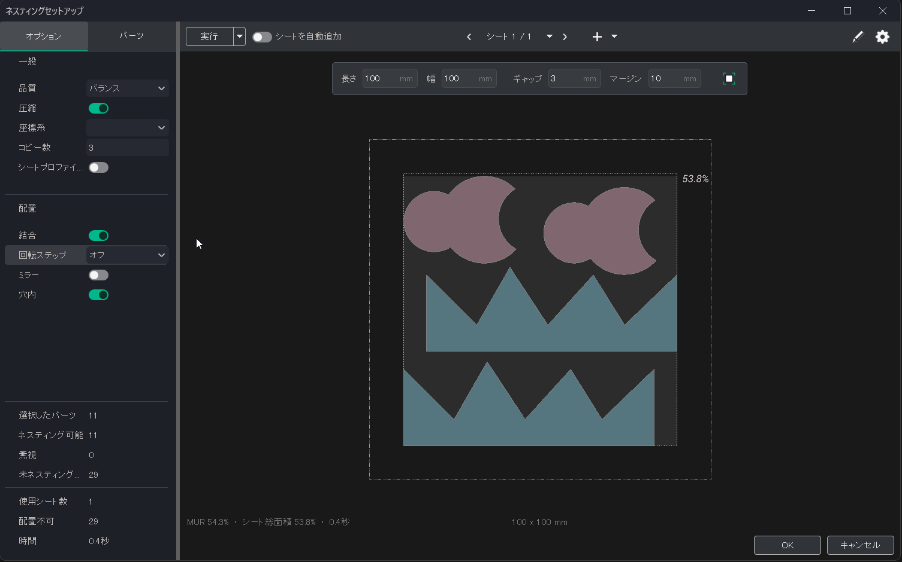

<strong>結果を確認・編集する</strong>

ネスティングレイアウトを確定すると、作成されたレイアウトを含む新しいフォルダが、<strong>パーツ</strong>フォルダ内に自動的に作成されます。

必要に応じて、作成されたネスティングレイアウトを手動で編集できます。

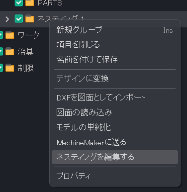

