# Nesting

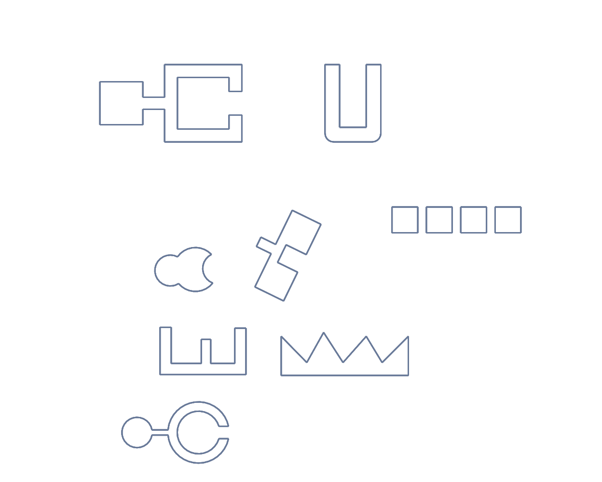 

## Área de aplicação:

A ferramenta Nesting está disponível na <strong>aba Model</strong>. <strong>Clique com o botão direito em uma chapa</strong> e selecione <strong>Create nesting</strong> para dispor automaticamente as peças selecionadas e otimizar o uso do material.

A ferramenta Nesting dispõe automaticamente as peças selecionadas em uma chapa para otimizar o uso do material e reduzir o desperdício. Antes de gerar o layout, configure as dimensões da chapa, o espaçamento, as margens, as cópias das peças, a rotação, o espelhamento, a direção das fibras e as regras de posicionamento.

### Layout da janela.

Clique aqui para expandir...

<strong>1. Aba Options.</strong> Contém as configurações que definem o cálculo de nesting.

<strong>2. Aba Parts.</strong> Exibe as peças que podem ser posicionadas, as chapas calculadas, as peças não posicionadas e as peças ignoradas. É usada para definir a quantidade e as regras individuais de posicionamento de cada peça.

<strong>3. Botão Run.</strong> Inicia o cálculo de nesting com as configurações atuais. A seta ao lado do botão abre comandos de cálculo adicionais.

<strong>4. Navegação entre chapas.</strong> Alterna entre as chapas incluídas no layout de nesting. O comando Add sheet adiciona outra chapa.

<strong>5. Parâmetros da chapa.</strong> Definem o comprimento, a largura, o espaçamento e as margens da chapa atual.

<strong>6. Edição manual.</strong> Permite editar manualmente o layout de nesting.

<strong>7. Botão Settings.</strong> Abre as configurações de nesting.

<strong>8. Layout de nesting.</strong> Exibe a disposição calculada das peças na chapa atual. O layout é gerado de acordo com os parâmetros da chapa selecionados, os requisitos de material e as regras de posicionamento.

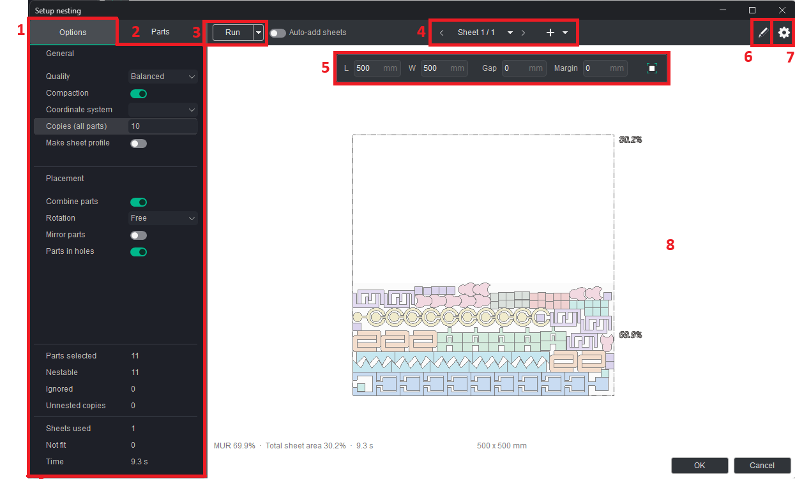

### Aba Options.

Clique aqui para expandir...

<strong>General</strong>

<strong>Quality.</strong> Seleciona o equilíbrio entre a velocidade de cálculo e a qualidade do nesting.

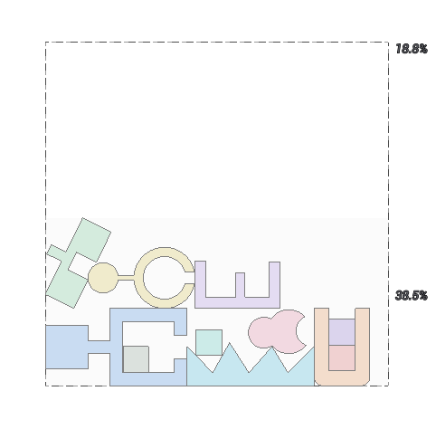 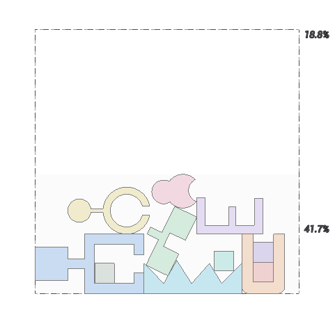 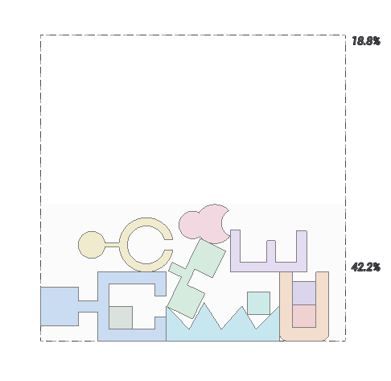

<strong>Compaction.</strong> Quando <strong>ON</strong>, reduz o espaço não utilizado entre as peças, sempre que possível.

<strong>Coordinate system.</strong> Seleciona o sistema de coordenadas usado para o layout da chapa.

<strong>Copies (all parts).</strong> Especifica um número comum de cópias para todas as peças selecionadas.

 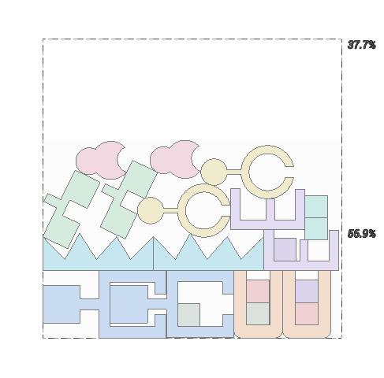

<strong>Make sheet profile.</strong> Mantém a chapa no projeto após a criação do nesting.

<strong>Placement.</strong>

<strong>Combine parts.</strong> Quando <strong>ON</strong>, permite que peças compatíveis sejam dispostas juntas na mesma chapa.

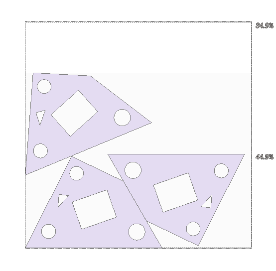 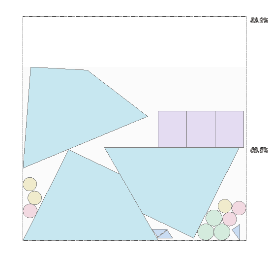

<strong>Rotation.</strong> Define a rotação permitida das peças durante o nesting.

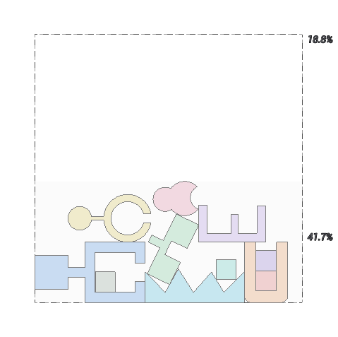 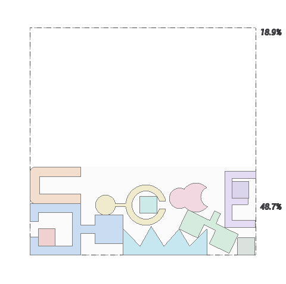 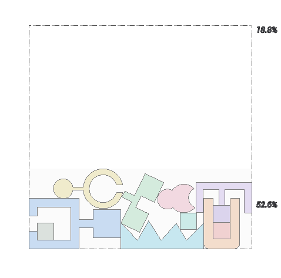 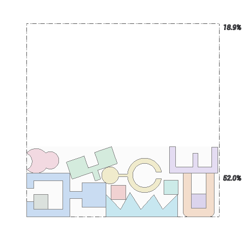 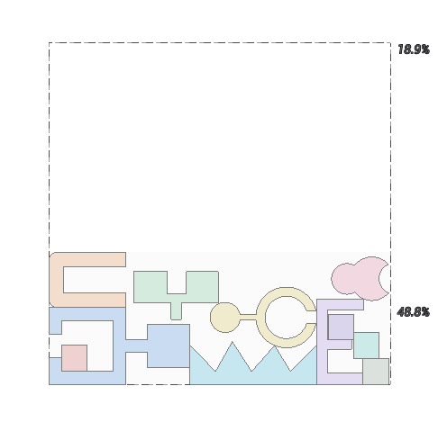

<strong>Mirror parts.</strong> Quando <strong>ON</strong>, permite posicionar cópias espelhadas das peças.

 

<strong>Parts in holes.</strong> Quando <strong>ON</strong>, permite posicionar peças dentro de contornos internos adequados de outras peças.

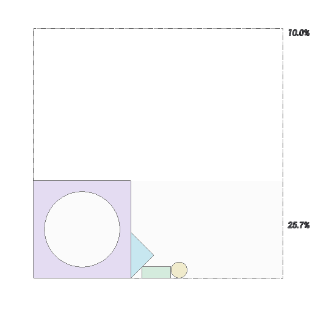 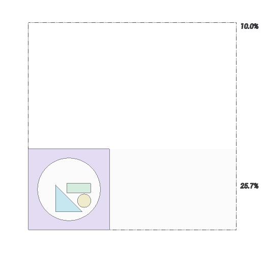

<strong>Nesting result.</strong>

<strong>Parts selected.</strong> Mostra o número de peças selecionadas para o nesting.

<strong>Nestable.</strong> Mostra o número de peças selecionadas que atendem às condições atuais de nesting.

<strong>Ignored.</strong> Mostra o número de peças excluídas do cálculo.

<strong>Unnested copies.</strong> Mostra o número de cópias solicitadas de peças que não puderam ser posicionadas.

<strong>Sheets used.</strong> Mostra o número de chapas exigidas pelo layout calculado.

<strong>Not fit.</strong> Mostra o número de peças que não cabem no formato de chapa disponível.

<strong>Time.</strong> Mostra o tempo necessário para calcular o resultado do nesting.

### Aba Parts.

Clique aqui para expandir...

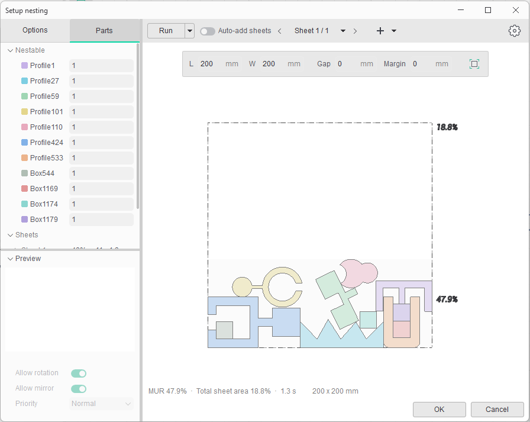

<strong>Nestable.</strong> Lista as peças que podem ser incluídas no nesting. O campo ao lado de cada peça define a quantidade necessária.

<strong>Sheets.</strong> Exibe as chapas geradas pelo cálculo. A entrada mostra o aproveitamento do material, o número de peças posicionadas e o tempo de cálculo.

<strong>Unnested.</strong> Contém as peças que não puderam ser posicionadas nas chapas disponíveis nas condições atuais.

<strong>Ignored.</strong> Contém as peças excluídas do cálculo.

<strong>Preview.</strong> Exibe uma pré-visualização da peça selecionada no momento.

<strong>Allow rotation.</strong> Quando <strong>ON</strong>, permite a rotação da peça selecionada durante o nesting.

<strong>Allow mirror.</strong> Quando <strong>ON</strong>, permite o posicionamento espelhado da peça selecionada.

<strong>Priority.</strong> Define a prioridade de posicionamento da peça selecionada.

### Parâmetros da chapa.

Os controles acima da pré-visualização definem as dimensões e as restrições de posicionamento da chapa atual.

Clique aqui para expandir...

<strong>Length.</strong> Define o comprimento da chapa atual.

<strong>Width.</strong> Define a largura da chapa atual.

<strong>Gap.</strong> Define a distância mínima entre as peças posicionadas.

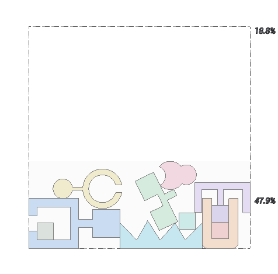 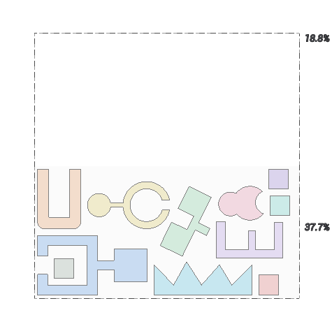

<strong>Margin.</strong> Define a faixa não utilizada ao longo das bordas da chapa.

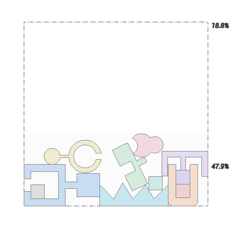 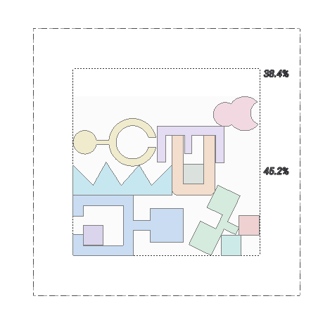

### Edição manual.

Use **Manual editing** para ajustar a disposição das peças na chapa atual.

Clique aqui para expandir...

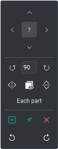

**Botões de seta (←, →, ↑, ↓).** Movem a peça selecionada até que ela toque um contorno adjacente ou a borda da chapa.

**?** Oculta as dicas de ferramenta.

**Rotate.** Gira o contorno selecionado em torno do seu centro pelo incremento de ângulo especificado.

Mantenha **R** pressionada e gire a roda do mouse para girar o contorno selecionado em torno da posição do cursor. Se vários contornos estiverem selecionados, mantenha **E** pressionada e gire a roda do mouse para girar cada contorno selecionado em torno do seu próprio centro. Por padrão, cada passo da roda do mouse gira o contorno em **5°**. Mantenha **Shift** pressionada para incrementos de **1°** ou **Alt** para incrementos de **90°**.

**Angle like a sample.** Copia o ângulo de rotação e o espelhamento de outro contorno. Selecione o contorno que deseja modificar, pressione **A** e clique no contorno cujas propriedades deseja copiar.

**Mirror.** Espelha os contornos selecionados na horizontal ou na vertical. Se vários contornos estiverem selecionados, ative **Each part** para espelhar cada peça em relação ao seu próprio centro.

**Remove.** Remove os contornos selecionados do layout de nesting e os adiciona à lista **Unnested Copies**.

**Add.** Adiciona à chapa atual os contornos selecionados no painel esquerdo, na lista **Unnested** ou **Nestable**.

**Placed by Hand.** Fixa o contorno selecionado em sua posição atual na chapa.

**Undo.** Desfaz a última ação.

**Redo.** Restaura a última ação desfeita.

**Comportamento da edição:**

- Mantenha **Ctrl** pressionada para executar essas ações sem verificação de colisões ou dos limites da chapa.
- Um **contorno vermelho** indica uma cópia que viola o afastamento exigido em relação a uma peça adjacente ou à borda da chapa.
- **Ctrl+Z** e **Ctrl+Y** funcionam em toda a janela. Eles podem desfazer ou refazer edições manuais, **Run**, **Remove Sheet** e alterações feitas nas chapas.
- Remover uma chapa ou alterar seu tamanho remove o status **Placed by Hand**.

### Botão Settings.

Clique aqui para expandir...

A janela pop-up <strong>New sheet defaults</strong> é aberta pelo ícone de engrenagem no canto superior direito. Ela define os parâmetros padrão das chapas adicionadas ao nesting.

<strong>Stock format.</strong> Seleciona um formato de chapa predefinido ou <strong>Custom</strong> para dimensões especificadas manualmente.

<strong>Length and width.</strong> Definem as dimensões de cada chapa adicionada.

<strong>Tech gap.</strong> Define o espaçamento técnico usado ao posicionar peças em uma nova chapa.

<strong>Margin.</strong> Define as áreas não utilizadas superior, inferior, esquerda e direita de cada chapa adicionada.

### Criação do layout.

Clique aqui para expandir...

<strong>Abra a aba Model</strong>

No <strong>Ency</strong>, acesse a aba <strong>Model</strong>.

<strong>Importe o modelo</strong>

Importe o seguinte modelo da biblioteca padrão do Ency:

Milling_25D\3 curves.3dm

<strong>Crie um layout de nesting</strong>

Clique com o botão direito no contorno e selecione <strong>Create Nesting</strong> no menu de contexto.

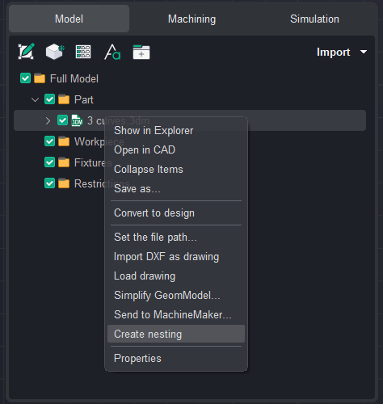

<strong>Abra a janela de nesting</strong>

A janela <strong>Setup nesting</strong> será aberta. Essa janela contém os parâmetros usados para configurar o layout de nesting.

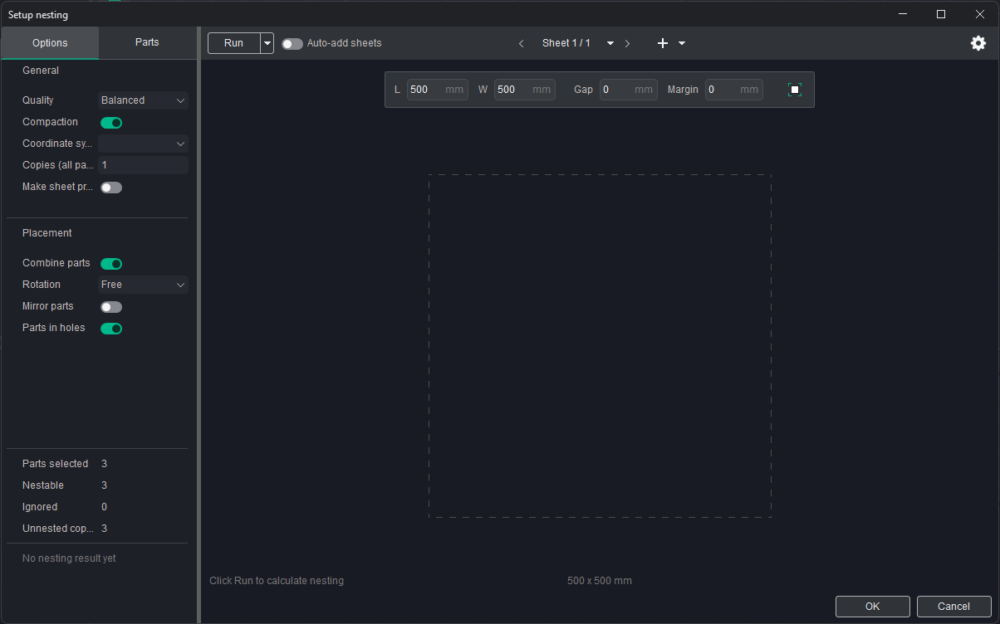

<strong>Defina os parâmetros de nesting</strong>

Defina os seguintes parâmetros:

- <strong>Copies</strong> — 3
- <strong>Rotation</strong> — Off
- <strong>Width</strong> — 100 mm
- <strong>Length</strong> — 100 mm
- <strong>Gap</strong> — 3 mm
- <strong>Frame</strong> — 10 mm

Verifique se todos os parâmetros foram informados corretamente antes de continuar.

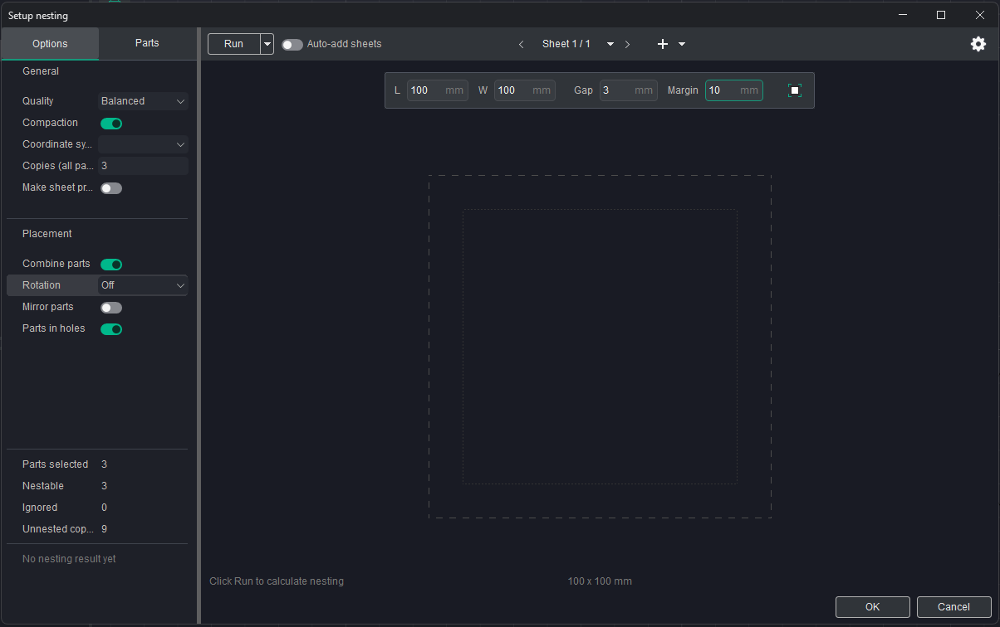

<strong>Execute o nesting</strong>

Clique em <strong>Run</strong> e aguarde a conclusão do processo de nesting.

Depois que o layout for gerado, revise o resultado. Se a disposição das peças for satisfatória, clique em <strong>OK</strong> para confirmá-la.

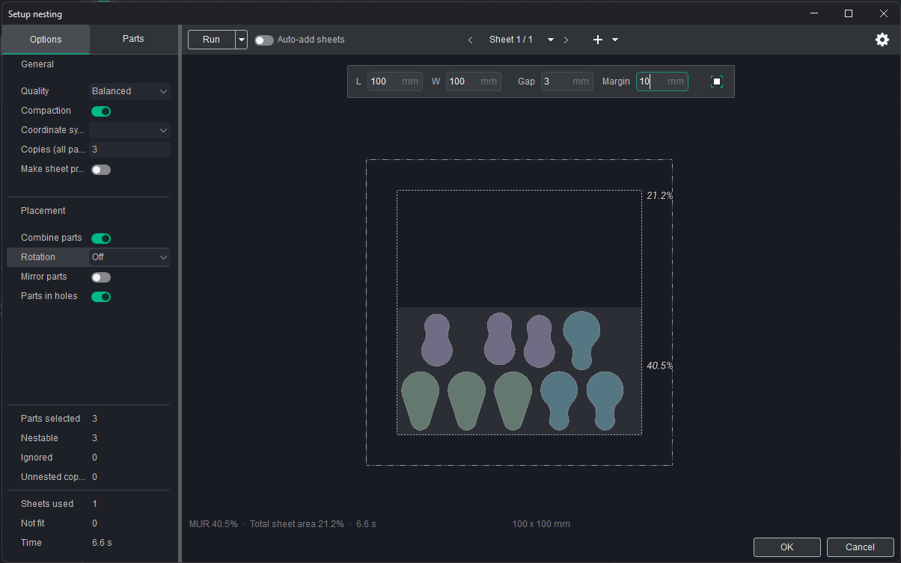

<strong>Revise e edite o resultado</strong>

Após a confirmação do layout de nesting, uma nova pasta com o layout gerado será criada automaticamente na pasta <strong>Parts</strong>.

Se necessário, o layout de nesting gerado pode ser editado manualmente.

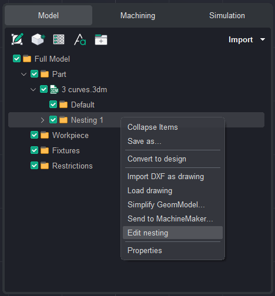

