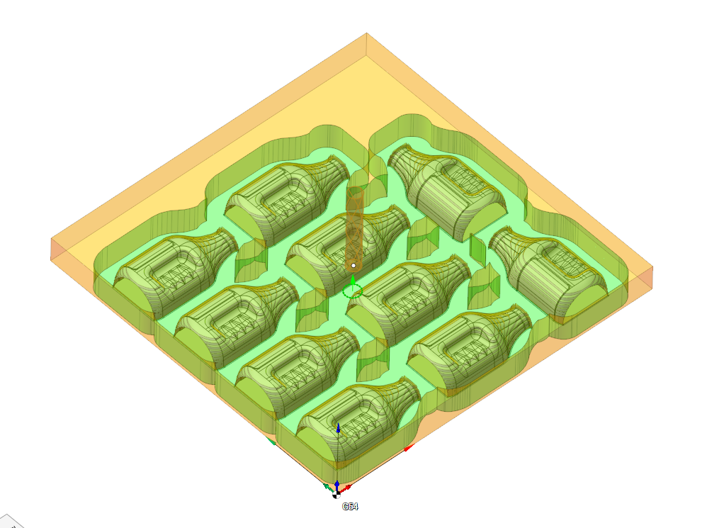
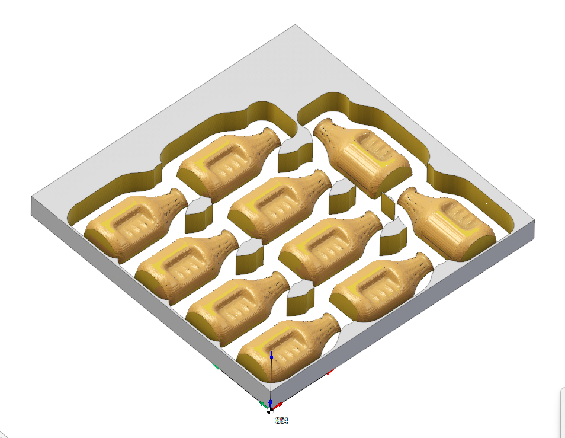

# 3D Nesting

## Application area:

3D nesting arranges copies of solid, surface or mesh parts on sheets or plates using their silhouettes — projections onto the sheet plane. Each sheet has a separate machining group: the sheet is its workpiece, and the placed copies form its part.

### Preparing parts.

1. On the **Model** tab, select a folder containing visible bodies and click **Create nesting**.
2. Set the number of copies of each part.
3. Select the part orientation and permitted rotations.

**Source geometry.** Solids, surfaces and meshes are supported. Bodies directly in a folder form one part; a subfolder forms a separate part. If a folder contains only several solids, each solid is treated as a separate part. Visible closed curves start [2D Nesting](164717805.md); hide these curves to use 3D nesting.

**Lies on the sheet.** Defines which side of the part rests on the sheet. **As in the model** keeps its original orientation. **Picked face** uses a supporting face selected by double-clicking it in the preview. The silhouette and dimensions update to match the selected orientation.

**Allow rotation.** Permits rotation in the sheet plane. Mirroring is unavailable for 3D parts.

### Sheet parameters and calculation.

**Copies multiplier.** Multiplies the quantities set for all parts.

**Sheet dimensions.** Set the length, width and margin from the sheet edges.

**Gap.** The distance between silhouettes must allow the roughing cutter to pass: set it to at least the cutter diameter, allowing for stock to leave.

**Thickness.** Open the arrow next to **+**, enable **Use sheet stock** and set the sheet thickness. It must be at least the height of the parts in their selected orientation.

Click **Run**, then **OK**. A **Nesting 1** node appears in the model with separate sheets and placed body copies. Common window parameters, sheet stock and manual layout editing are described in [2D Nesting](164717805.md).

### Machining sheets.

1. On the **Machining** tab, click **+** and select **3D nesting machining** in **Structure**.
2. Create one group per sheet. A new group automatically selects the next sheet without a group.
3. Add the required operations to the groups and assign tools.

**Sheet group.** Contains its own workpiece matching the sheet shape and thickness, and all copies placed on the sheet. The copies rest at the bottom of the workpiece. To use another sheet, select it in the group's part properties.

**Updating.** Copies in the groups update automatically after the layout changes. Recalculate the operations and update predrilling.

### Roughing.

Add a **Roughing waterline** operation to the group and assign a cutter.

**Machining zone.** Operations that support zones automatically receive a band around the parts. Its width depends on the tool diameter and radial stock to leave. Nearby bands merge; material outside the band is not removed.

**Sheet remnant.** An automatic restricted zone protects the remnant from milling. The automatic zones are not displayed in the job assignment list.

### Predrilling.

Click **Predrill** in the roughing operation's job assignment. A **Hole machining** operation is created before it, with holes where the cutter cannot enter from the side. The hole locations are added to the roughing plunging points so that the cutter enters a prepared hole vertically.

**Drill.** The smallest suitable drill with a diameter of at least 1.1 times the cutter diameter is selected automatically, first from the project, then from the current library. Check the assigned tool: if no suitable drill exists, the system may copy a drill and increase its diameter. In tool assembly mode, assign the drill manually.

**Depth.** Accounts for the workpiece, the roughing bottom level and any part beneath the hole, keeping the drill tip clear of the part.

**Recalculation.** After changing the layout or cutter, click **Predrill** again. The existing drilling operation is updated; a manually selected drill and manually edited holes are retained. Then calculate the operations.

### Simulation and NC program.

**Simulation.** Each sheet starts with its own original workpiece. Selecting a group or one of its operations shows the result for that sheet.

**Stop before sheet.** The group parameter controls the stop for replacing a sheet: **Auto** — when the previous sheet uses the same coordinate system; **Yes** — always; **No** — without a stop.

The NC program machines the sheets in sequence. The spindle and coolant are switched off before the stop, and a comment identifies the group and sheet number.
