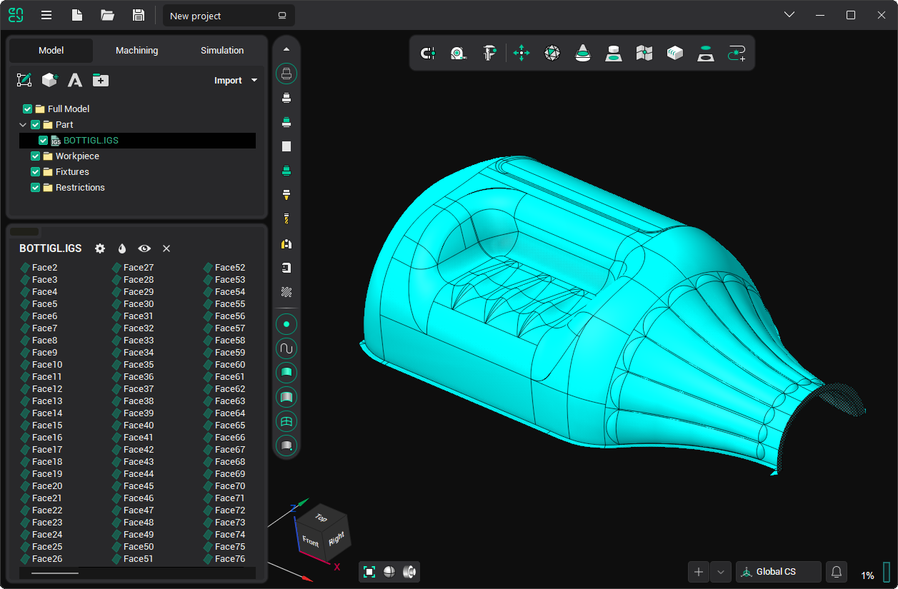
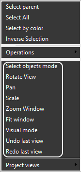
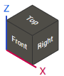
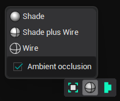
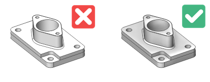
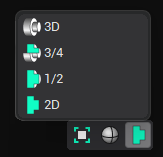

# グラフィックウィンドウと視覚化コントロール

スクリーンの主要部分は <strong>グラフィックウィンドウ</strong>で占められています。形状モデル、機械、ワーク、ツールパスなどのをオブジェクトを表示できます。

一部の可視化コントロールのホットキーは、[システム設定](90.md)ウィンドウの[表示](24.md)タブで変更できます。

視覚化パラメータは、メインウィンドウの左側にあるビューコントロールツールバー、またはグラフィックスクリーンのコンテキストメニューを使って変更することができます。

 

最初の4つの要素は、マウスの左ボタンによって実行されるアクションを切り替えます。

- [選択モード](325.md)：左クリックで、画面上からオブジェクトを選択します（これがデフォルトの状態です）。
- [ビュー回転](20.md)：左ボタンを押しながらマウスを動かすと、ビューが回転します。
- [パン](19.md): 左ボタンを押しながらマウスを動かすと、ビューが移動します。
- [スケール](855.md): 左ボタンを押しながらマウスを動かすと、ビューが拡大縮小されます。

これらの動作はすべて、モードを変更することなく簡単に実行できます。

- ビューを回転させるには、右ボタンを押したままマウスを動かします。
- ビューを移動するには、中ボタンを押しながらマウスを動かします。
- マウスホイールを回すとズームします。

ホットキーを使って表示を変更する方法もあります。以下のトピックを参照： [ウィンドウズーム](11.md)、 [ドラッグ操作による回転](20.md)、[ドラッグによるパン画面](19.md)、[インタラクティブズーム（拡大・縮小）](855.md)、[ズーム拡張](60.md)

表示されているすべてのオブジェクトを素早く表示するには、  ボタンか [フィットウィンドウ](60.md) メニュー項目を使用してください。

いくつかの [標準ビュー](728.md) は、これらのボタンを使用して切り替えることができます（ボタンの正確な外観は、マシンの種類によって異なります）。

[アンドゥ](358.md)/ [リドゥ](332.md) メニュー項目を使用して、前または次のビューにすばやく戻ります。

ドロップダウンメニューのある  ボタンは、3次元オブジェクトの表示モードを切り替えることができます。

- <strong>シェード</strong>：エッジのないシェード
- <strong>シェードプラスワイヤー</strong>：エッジのあるシェード
- <strong>ワイヤー</strong>：エッジのみ

ボタン自体をクリックすると、これらのモードが交互に切り替わります。

<strong>アンビエント オクルージョン</strong> は、シーン内の各ポイントが周囲の照明にどれだけ露出しているかを計算するために使用されるシェーディングおよびレンダリングのテクニックです。下の例をご覧ください。

上の  ボタンは回転体のみの表示モードを定義します。

- 3D
- 3Dクォーターなし
- 3Dの半分
- 2D軸断面
