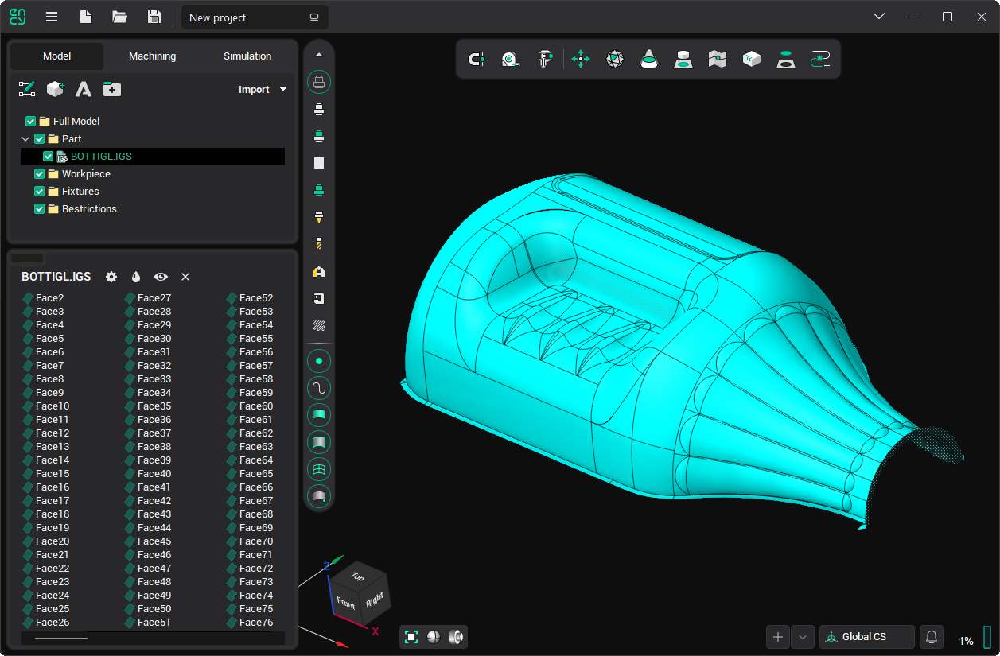
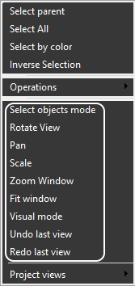
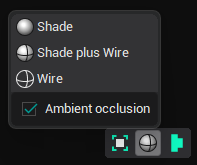
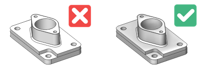
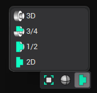

# グラフィックウィンドウと視覚化コントロール

スクリーンの主要部分は <strong>グラフィックウィンドウ</strong>で占められています。形状モデル、機械、ワーク、ツールパスなどのをオブジェクトを表示できます。

一部の可視化コントロールのホットキーは、[システム設定](90.md)ウィンドウの[表示](24.md)タブで変更できます。

視覚化パラメータは、メインウィンドウの左側にあるビューコントロールツールバー、またはグラフィックスクリーンのコンテキストメニューを使って変更することができます。

 

最初の4つの要素は、マウスの左ボタンによって実行されるアクションを切り替えます。

- [選択モード](325.md)：左クリックで、画面上からオブジェクトを選択します（これがデフォルトの状態です）。
- [ビュー回転](20.md)：左ボタンを押しながらマウスを動かすと、ビューが回転します。
- [パン](19.md): 左ボタンを押しながらマウスを動かすと、ビューが移動します。
- [スケール](855.md): 左ボタンを押しながらマウスを動かすと、ビューが拡大縮小されます。

これらの動作はすべて、モードを変更することなく簡単に実行できます。

- ビューを回転させるには、右ボタンを押したままマウスを動かします。
- ビューを移動するには、中ボタンを押しながらマウスを動かします。
- マウスホイールを回すとズームします。

ホットキーを使って表示を変更する方法もあります。以下のトピックを参照： [ウィンドウズーム](11.md)、 [ドラッグ操作による回転](20.md)、[ドラッグによるパン画面](19.md)、[インタラクティブズーム（拡大・縮小）](855.md)、[ズーム拡張](60.md)

表示されているすべてのオブジェクトを素早く表示するには、  ボタンか [フィットウィンドウ](60.md) メニュー項目を使用してください。

いくつかの [標準ビュー](728.md) は、これらのボタンを使用して切り替えることができます（ボタンの正確な外観は、マシンの種類によって異なります）。

[アンドゥ](358.md)/ [リドゥ](332.md) メニュー項目を使用して、前または次のビューにすばやく戻ります。

## 表示モードの設定：

ドロップダウンメニューのある  ボタンは、3次元オブジェクトの表示モードを切り替えることができます。

- <strong>シェード</strong>：エッジのないシェード
- <strong>シェードプラスワイヤー</strong>：エッジのあるシェード
- <strong>ワイヤー</strong>：エッジのみ

ボタン自体をクリックすると、これらのモードが交互に切り替わります。

<strong>アンビエント オクルージョン</strong> は、シーン内の各ポイントが周囲の照明にどれだけ露出しているかを計算するために使用されるシェーディングおよびレンダリングのテクニックです。下の例をご覧ください。

**地面平面。** シーンの向きを確認するための基準平面を表示します。

**装置の配色。** 機械の表示に使用する色を制御します。運動するリンクを対照的な色で区別し、静止する構成要素は中立的な色で表示します。

- **Project Colors。** 元のモデルの色を保持します。
- **Gunmetal。** 工業用の配色を適用します。
- **Restrained。** 別の工業用配色を適用します。

*ロボットマニピュレータは、どの配色でもメーカー本来の色を保持します。*

*3Dビューでの装置の配色例。*

個々のオブジェクトの表示設定は、**表示パネル**で行えます。[詳細を見る](359.md#common-display-settings)

## 回転体表示モード：

上の  ボタンは回転体のみの表示モードを定義します。

- 3D
- 3Dクォーターなし
- 3Dの半分
- 2D軸断面

## インタラクティブ直動軸ルーラー：

**インタラクティブ直動軸ルーラー**は、**3Dビュー**で機械ノードを直動軸に沿ってドラッグするときに、現在の座標と移動限界を表示します。[詳細を見る](100167.md)
