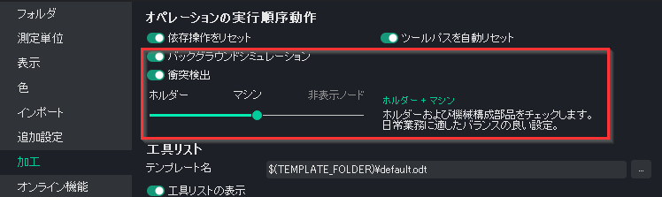
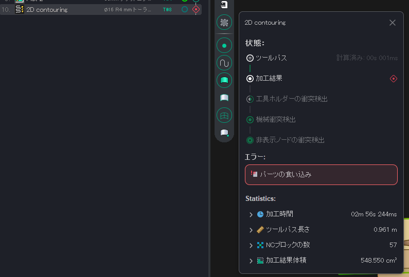
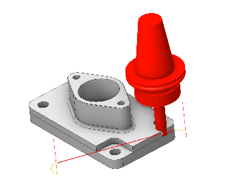
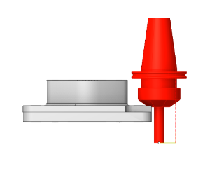
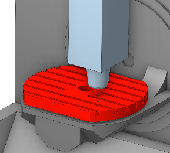
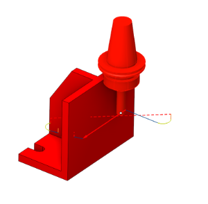
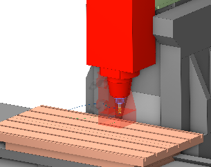

# バックグラウンド加工結果計算中の衝突検出

• 

## 適用分野:

<strong>バックグラウンドシミュレーション</strong>における<strong>衝突検出</strong>機能は、ユーザーの作業を中断することなく、ツールパスに対して機械およびワーク保持具との物理的な干渉を自動的に検証します。軌跡計算が完了すると、<strong>加工</strong>タブには計算されたツールパスだけでなく、加工後のワークモデルも表示されます。さらに、食い込みやマシンコンポーネントに関する問題が検出された場合、システムはアラートを生成します。

この機能は、シンプルなプロジェクトや、小さなステップオーバーをを伴う精密仕上げ加工が不要なケースにおいて特に有効です。そのため、ユーザーは別途加工シミュレーションを起動することなく、加工タブ上で直接製造プロセスの設計を継続でき、最終結果を即座に評価することが可能となります。

ただし、<strong>バックグラウンドシミュレーション</strong>の結果計算には、膨大な計算リソースと時間を要し、CPU処理能力およびRAM容量を大きく消費します。そのため、依存関係のある多数のオペレーションを再計算する場合や、ワーク再セットアップが複数回必要な場合、あるいは非常に小さなステップオーバーによる仕上げ加工を行う場合には、加工結果のシミュレーションや軌跡監視に要する時間が大幅に増加します。

<strong>バックグラウンドシミュレーションの計算</strong>をすべて無効化することが可能です。この場合、CAMシステムは3Dモデルのみに基づいてツールパスを生成します。加工結果の検証は、後から<strong>シミュレーションタブ</strong>で行うことが可能です。ただし、CAMシステムには前工程の加工結果を必要とする自動オペレーションが含まれています。これらのオペレーションには、以下が含まれます。

<strong>•</strong> ウォーターライン荒加工

<strong>•</strong> 平面荒加工

<strong>•</strong> ポケット加工

<strong>•</strong> 穴あけ加工

<strong>•</strong> すべての旋削加工

これらのオペレーションでは、バックグラウンド計算が無効化されている場合であっても、ツールパス生成時に前工程の加工結果の計算が自動的に有効になります。

バックグラウンドシミュレーションは、<strong>加工</strong>タブ内の２つの設定スイッチで制御されます。

<strong>1. バックグラウンドシミュレーション</strong> 中間ワーク（途中工程のワーク形状）を計算するために使用されます。また、ワークが非切削送りで切削されている場合にも検出しますが、アーバー、治具、または機械本体との衝突は検出されません。エラー検出を行うには、適切なフィルタの設定が必要です。

<strong>2.</strong> <strong>衝突検出</strong> バックグラウンドでの衝突検出を有効にするには、システム設定で<strong>衝突検出</strong>オプションを有効にする必要があります。このオプションを有効にすると、検証条件の一覧が表示されます。ユーザーは、以下の衝突チェックモードのいずれかを選択できます。

<strong>• <strong>ホルダー：</strong> 工具ホルダーとの衝突のみをチェックします。最も高速に計算されます。

 

<strong>• マシン<strong>（ホルダー＋マシン）：</strong></strong> 工具ホルダーに加え、表示されているすべての機械構成要素を対象に含みます。

 

<strong>• <strong>非表示ノード（ホルダー＋マシン＋<strong>非表示</strong>ノード）-</strong></strong> フルチェック: ホルダー、マシン、およびユーザー設定により非表示となっているマシンノードが含まれます。

検証対象となる要素が多いほど、オペレーションの計算時間は長くなります。検証完了後、各オペレーションのステータスがユーザーに表示されます。 [詳細を見る](1118119.md)

<strong>バックグラウンドシミュレーション</strong>に加えて、<strong>シミュレーションタブ</strong>ではステップごとのシミュレーションを実行することができます。<strong>バックグラウンドシミュレーション</strong>と<strong>ステップシミュレーション</strong>の連携に関する主なポイントについては、本マニュアルの別章で説明しています。[詳細を見る](742.md)
