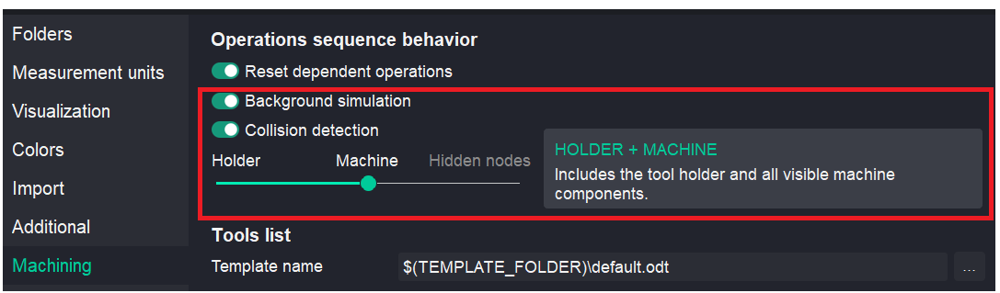
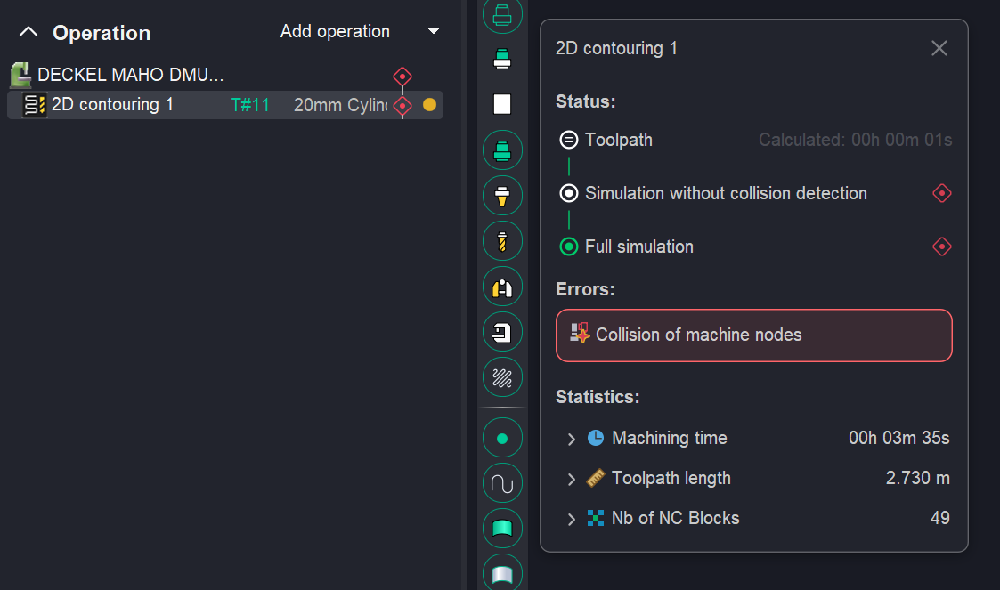
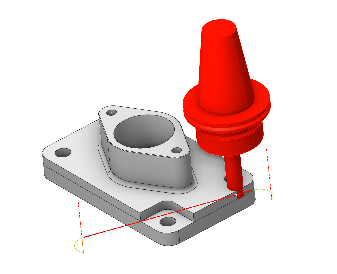
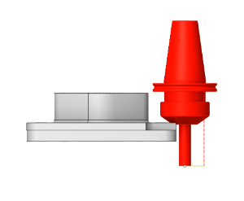
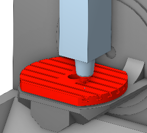
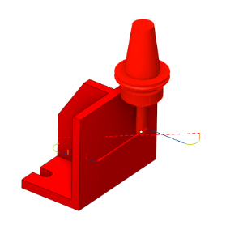
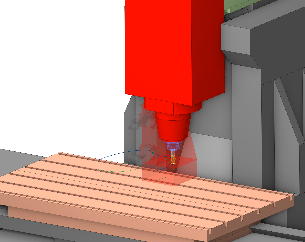

# Kollisionserkennung in der Hintergrundsimulation

 

## Anwendungsbereich:

Die **Collision Detection** der **Background Simulation** prüft Werkzeugbahnen automatisch auf Kollisionen mit Maschine und Spannmitteln, während die Projektbearbeitung fortgesetzt werden kann. Nach der Bahnberechnung zeigt die Registerkarte **Technology** neben der Werkzeugbahn auch das bearbeitete Rohteil. Erkannte Einschnitte und Probleme mit Maschinenkomponenten werden gemeldet.

Diese Funktion ist besonders für einfache Projekte und Bearbeitungen ohne sehr kleine Schlichtbahnabstände geeignet. Der Bearbeitungsprozess kann direkt auf **Technology** weiter aufgebaut und das Ergebnis beurteilt werden, ohne eine separate Simulation zu starten.

Die Hintergrundsimulation benötigt jedoch Rechenzeit, CPU-Leistung und Arbeitsspeicher. Bei vielen voneinander abhängigen Operationen, mehreren Umspannungen oder feinen Schlichtbahnen mit sehr kleinen Abständen kann die Berechnung der Bearbeitungsergebnisse und die Bahnprüfung deutlich länger dauern.

Alle Hintergrundberechnungen können deaktiviert werden. Das CAM-System erzeugt die Werkzeugbahn dann anhand des 3D-Modells; die Bearbeitungsergebnisse können später auf **Simulation** geprüft werden. Bestimmte Operationen benötigen jedoch weiterhin das Ergebnis der vorherigen Bearbeitung.

Dazu gehören:

1. Wasserlinien-Schruppen.
2. Ebenenschruppen.
3. Taschenfräsen.
4. Bohrungsbearbeitung.
5. Alle Drehoperationen.

Für diese Operationen aktiviert das CAM-System die Berechnung des vorherigen Bearbeitungsergebnisses bei der Bahnerzeugung automatisch, auch wenn die Hintergrundberechnung sonst deaktiviert ist.

In den Systemeinstellungen auf der Registerkarte **Machining** stehen zwei Schalter zur Verfügung:

1. **Background simulation.** Berechnet das Zwischenrohteil und erkennt Materialabtrag bei Bewegungen mit nicht schneidendem Vorschub. Kollisionen mit Werkzeugaufnahme, Spannmitteln oder Maschine werden dabei nicht geprüft. Zur Fehlererkennung müssen die entsprechenden Filter eingestellt sein.
2. **Collision Detection.** Aktiviert die Kollisionsprüfung im Hintergrund. Danach kann der Prüfumfang gewählt werden:

- **Holder (Halter).** Prüft nur Kollisionen mit dem Werkzeughalter. Dies ist die schnellste Variante.

 

- **Machine (Holder+Machine).** Berücksichtigt den Werkzeughalter und alle sichtbaren Maschinenkomponenten.

 

- **Hidden nodes (Holder+Machine + Hidden nodes).** Vollständige Prüfung einschließlich Halter, Maschine und ausgeblendeter Maschinenknoten.

Je mehr Komponenten geprüft werden, desto länger dauert die Operationsberechnung. Nach Abschluss wird der Status jeder Operation angezeigt. [Details](1118119.md)

Zusätzlich zur Hintergrundsimulation kann auf **Simulation** eine schrittweise Simulation ausgeführt werden. Das Zusammenspiel beider Verfahren ist in einem eigenen Abschnitt beschrieben. [Details](742.md)
