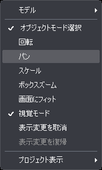

# Interactive pan

Press and hold the [**Middle Mouse Button**] (Mouse Wheel), then drag on the main visualization screen to move graphic objects to a new location.

Alternatively, use the [**Left Mouse Button**] with the **Pan** mode enabled, which can be activated from the pop-up menu of the graphic window.

