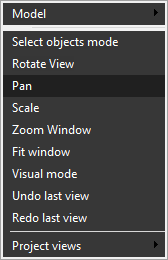

# インタラクティブパン

[<strong>マウス中央ボタン</strong>] (マウスホイール) を押したまま、メインの表示画面上でドラッグしてグラフィックオブジェクトを新しい場所に移動します。

あるいは、グラフィックウィンドウのポップアップメニューから起動できる <strong>パン</strong>モードを有効にして、[<strong>左クリック</strong>]で使用できます。

