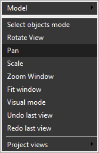

# Spostamento panoramico interattivo (pan)

Tenere premuto il [<strong>Middle Mouse Button</strong>] (tasto centrale del mouse, rotellina), quindi trascinare sullo schermo principale di visualizzazione per spostare gli oggetti grafici in una nuova posizione.

In alternativa, usare il [<strong>Left Mouse Button</strong>] (tasto sinistro del mouse) con la modalità <strong>Pan</strong> attivata, attivabile dal menu a comparsa della finestra grafica.

