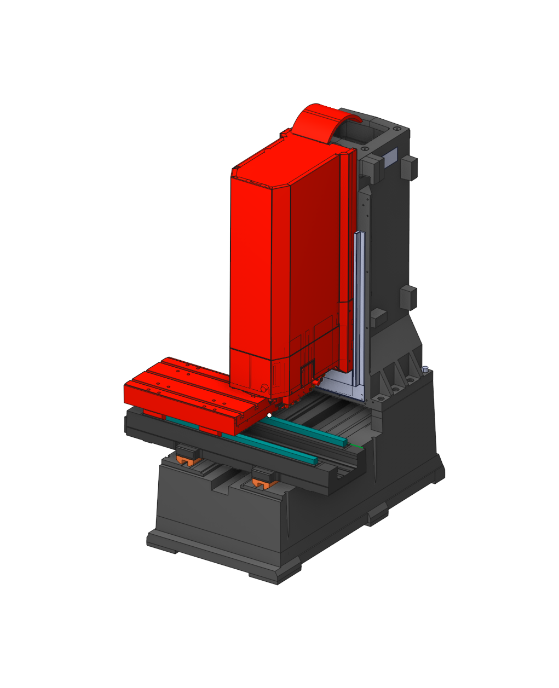
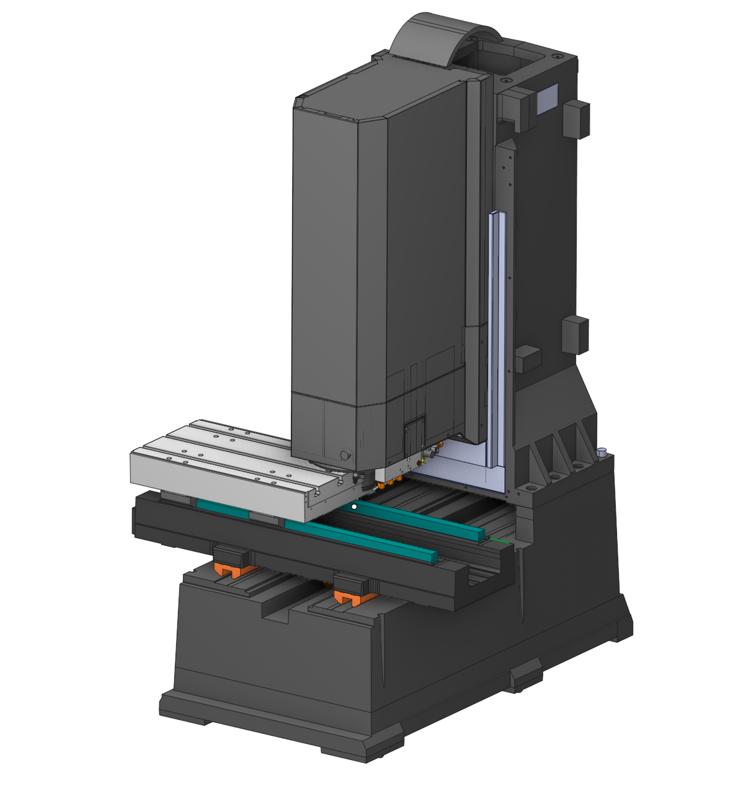
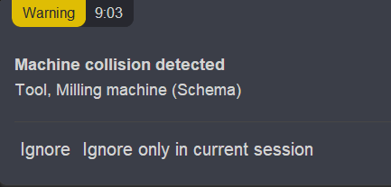
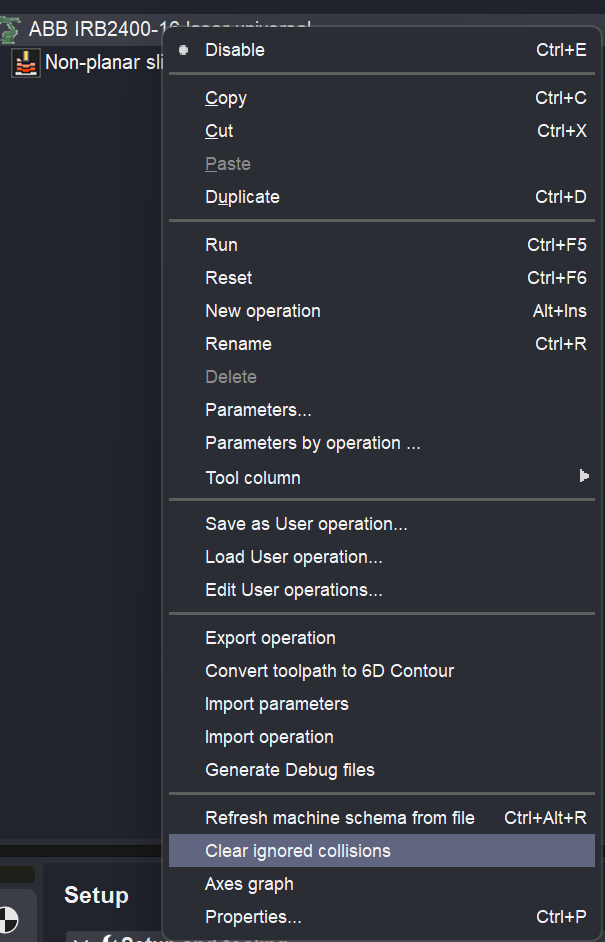

# Modifica dell'elenco di esclusione delle collisioni

 

## Ambito di applicazione:

È stata implementata la modifica diretta della sezione <strong>CDIgnoreList</strong> nello schema della macchina direttamente dal sistema CAM. In precedenza la modifica richiedeva l'inserimento manuale dei dati nel Blocco note o l'uso di MachineMaker.

Quando durante la simulazione si verifica una collisione, compare una notifica che segnala la collisione tra nodi. A questa notifica è stato aggiunto un pulsante <strong>Ignore</strong> (ignora) o <strong>Ignore only in curent session</strong> (ignora solo nella sessione corrente).

### Funzionalità:

1. Quando durante una simulazione viene rilevata una collisione, una notifica avvisa l'utente indicando i nodi in collisione (ad esempio il nodo X e il nodo Y). Questa notifica comprende i pulsanti <strong>Ignore</strong> o <strong>Ignore only in curent session</strong>. Premendo il pulsante "Ignore" la coppia di nodi individuata viene aggiunta alla CDIgnoreList, ignorando di fatto le collisioni future tra quei nodi specifici.

<strong>Nel primo caso</strong> viene creato un file con estensione ".cdil" accanto al file della cinematica della macchina. Se il file non esiste, viene creato.

Quando si crea un nuovo progetto CAM, il sistema fa riferimento a una macchina. Se accanto al file della macchina esiste un file dell'elenco di esclusione, i dati vengono caricati da tale file; in caso contrario i dati vengono caricati direttamente dal file della macchina.

<strong>Nel secondo caso</strong> non viene creato alcun file. Tutto funziona solo all'interno della sessione corrente.

2. Il file può essere svuotato tramite il menu a comparsa della macchina (nella <strong>scheda technology</strong>).

