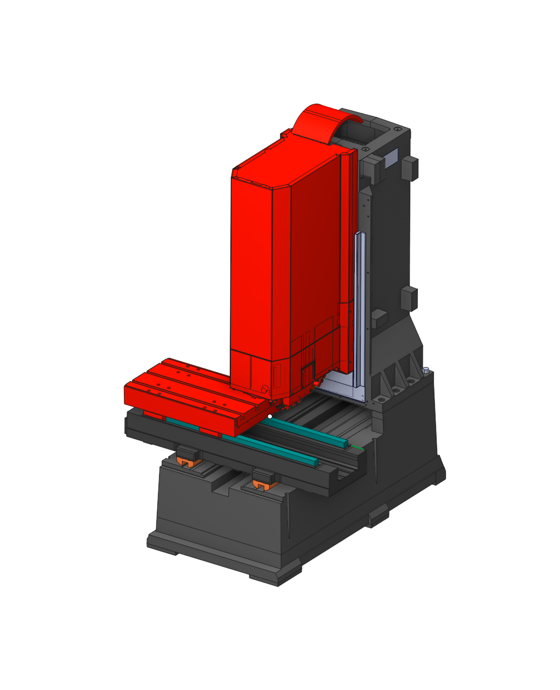
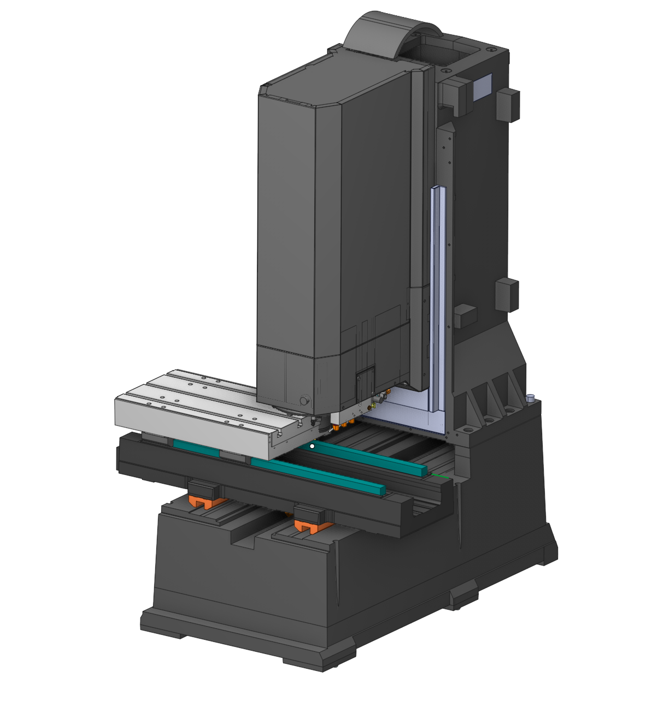
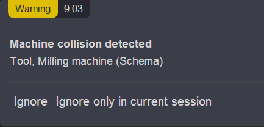
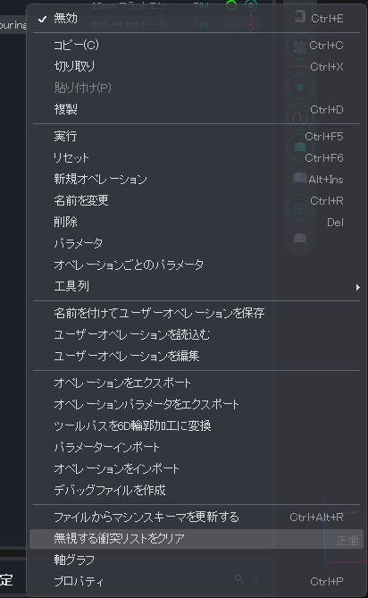

# 衝突無視リストの編集

 

## 適用分野：

CAM システムから直接、マシンスキームの <strong>CDIgnoreList</strong> セクションを編集できるようになりました。従来は、編集にはメモ帳に手入力するか、MachineMakerを使用する必要がありました。

シミュレーション中に衝突が発生すると、ノード間で衝突が発生したことを示す通知が表示されます。 この通知には、「 <strong>無視</strong>」 または「 <strong>現在のセッションのみ無視</strong>」 ボタンが追加されました。

### 機能性：

1. シミュレーション中に衝突が検出されると、衝突したノード（例：ノードXとノードY）を示す通知がユーザーに通知されます。この通知には 「 <strong>無視</strong>」または 「 <strong>現在のセッションのみ無視</strong>」ボタンが含まれています。「無視」ボタンを押すと、該当するノードのペアがCDIgnoreListに追加され、特定のノード間の今後の衝突が効果的に無視されます。

<strong>「 <strong>無視</strong> 」 の場合</strong>、拡張子".cdil "のファイルがマシンキネマティクスファイルと同じ場所に”拡張子".cdil "のファイルが作成されます。ファイルが存在しない場合は新規作成されます。

新しいCAMプロジェクトを作成する際、システムはマシンを参照します。マシンファイルと同じ場所に無視リストファイルが存在する場合はそのファイルから読み込まれ、存在しない場合はマシンファイルから直接データが読み込まれます。

「<strong>現在のセッションのみ無視</strong>」の場合では、ファイルは作成されません。すべて（の設定）は現在のセッション内でのみ機能します。

2. このファイルは、マシンのポップアップメニュー（ <strong>加工タブ</strong>上）からクリアできます。

